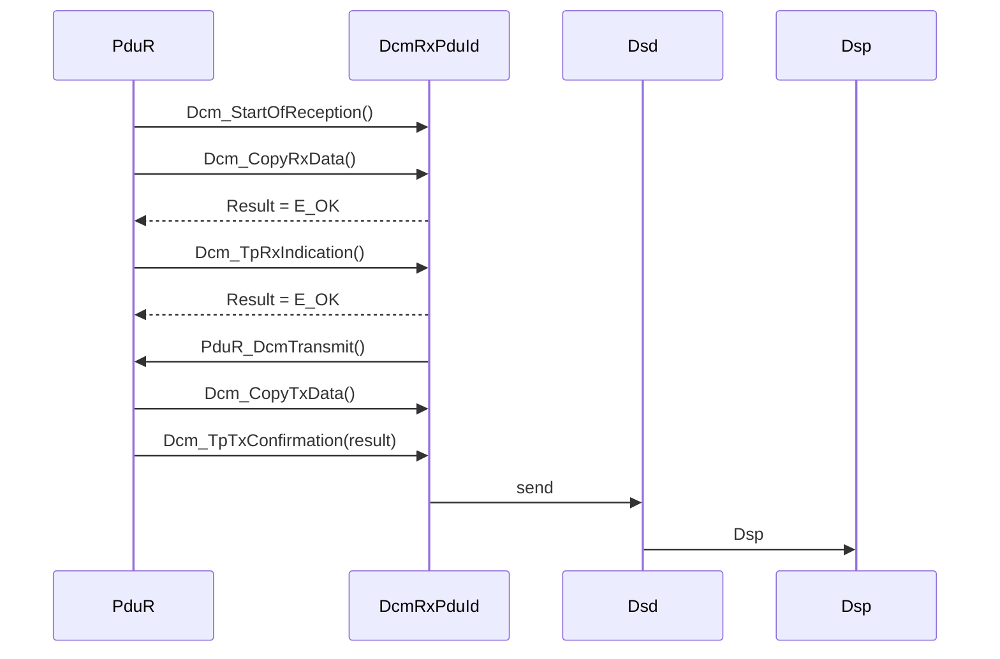
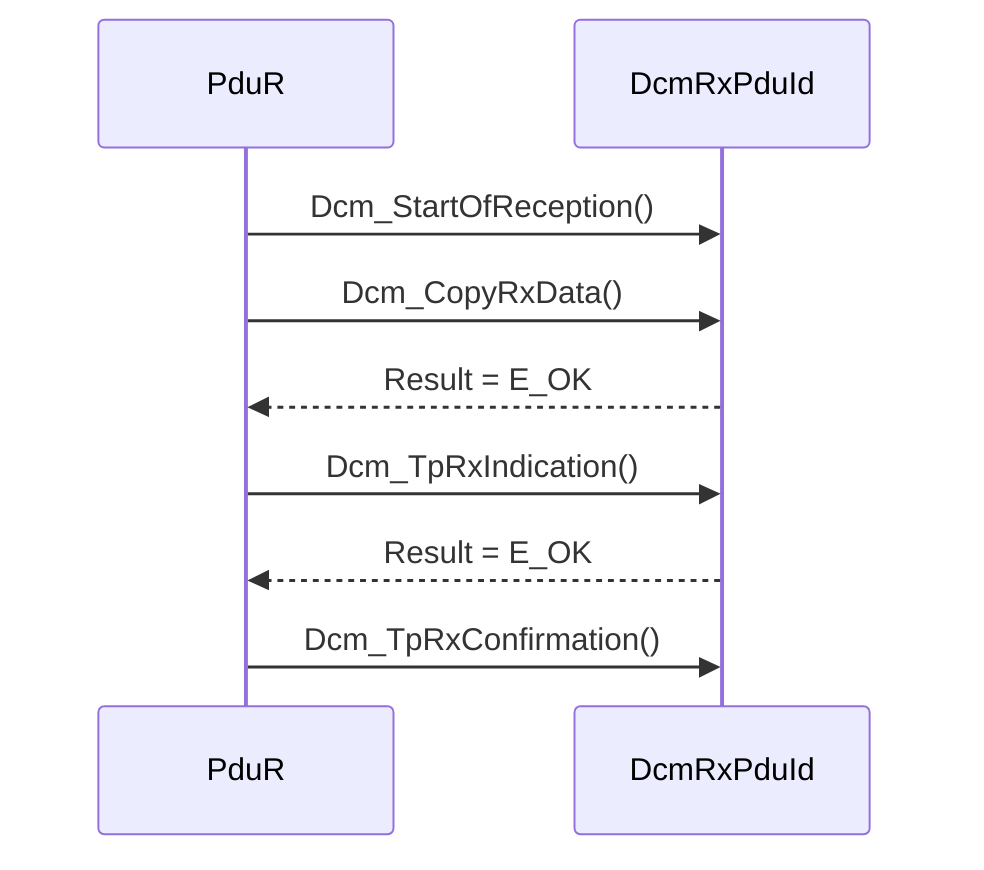
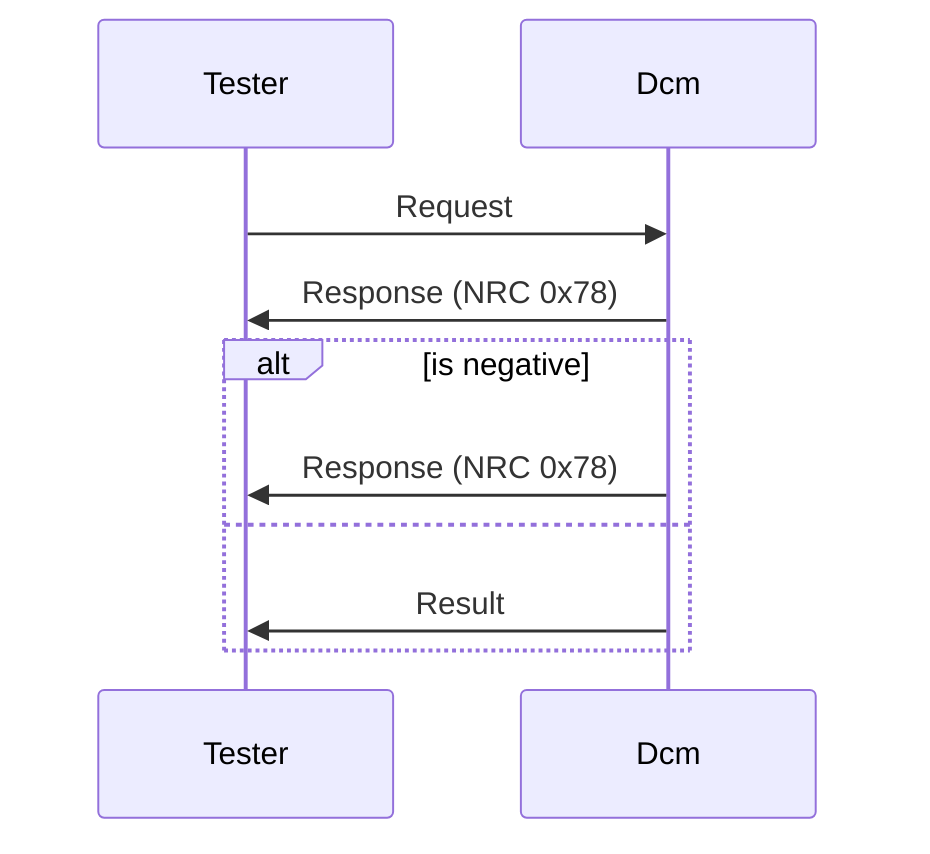
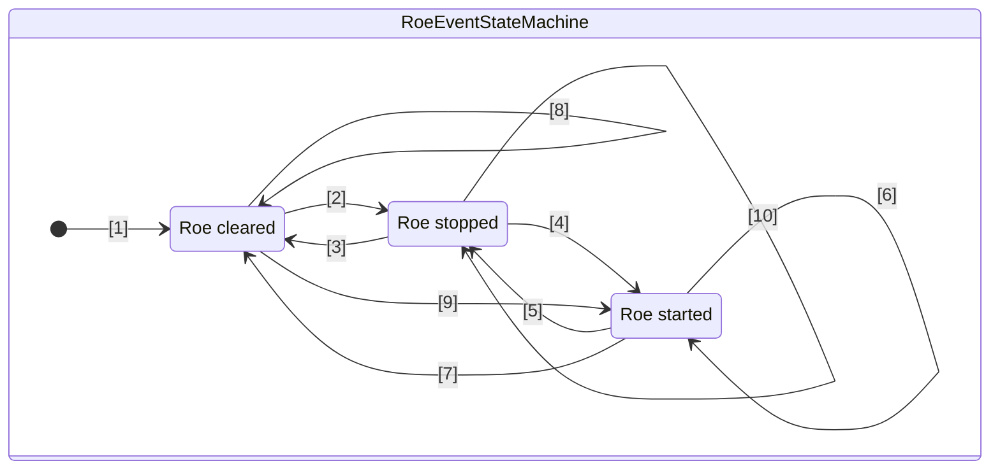

## Table of contents
{: .no_toc .text-delta }
- TOC
{:toc}

## 핵심 요약

> 진단 요청 처리와 DSL·DSD·DSP의 역할, 관련 설정과 동작을 정리한 문서다.

## 적용 범위

<blockquote class="notice">

💡

정확한 규범적 요구사항은 적용 AUTOSAR 릴리스를 지정한 뒤 확인한다.

</blockquote>

## 본문

---



---

# 7.2 진단 세션 레이어 (Diagnostic Session Layer;DSL)

## 7.2.1 소개

- [SWS_Dcm_00030] DSL 서브모듈의 모든 기능 영역은 ISO14229-1[15] 사양과 ISO15765-3[18]의 네트워크 독립적인 부분을 준수해야함

> DSL 서브모듈에는 네트워크에 의존하는 기능 영역이 없음
> 구성 내에서 네트워크에 따라 일부 매개변수를 설정할 수 있음

---

## 7.2.2 사용 사례

- DSL 서브 모듈은 다음과 같은 기능을 제공
    - 세션 처리(ISO14229-1[15] 및 ISO15765-3[18]에서 요구하는 대로)
    - 어플리케이션 레이어 타이밍 처리(ISO14229-1[15] 및 ISO15763-3[18]에서 요구하는 대로)
    - 특정 응답 동작(ISO14229-1[15] 및 ISO15763-3[18]에서 요구하는 대로)

---

## 7.2.3 다른 모듈과의 상호작용

- DSL은 다른 모듈과 다음과 같은 상호 작용을 함
    - PduR 모듈
        - PduR 모듈은 수신 진단 요청에 대한 데이터를 제공
        - DSL 서브모듈은 진단 응답 출력을 트리거함
    - DSD 서브 모듈
        - DSL 서브모듈은 수신 요청에 대해 DSD 서브모듈에 알리고 데이터를 제공
        - DSD 서브모듈은 진단 응답의 출력을 트리거함
    - SW-C / DSP 서브 모듈
        - DSL 서브모듈은 보안 및 세션 상태에 대한 액세스를 제공
    - ComM 모듈
        - DSL 서브모듈은 ComM 모듈에 필요한 통신 동작을 보장

---

## 7.2.4 기능 설명

### 7.2.4.1 개요

- DSL 서브 모듈은 다음과 같은 기능을 제공
- **요청 처리(Request Handling):**
    - PduR 모듈에서 DSD 서브모듈로 요청을 전달함
    - 동신에 “TesterPresent”(유지 로직) 처리
- **응답 처리(Response Handling):**
    - DSD 서브 모듈에서 PduR 모듈로 응답을 전달
    - 테스터에게 응답 시간을 보장
    - 주기적 전송 지원
    - 응답 온 이벤트(ResponseOnEvent; ROE) 전송 지원
    - 세분화된 응답 지원
    - 어플리케이션에서 트리거된 응답 대기 중 응답 지원
- **보안 수준 처리(Security Level Handling):**
    - 보안 수준을 관리
- **세션 상태 처리(Session Status Handling):**
    - 세선 상태를 관리
    - 기본값이 아닌 활성 세션을 추적
    - 타이망을 수정
- **진단 프로토콜 처리(Diagnostic Protocol Handling):**
    - 다양한 진단 프로토콜 처리
    - 리소스 관리
- **통신 모드 처리(Communication Mode Handling):**
    - 통신 요구 사항 처리(Full- / Silent- / No Communication)
    - active / inactive 진단 표시
    - 모든 종류의 진단 전송을 active / inactive

---

### 7.2.4.2 PduR 모듈에서 DSD 서브모듈로 요청 전달

> PduR 모듈은 새로운 진단 요청 콘텐츠의 수신이 시작될 때마다 DCM 모듈에 할당된 DcmRxPduId를 통해 DCM 모듈에 알림.
> 이 때 Dcm_StartOfReception()을 호출하여 수신할 데이터 크기를 DCM 모듈에 알리고 첫 번째 프레임 또는 단일 프레임의 데이터를 제공하며, 데이터 크기가 버퍼 크기를 초과하거나 요청된 서비스를 사용할 수 없는 경우 DCM이 수신을 거부할 수 있도록 함
> 이후 Dcm_CopyRxData를 호출하면 DCM 모듈이 제공된 버퍼에서 DCM 버퍼로 데이터를 복사하도록 요청
> 진단 요청의 수신이 완료되면(Dcm_StartOfReception이 성공하면) PduR 모듈은 Dcm_TpRxIndication()을 호출하여 DCM 모듈에 수신 표시를 제공
> DCM은 일반 연결을 사용할 수 있어야 하며, 여기서 주소 지정 정보는 DcmRxPdu의 메타데이터를 통해 Dcm_StartOfReception()에 의해 DCM에 제공됨
> 이 주소 지정 정보는 응답 및 동일한 테스터의 요청 감지를 위해 저장 및 사용되어야함
> 자세한 내용은 **일반 연결 처리 섹션**을 참고

- [SWS_Dcm_00111] DSL 서브모듈은 파라미터 Result = E_OK(SWS_Dcm_00093 참조)로 Dcm_TpRxIndication()을 호출한 후에만 수신 데이터를 DSD 서브모듈로 전달
- [SWS_Dcm_00241] 요청 메시지가 수신되는 즉시 (파라미터 Result = E_OK(SWS_Dcm_00093 참조)로 Dcm_TpRxIndication()을 호출한 후 연결된 Tx-DcmPduId에 대해 Dcm_TpTxConfirmation()을 호출하기 전까지) DSL 하위 모듈은 해당 DcmPduId를 차단해야함(SWS_Dcm_00351 참조). 이 요청을 처리하는 동안에는 해당 응답 메시지가 전송되고 DcmPduId가 다시 해제될 때까지 동일한 DcmDslConnection의 다른 요청(예: OBD 세션에 의해 향상된 세션이 종료될 수 있음)을 수신할 수 없음(동시 TesterPresent 요청 제외)

> API(프로토타입, 입출력 파라미터)에 대한 자세한 설명은 PduR 모듈의 인터페이스 설명에서 확인할 수 있음([2] 참조)
> 진단 통신 어플리케이션에 따라 서로 다른 DcmPduId를 사용할 수 있음. 예를 들어:

- OBD DcmRxPduId : OBD 요청 수신용
- OBD DcmTxPduId : OBD 응답 전송용
- UDS phys DcmRxPduId : 물리적 주소가 지정된 UDS 요청 수신용
- UDS fuc DcmRxPduId : 기능적(Functionally) 주소가 지정된 UDS 요청 수신용
- UDS DcmTxPduId :  UDS 응답 전송용

> 주소 유형(phys/func)은 DcmRxPduId에 따라 구성됨(구성 매개변수 DcmDslProtocolRx 참조)
> 전송 계층의 주소 지정 형식(확장 주소 지정, 일반 주소 지정)과 관계없이 기능적 수신과 물리적 수신에 대해 항상 다른 DcmRxPduId 값이 있기 때문에 DcmRxPduId별로 구성할 수 있음

---

### 7.2.4.3 동시 “TesterPresent”(”keep alive logic”)

> 테스터가 물리적 요청/응답과 병행하여 기능적인 “TesterPresent” 명령을 전송할 수도 있음
> 이를 ISO14229-1[15]에서 “keep alive logic”이라고 함
> 이 기능 “TesterPresent”는 물리적 요청과 동일한 DcmDslConnection에 속하는 별도의 DcmRxPduId(UDS 기능 DcmRxPduId)에서 수신됨
> 이 경우 명시적으로 구성되지 않은 Dcm 내부 수신 버퍼가 사용됨
> 이러한 이유로 기능적 TesterPresent(그리고 응답이 없는 기능적 TestPresent만)는 다음과 같은 방식으로 처리

- [SWS_Dcm_00112] PduR 모듈이 파라미터 Result = E_OK(SWS_Dcm_00093 참조)로 Dcm_TpRxIndication()을 호출하고 요청이 “suppressPosPspMsgIndicationBit”이 TRUE(SID = 0x3E, 서브펑션 =0x80)인 “TesterPresent” 명령이면 DSL 서브 모듈은 세션 타임아웃 타이머를 재설정함(S3Server)
- [SWS_Dcm_00113] PduR 모듈이 파라미터 Result = E_OK(SWS_Dcm_00093 참조)로 Dcm_TpRxIndication()을 호출하고 요청이 “suppressPosRspMsgIndicationBit”이 TRUE(SID = 0x3E, 서브펑션 = 0x80)로 설정된 “TestPresent” 명령이면 DSL 서브모듈은 추가 해석을 위해 이 요청을 DSD 서브 모듈에 전달하지 않아야함을 의미
- **SWS_Dcm_00013의 근거 :** DSL 서브모듈의 “TesterPresent” 기능을 우회하기 때문에 DCM 모듈은 지연 없이 다음 물리적 요청을 수신하고 처리할 수 있음
- [SWS_Dcm_01168] Dcm은 TesterPresent 요청이 “suppressPosRspMsgIndicationBit”이 TRUE로 설정된 기능 주소에서 수신된 경우에만 동시 요청으로 처리

---

### 7.2.4.4 DSD 서브모듈에서 PduR 모듈로 응답 전달

- [SWS_Dcm_00114] DSD 서브모듈은 응답 전송을 위해 DSL 서브모듈에 요청함
- [SWS_Dcm_00115] DcmDslMainConnection의 진단 응답이 준비되면, DSL 서브모듈은 해당 DcmDslProtocolTxPduRef 파라미터를 PduId로 사용하여 PduR_DcmTransmit()을 호출하여 진단응답의 PduR 모듈로의 전송을 트리거 해야함
- [SWS_Dcm_01072] 주기적 전송의 경우, Dcm은 PduR_DcmTransmit() 호출에서 전체 payload 데이터를 제공해야하며 Dcm_CopyTxData에 대한 호출이 없을 것으로 예상
- [SWS_Dcm_01073] 주기적 전송의 경우, 전송 결과를 알리기 위해 Dcm_TxConfirmation()을 호출하여 주기적 전송을 위해 Dcm을 호출함

> 응답은 DCM 모듈 구성에서 요청이 수신된 ID, 즉 DcmRxPduId에 연결된 DcmTxPduId와 함께 전송됨(구성 파라미터 DcmDslProtocolTx 참조)
> PduR_DcmTransmit() 내에서 길이 정보 및 일반 연결의 경우 주소 지정 정보만 PduR 모듈에 전달됩니다. DCM 모듈이 PduR_DcmTransmit()을 성공적으로 호출한 후, PduR 모듈은 Dcm_CopyTxData()를 호출하여 전송할 데이터를 제공하도록 DCM 모듈에 요청하고 전체 PDU가 성공적으로 전송되었거나 오류가 발생한 후 Dcm_TpTxConfirmation()을 호출함
> 일반 연결 내 주소 정보 처리에 대한 자세한 내용은 7.2.4.5 일반 연결 처리 섹션을 참조

- [SWS_Dcm_00117] 완전한 DCM PDU가 성공적으로 전송되었거나 오류가 발생한 후 DSL 서브모듈이 Dcm_TpTxConfirmation() 호출로 확인을 받으면, DSL 서브모듈은 이 확인을 DSD 서브모듈로 전달
- [SWS_Dcm_00118] 전송 실패(실패한 PduR_DcmTransmit() 요청) 또는 오류 확인(오류 있는 Dcm_TpTxConfirmation()) 시 DSD 서브모듈은 진단 응답 전송을 반복하지 않음
- 참고 : Dcm_TpTxConfirmation은 PduR_DcmTansmit이 성공한 경우에만 예상됨
- [SWS_Dcm01166] DcmDslProtocolTx의 Multiplicity가 “0”으로 설정된 경우, Dcm은 응답을 보내지 않고 수신된 진단 요청을 처리
- API(프로토타입, 입력/출력 파라미터)에 대한 자세한 설명은 PduR 모듈의 인터페이스 설명에서 확인 ([2]참조)

### 7.2.4.5 일반 연결 처리 (Generic Connection Handling)

> DCM은 메타데이터길이 ≥1로 DcmPdus에 의해 식별되는 일반 연결을 처리할 수 있어야 함
> 이러한 연결은 런타임에 실제 테스터 주소(actual tester address)를 전달
> 일반 연결은 ISO15765-2[17]에 따라 일반 고정 또는 혼합 29비트 주소 지정 형식을 사용하는 CAN 진단에 지원됨
> 이에 CAN ID의 실제 레이아웃에 따라 일반 연결은 확장 또는 일반 및 혼합 11비트 주소 지정 형식에도 사용할 수 있음
> DCM은 CanTp에서 사용하는 실제 주소 지정 형식(actual addressing format)을 인식하지 못함
> 일반 연결에는 구성 매개변수 DcmDslProtocolRxTesterSourceAddr가 필요하지 않음
> 여러 연결이 동일한 DcmPdus를 참조할 수 있음

- [constr_6044] 일반 연결은 일관성이 있어야함. 즉, DcmDsl 커넥션의 모든 참조된 PDU(DcmDslProtocolRxPduRef, DcmDslProtocolTxPduRef, DcmDslPeriodicTxPduRef, DcmDslRoeTxPduRef)의 메타데이터 길이와 PduLength가 동일함
- [SWS_Dcm_00848] 일반 연결을 통해 수신된 진단 요청의 소스 주소가 서장되어야함. 이 주소는 Dcm_StartOfReception()을 통해 제공된 메타데이터의 첫 번째 바이트에 제공
- [SWS_Dcm_00849] 저장된 소스 주소는 일반 연결을 통해 전송되는 응답의 타겟 주소로 사용됨. PduR_DcmTransmit()에 제공된 메타데이터의 두 번째 바이트에 제공

### 7.2.4.6 busy responses를 전송하여 테스터 타이밍 보장

- [SWS_Dcm_00024] 응용 프로그램(또는 DSP 서브 모듈)이 요청된 진단 작업을 수행할 수 있지만 작업을 완료하고 응답을 준비하는데 추가 시간이 필요한 경우, DSL 서브 모듈은 응답 시간에 도달하면 NRC 0x78(Response pending)로 부정 응답을 전송(각각 DcmDspSessionP2ServerMax-DcmTimStrP2ServerAdjust-DcmDspSessionP2StarServerMax-DcmTimStrP2StarServerAdjust)  (SWS_BSW_04016)

> SWS_Dcm_00024의 근거 : DSL 서브 모듈이 테스터에 대한 응답 타이밍을 보장

- [SWS_Dcm_00119] DSL 서브 모듈은 별도의 버퍼에서 SWS_Dcm_00024에서 요구하는 대로 부정 응답을 전송해야함

> SWS_Dcm_00119의 근거 : 진단 버퍼에 이미 응답 내용을 준비한 애플리케이션과 같이 진행 중인 요청 처리를 덮어쓰는 것을 방지하기 위해 필요
> 하나의 진단 요청에 대한 NRC 0x78(Response pending)의 부정 응답 수는 구성 파라미터 DcmDslDiagRespMaxNumRespPend에 의해 제한됨. 이렇게 하면 애플리케이션의 교착 상태를 방지

- [SWS_Dcm_00120] 요청된 진단 작업에 대한 부정 응답 횟수(SWS_Dcm_00024 참조)가 구성 파라미터 DcmDslDiagRespMaxNumRespPend에 정의된 값에 도달하면 DCM 모듈은 활성된 진단 요청(active diagnostic request)의 처리를 중지해야함
    활성 포트 인터페이스(active port interface)의 OpStatus 파라미터를 DCM_CANCEL로 설정하여 애플리케이션 또는 BSW(이 진단 작업이 SW-C 인터페이스 또는 BSW 인터페이스에 대한 호출을 의미하는 경우)에 알리고 NRC 0x10(General reject)으로 부정 응답을 전송해야

### 7.2.4.7 주기적 전송(periodic transmission) 지원

> UDS 서비스 ReadDataByPeriodicIdentifier(0x2A)를 사용하면 테스터가 하나 이상의 주기적 DataIdentifier로 식별된 ECU로 부터 데이터 레코드 값의 주기적 전송을 요청할 수 있음

- [SWS_Dcm_00122] DCM 모듈은 별도의 프로토콜과 설정 가능한 크기의 별도 버퍼를 사용하여 주기적 전송에 대한 응답을 전송해야함

> DcmDslPeriodicTransmissionConRef 구성 파라미터를 사용하면 주기적 전송 요청을 수신하거나 주기적 전송 응답을 전송하는데 사용되는 프로토콜을 주기적 전송 메시지 전송에 사용되는 프로토콜에 연결할 수 있음
> 주기적 전송 프로토콜에 여러 개의 DcmTxPduId를 할당할 수 있음
> DCM 모듈은 통신 모드에 따라 몇 가지 제한 사항을 준수함

- [SWS_Dcm_00123] 주기적 전송 통신은 전체 통신 모드(Full COM)에서만 이루어짐

> 전체 통신 모드(Full COM)가 아닐 때 주기적인 전송 이벤트가 발생할 수 있음.
> 따라서 다음과 같은 요구사항이 존재함

- [SWS_Dcm_00125] DCM 모듈은 전체 통신 모드(Full COM) 옆의 주기적 전송 이벤트를 폐기하고 전송을 위해 대기열에 넣지 않아야함
- [SWS_Dcm_00126] 주기적인 전송 이벤트는 전체 통신 모드(Full COM)를 활성화하지 않음

<blockquote class="notice">

💡

[SWS_Dcm_01072] 주기적 전송의 경우, Dcm은 PduR_DcmTransmit() 호출에서 전체 payload 데이터를 제공해야하며 Dcm_CopyTxData에 대한 호출이 없을 것으로 예상 [SWS_Dcm_01073] 주기적 전송의 경우, 전송 결과를 알리기 위해 Dcm_TxConfirmation()을 호출하여 주기적 전송을 위해 Dcm을 호출함

</blockquote>

### 7.2.4.8 ROE(ResponseOnEvent) 전송 지원

> 테스터는 UDS 서비스 ResponseOnEvent(0x86)를 사용하여 지정된 이벤트에 의해 시작된 응답의 전송을 시작하거나 중지하도록 ECU에 요청함. 전송할 이벤트를 등록할 때 테스터는 응답할 해당 서비스도 지정함 (예: UDS 서비스 ReadDataByIdentifier(0x22))

- [SWS_Dcm_00595] ROE 기능은 DcmDslResponseOnEvent 컨테이너가 존재하는 경우에만 활성화됨

<blockquote class="notice">

💡

ROE가 발생해도 DcmDslResponseOnEvent 컨테이너가 있는 경우에 Configuration 되어 있어야함

</blockquote>

#### 7.2.4.8.1 ROE 상태 차트

- [SWS_Dcm_00871] Dcm은 여러 RoeEvents를 지원해야 함
    각 RoeEvent는 “ROE cleared”, “ROE stopped”, “ROE started’’ 상태를 가질 수 있음
    상태 간 전환은 다음 섹션에서 설명. 그림 6의 레이블은 섹션의 번호를 나타냄

##### 7.2.4.8.1.1 Dcm 초기화 (1)

- [SWS_Dcm_00872]  Dcm_Init() 중에 각 이벤트의 상태를 ‘ROE cleared’ 상태로 변경

#### 7.2.4.8.1.2 ‘ROE cleared’ 상태에서 ‘ROE stopped’로 전환 (2)

- [SWS_Dcm_00873] 유효한 ROE **setup** 요청을 수신하면 요청에서 처리되는 RoeEvent가 ‘ROE stopped’ 상태로 변경(표2 참조)
- [SWS_Dcm_00874] StorageState가 ‘stroeEvent’로 **setup**된 상태에서 RoeEvent가 설정되었고, StartResponseOnEvent가 ‘storeEvent’로 설정되지 않은 상태에서 전원 주기동안 활성화(active over power cycles)된 EventWindowTime 또는 이후 clearResponseOnEvent가 수신되면 Dcm은 비휘발성 정보(non-volatile information)가 제공되는 즉시 ‘ROE stopped’ 상태로 변경

> 참고 : StorageState가 ‘StoreEvent’로 설정된 상태에서 이벤트가 한 번 초기화되면 ClearResponseOnEvent 요청에 의해 초기화될 때까지 초기화된 상태로 유지(SWS_Dcm_00897 참조)

- [SWS_Dcm_00951] RoeEvent에 대해 구성 파라미터 DcmDspRoeInitialEventStatus가 DCM_ROE_STOPPED로 설정된 경우, Dcm은 초기화 시 즉시 ‘ROE Stopped’ 상태로 전환

> 참고 : DcmDspRoeInitialEventStatus 세트는 구성에 따른 RoeEvent의 초기화를 정의

#### 7.2.4.8.1.3 ‘ROE stopped’ 상태에서 ‘ROE cleared’로 전환 (3)

- [SWS_Dcm_00875] 하위 함수 clearResponseOnEvent(0x06)로 유효한 ROE 요청을 수신하면 RoeEvents가 ‘ROE cleared’ 상태로 변경

#### 7.2.4.8.1.4 ‘ROE stopped’ 상태에서 ‘ROE started’로 전환 (4)

- [SWS_Dcm_00876] 하위 함수 startResponseOnEvent(0x05)로 유효한 ROE 요청을 수신하면 모든 중지된 RoeEvent가 ‘ROE started’ 상태로 변경
- [SWS_Dcm_00902] 기본 세션 종료 시 ‘ROE started’ 상태였던 모든 RoeEvent는 기본 세션에 (재)진입하면 다시 ‘ROE started’ 상태로 변경
- [SWS_Dcm_00965] StorageState가 StoreEvent로 설정된 유효한 StartResponseOnEvent 요청이 수신되고 Event Window Time이 이전 전원 주기에서 StorageState를 지원하는 경우, 비휘발성(volatile) 데이터를 사용할 수 있는 즉시 RoeEvent는 ‘ROE stopped’ 상태에서 ‘ROE started’ 상태로 변경 (이 ROEEvent는 SWS_Dcm_00951에 따라 ‘ROE stopped’로 설정)

#### 7.2.4.8.1.5 ‘ROE started’ 상태에서 ‘ROE stopped’로 전환 (5)

- [SWS_Dcm_00877] 하위 함수 stopResponseOnEvent(0x00)로 유효한 ROE 요청을 수신하면 중지된 RoeEvent가 ‘ROE stopped’ 상태로 변경
- [SWS_Dcm_00878] Event Window Time이 초과되면 중지된 RoeEvents가 ‘ROE stopped’ 상태로 변경
- [SWS_Dcm_00879] 현재 세션에서 나가면 시작된 모든 RoeEvent가 ‘ROE stopped’ 상태로 변경

> 참고 : 현재 세션이 기본 세션이 아닌 세션에서 동일하거나 다른 세션으로 변경되는 경우와 관계없이 현재 세션이 종료되면 RoeEvents가 중지됨
> 기본 세션이 아닌 세션으로 전환함, 기본 세션을 현재 활성 세션으로 두면 세션이 중지되고 저장됨(세션이 다시 시작되는 즉시 다시 시작하기 위해 기본 세션으로 다시 변경(SWS_Dcm_00902 참조))

- [SWS_Dcm_00952] OnDTCStatusChange 하위 함수로 ROE 요청이 수신되고 RoeEvent가 ‘ROE started’인 경우, OnDTEStatusChange의 RoeEvent는 ‘ROE stopped’ 상태로 변경되고 새 요청으로 설정된 DTCStatusMask에 의해 ServiceToRespondTo가 트리거 됨

#### 7.2.4.8.1.6 ‘ROE started’ 상태에서 ‘ROE started’로 전환 (6)

- [SWS_Dcm_00880] 하위 함수 StartResponseOnEvent(0x05)로 유효한 ROE 요청을 수신하면 Dcm은 긍정적으로 응답하고 ‘ROE 시작’ 상태를 유지

#### 7.2.4.8.1.7 ‘ROE started’ 상태에서 ‘ROE cleared’로 전환 (7)

- [SWS_Dcm_00884] 하위 함수 clearResponseOnEvent(0x06)로 유효한 ROE 요청을 수신하면 모든 RoeEvent가 ‘ROE cleared’ 상태로 변경

#### 7.2.4.8.1.8 ‘ROE cleared’ 상태에서 ‘ROE cleared’로 전환 (8)

- [SWS_Dcm_00885] 모든 RoeEvent가 ‘ROE cleared’ 상태이고 유효한 stopResponseOnEvent(0x00) 요청이 수신되면 Dcm은 NRC 0x24(requestSequenceError)의 부정 응답으로 요청을 거부해야 함
- [SWS_Dcm_00886] 모든 RoeEvent가 ‘ROE cleared’ 상태이고 유효한 startResponseOnEvent(0x05) 요청이 수신되면 Dcm은 NRC 0x24(requestSequenceError)의 부정 응답으로 요청을 거부해야 함
- [SWS_Dcm_00887] 모든 RoeEvent가 ‘ROE cleared’ 상태이고 유효한 clearResponseOnEvent(0x06) 요청이 수신되면 Dcm은 긍정적으로 응답하고 RoeEvent는 ‘ROE cleared’ 상태를 유지
- [SWS_Dcm_00888] 비휘발성(volatile) 데이터를 올바르게 읽지 못한 경우, ‘ROE cleared’ 상태의 모든 RoeEvent는 ‘ROE cleared’ 상태로 유지

#### 7.2.4.8.1.9 ‘ROE cleared’ 상태에서 ‘ROE started’로 전환 (9)

- [SWS_Dcm_00889] Event Window Time이 전원 주기 동안 활성화되어 있고 시간 초과되지 않은 경우, Dcm은 비휘발성 정보를 사용할 수 있는 즉시 마지막 전원 주기 동안 기본 세션에서 활성화되었던 모든 RoeEvents를 다시 활성화해야
- [SWS_Dcm_00890] StorageStatus가 StoreEvent로 설정된 유효한 StartResponseOnEvent 요청이 수신되고 Event Window Time이 이전 전원 주기에서 StorageStatus를 지원하는 경우, 비휘발성(volatile) 데이터를 사용할 수 있는 즉시 RoeEvent가 ‘ROE started’ 상태로 변

#### 7.2.4.8.1.10 ‘ROE stoppted’ 상태에서 ‘ROE stopped’로 전환 (10)
