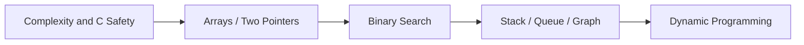

## 문제를 제한 시간과 메모리 안에서 해결하는 상황

알고리즘 선택 전에 입력 범위, 상태의 의미와 불변식을 정한다. C에서는 integer overflow, array 경계와 lifetime이 알고리즘의 논리와 함께 correctness를 결정한다.

> 문제 조건을 자료구조·복잡도·경계 조건으로 바꾸는 연습을 한다. C에서는 알고리즘뿐 아니라 overflow·메모리 수명·배열 경계를 명확하게 관리해야 한다.

## Learning Path

## Solving Routine

입력 크기·범위·중복·정렬 여부 확인 → 단순 해법 → 병목 → 불변식과 최적화 → 복잡도 → 구현 → 최소·최대·비정상 경계 테스트 순으로 진행한다. 정답만 외우지 말고 왜 성립하는지 설명한다.

## C Practice

아래 하위 문서의 예제는 C11 PC 실행용이다. main의 assert를 실행한 후 온라인 채점 입력 형식으로 바꾼다. 임베디드 API 예제와 달리 독립적인 알고리즘 검증에 초점을 둔다.

## 이해를 확인하는 질문

> 예제 입력을 모두 통과하면 충분할까?

빈 입력, 최댓값, 중복·정렬 상태와 실패 경로를 포함해야 한다. 복잡도와 메모리 범위도 확인한다.

