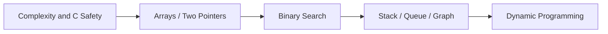

## Table of contents
{: .no_toc .text-delta }
- TOC
{:toc}
## Overview

문제 조건을 자료구조·복잡도·경계 조건으로 바꾸는 연습을 한다. C에서는 알고리즘뿐 아니라 overflow·메모리 수명·배열 경계를 명확하게 관리해야 한다.

## Learning Path

## Solving Routine

입력 크기·범위·중복·정렬 여부 확인 → 단순 해법 → 병목 → 불변식과 최적화 → 복잡도 → 구현 → 최소·최대·비정상 경계 테스트 순으로 진행한다. 정답만 외우지 말고 왜 성립하는지 설명한다.

## C Practice

아래 하위 문서의 예제는 C11 PC 실행용이다. main의 assert를 실행한 후 온라인 채점 입력 형식으로 바꾼다. 임베디드 API 예제와 달리 독립적인 알고리즘 검증에 초점을 둔다.

