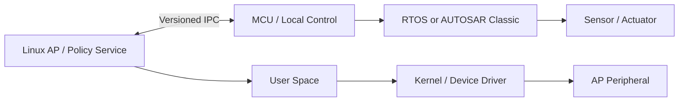

## AP에서 여러 service가 동시에 device를 사용하는 상황

Linux는 process address space, scheduler, driver와 system service를 통해 자원을 중재한다. User-space API 성공과 hardware의 실제 완료 시점은 다를 수 있다.

> AP에서 실행되는 Linux를 Boot·Process·Device Driver·IPC·Debugging 관점으로 학습한다. 명령어 목록만 외우기보다 애플리케이션 요청이 system call과 driver를 통해 하드웨어에 도달하는 경로를 이해한다.

## AP and MCU

AP는 일반적으로 MMU·외부 메모리·풍부한 I/O를 갖고 Linux 같은 OS에서 복잡한 애플리케이션을 실행한다. MCU는 로컬 I/O·실시간 제어를 담당하며 Bare Metal, RTOS, AUTOSAR Classic 등을 사용할 수 있다. 이는 절대적 구분이 아니며 성능·메모리·안전·실시간 요구에 따른 선택이다.

## Execution Architecture

## Learning Path

AP & MCU Integration → Boot & Device Tree → Process, Thread & IPC → Device I/O & Networking → Debugging & Performance 순서로 읽는다. 실습은 Linux PC에서 시작하고 보드 고유 부팅·드라이버 설정은 실제 BSP와 회로도에 맞춰 확인한다.

## 이해를 확인하는 질문

> Linux를 쓰면 실시간 제어 deadline도 자동 보장될까?

Scheduling policy, kernel 설정, driver와 load에 따른 latency를 분석해야 한다. RTOS·MCU와의 역할 분담도 함께 설계한다.
