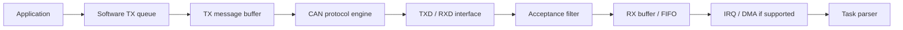

## CAN ID filter를 설정했는데 예상하지 않은 message가 들어오는 상황

Controller의 buffer, mask, filter와 interrupt는 수신 frame의 저장과 통지를 담당한다. application message의 의미와 bus의 전기적 상태는 별도 계층이므로 register 설정과 network 계약을 나누어 분석한다.

> CAN Controller는 message buffer·filter·bit timing·error state를 관리하는 MCU hardware다. CAN transceiver는 bus의 전기 신호를 송수신하며, network topology와 termination은 차량 네트워크 설계에 속한다.

## Controller, Transceiver and Network

| 계층              | 역할                                                                           | 확인 예                      |
| --------------- | ---------------------------------------------------------------------------- | ------------------------- |
| MCU Controller  | Bit timing, frame serialization, arbitration, CRC, error handling, buffer 관리 | FlexCAN clock·MB·IRQ·상태   |
| Transceiver     | TXD/RXD와 differential bus 사이 전기적 변환                                          | EN/STB, 전압·전파 지연          |
| Vehicle Network | ECU 간 메시지 계약·주기·배선·진단·복구 정책                                                  | ID/DBC, bus load, gateway |

## Functional Model

## Clock and Timing

CAN protocol engine에 들어가는 실제 clock으로 TQ와 segment를 계산한다. CPU frequency와 같다고 가정하지 않는다. Nominal/Data timing, Sample Point, SJW와 TDC의 역할을 구분하며 register encoding은 사용 IP·RTD 버전으로 확정한다.

## Buffer and Filter

RX FIFO와 message buffer의 차이, payload size에 따른 RAM 소비, 표준/확장 ID의 filter 의미를 확인한다. Filter를 통과했다는 이유만으로 application payload가 유효한 것은 아니다. IDE·FDF·길이·계약을 parser에서 다시 검증한다.

## ISR and Ownership

Callback pointer를 queue에 넣는 것만으로 buffer 수명이 연장되지 않는다. Frame을 복사하거나 buffer ownership을 넘기고 hardware 재사용 시점을 정의한다. TX busy, RX overflow, late callback과 cancel 상태를 명시한다.

## Learning Path

CAN Bit Timing & FlexCAN에서 clock 계산·설정·C encode/decode·TX/RX 구현을 읽고, CAN FD Configuration에서 FD 전환·Data timing·DLC·TDC를 이어서 확인한다. 차량 통신의 CAN/CAN FD 페이지는 ECU 간 통신 계약과 실제 bus 검증 관점을 다룬다.

## 이해를 확인하는 질문

> Hardware filter가 있으면 software 검사는 생략해도 될까?

Filter는 수신 범위를 줄인다. 길이, frame type, counter·checksum과 application state 검사는 별도로 필요하다.

