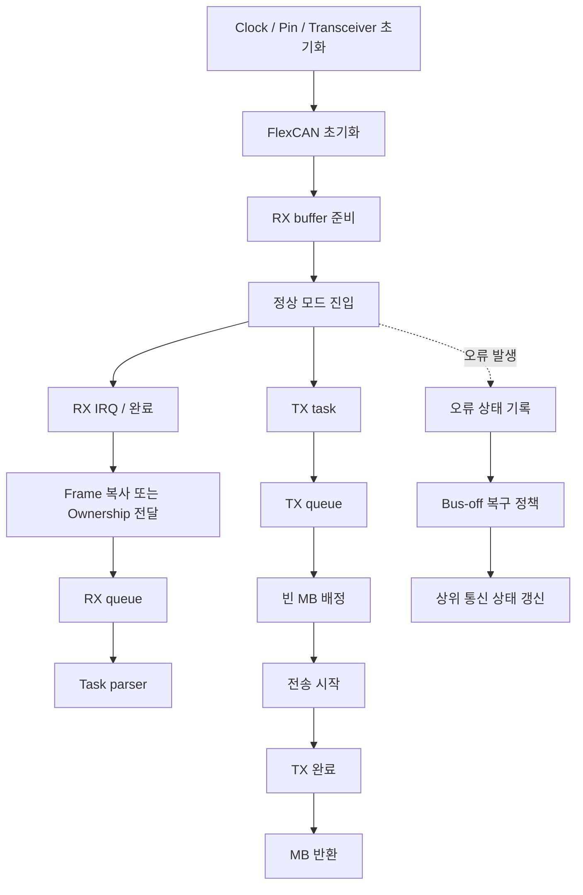

## 같은 500 kbit/s인데 두 ECU가 안정적으로 통신하지 못하는 상황


Bitrate는 clock과 prescaler, time segment의 합으로 정해진다. 같은 bitrate라도 sample point, oscillator 오차, propagation delay와 SJW가 달라질 수 있다. Register encoding과 실제 time quanta를 구분해야 한다.


## Scope


<blockquote class="notice">
<div class="callout">
<div class="callout-icon" markdown="1">
💡 
</div>
<div class="callout-content" markdown="1">
MCU CAN Controller의 timing·buffer·driver 구현을 다룬다. S32K312와 설치 RTD를 기준으로 실제 API·register 범위를 확인한다. 아래 수치와 board_can_* adapter는 실습용이며 사용 보드의 기본 설정값이 아니다.
</div>
</div>
</blockquote>


## 실무 설정: CAN 비트 타이밍과 클록 계산


컨트롤러 입력 클록 → CAN 전용 클록 선택·분주 → 비트 타이밍 prescaler → Time Quantum(TQ) → 비트 구간 순서로 계산한다. CPU 클록, APB/IPG 버스 클록, FlexCAN 프로토콜 엔진 클록은 같다고 가정하지 않는다. 클록 트리에서 해당 CAN 인스턴스에 실제 공급되는 주파수를 확인해야 한다.


```text
f_CAN = 선택된 클록 소스 주파수 / 상위 클록 분주비
TQ = BRP / f_CAN
N_TQ = 1 + PROP_SEG + PHASE_SEG1 + PHASE_SEG2
bitrate = f_CAN / (BRP × N_TQ)
sample_point[%] = 100 × (1 + PROP_SEG + PHASE_SEG1) / N_TQ
TSEG1 = PROP_SEG + PHASE_SEG1
TSEG2 = PHASE_SEG2
```


여기서 BRP는 실제 분주비, 각 SEG는 실제 TQ 개수다. 레지스터에 쓰는 값과 구분한다. 많은 타이밍 필드는 실제값−1을 저장하지만 모든 필드가 그렇지는 않다. 드라이버 API가 실제값을 받는지 인코딩 값을 받는지도 확인한다. SYNC_SEG는 1 TQ이다.


## 계산 예제: 80 MHz에서 500 kbit/s, Sample Point 80%

<div class="image-flex">
<div class="image-item">
<div class="image-item-img">
<a data-fslightbox="/_images/MCU_Peripheral/CAN_Controller/CAN_Bit_Timing_&_FlexCAN/1.webp" href="/_images/MCU_Peripheral/CAN_Controller/CAN_Bit_Timing_&_FlexCAN/1.webp" data-type="image" aria-label="This is fslightbox">
<div class="skeleton-loading">
<div class="skeleton-img"></div>
</div>
<figure>

<figcaption>f_CAN=80 MHz, 실제 BRP=8, TQ=100 ns를 가정한 설명용 비트 구간도다. SYNC 1 + PROP 7 + PHASE1 8 + PHASE2 4 = 20 TQ이며 Sample Point는 16 TQ, 즉 80%다. 실제 측정 파형이 아니다.</figcaption>
</figure>
</a>
</div>
</div>
</div>


<blockquote class="notice">
<div class="callout">
<div class="callout-icon" markdown="1">
💡 
</div>
<div class="callout-content" markdown="1">
그림 읽기와 실측 확인: Sample Point는 PHASE1과 PHASE2 경계다. 그림의 구간 폭보다 표기된 TQ를 기준으로 계산하고, 실제 register 인코딩·SJW 제약은 해당 FlexCAN 매뉴얼과 생성 설정으로 확인한다.
</div>
</div>
</blockquote>


```text
입력 f_CAN = 80,000,000 Hz
실제 BRP = 8 → TQ = 8 / 80 MHz = 100 ns
PROP_SEG = 7, PHASE_SEG1 = 8, PHASE_SEG2 = 4
N_TQ = 1 + 7 + 8 + 4 = 20
bit time = 20 × 100 ns = 2 us
bitrate = 80 MHz / (8 × 20) = 500,000 bit/s
sample point = (1 + 7 + 8) / 20 = 80%
SJW = 4 TQ → 최대 재동기화 조정 폭 400 ns
```


이 예제는 타이밍 계산용 후보이며 특정 보드의 검증 완료 설정이 아니다. SJW·각 세그먼트·분주비 범위와 관계는 컨트롤러 제약을 만족해야 한다. 일반적으로 SJW는 PHASE_SEG2를 넘지 않도록 하며 PHASE_SEG1 관련 제약도 해당 하드웨어 규정을 확인한다. 동일 bitrate와 sample point여도 전파 지연, 발진기 허용 오차, 버스 길이에 대한 적합성은 달라질 수 있다.


## FlexCAN: CTRL1과 확장 타이밍 레지스터 구분


일부 FlexCAN의 기존 CTRL1 타이밍은 PRESDIV·PROPSEG·PSEG1·PSEG2·RJW 필드를 사용한다. 이 필드들이 모두 실제값−1 인코딩인 IP를 전제로 하면 위 예제는 PRESDIV=7, PROPSEG=6, PSEG1=7, PSEG2=3, RJW=3이다. 반드시 해당 MCU Reference Manual의 필드 정의와 유효 범위를 대조한다.


확장 비트 타이밍을 지원하는 IP는 CBT의 BTF 같은 선택 필드로 확장 경로를 사용하고 EPRESDIV·EPROPSEG·EPSEG1·EPSEG2·ERJW 등을 설정할 수 있다. 더 최신 IP에서는 ENCBT·EDCBT 등 다른 레지스터를 사용하기도 한다. 레지스터 이름과 선택 조건은 FlexCAN 세대별로 다르므로 다른 MCU의 값을 그대로 복사하지 않는다. 확장 경로를 선택했다면 CTRL1 타이밍 값만 바꿔도 실제 통신 속도는 바뀌지 않을 수 있다.


## 클록과 초기화에서 확인할 설정값


| **항목**     | **설명 및 적용 기준**                                                                                                                                          |
| ---------- | ------------------------------------------------------------------------------------------------------------------------------------------------------- |
| **클록 소스**  | 외부 발진기·PLL 파생 클록 등에서 CAN 프로토콜 엔진의 소스를 선택한다. S32K1xx에서는 PCC와 CTRL1.CLKSRC 등의 관계를, 다른 계열에서는 해당 클록 멀티플렉서와 divider를 확인한다. 동일 레지스터 명칭이 다른 계열에도 있다고 가정하지 않는다. |
| **상위 분주비** | CAN 클록이 이미 80 MHz로 설정되었다면 계산기에 CPU 160 MHz를 다시 넣지 않는다. 예를 들어 상위에서 160 MHz/2, 비트 prescaler에서 /8이면 TQ는 100 ns다.                                           |
| **모드 변경**  | 해당 매뉴얼 순서에 따라 모듈 활성화와 freeze 진입 확인 후 타이밍·메시지 버퍼를 구성한다. 동작 중 타이밍 변경을 피하고 freeze 진입·해제는 timeout을 둔 상태 비트 polling으로 확인한다.                                  |
| **핀·트랜시버** | TX/RX mux, 트랜시버 enable/standby, 전원·접지·종단 저항을 확인한다. 컨트롤러 설정만으로 외부 트랜시버가 자동 활성화되지는 않는다.                                                                   |
| **수신 설정**  | ID 표준/확장 구분, 개별/전역 acceptance mask, FIFO 또는 메시지 버퍼 배치, 인터럽트 활성화와 상태 flag 처리 순서를 확인한다.                                                                   |


## CAN 속도 변경 시 함께 바꿀 항목


500 kbit/s → 250 kbit/s로 바꿀 때는 위 예제의 실제 BRP를 8 → 16으로 변경하면 20 TQ·80% Sample Point를 유지할 수 있다. 같은 CAN 클록이 유지되고 해당 BRP 범위가 허용될 때만 성립한다. 송수신 ECU, CAN 분석기, 게이트웨이 채널 등 같은 네트워크의 Nominal bitrate를 함께 변경해야 한다.


```bash
# Linux SocketCAN 예시: 실제 CAN 장치와 드라이버가 필요하다.
sudo ip link set can0 down
sudo ip link set can0 type can bitrate 500000 sample-point 0.800
sudo ip link set can0 up
ip -details -statistics link show can0
```


SocketCAN의 sample-point는 80%가 아니라 0.800 형식이다. 커널이 실제 클록·드라이버 범위에서 타이밍을 선택하므로 요청한 Sample Point와 선택된 결과를 비교한다. vcan은 물리 클록·ACK·종단 저항이나 비트 타이밍을 검증하지 못한다.


## 실측과 오류 분석

- 우선 내부 loopback으로 소프트웨어 송수신 경로를 확인한 뒤 외부 정상 노드와 통신한다. 내부 loopback 성공은 트랜시버·배선·버스 타이밍 검증이 아니다.
- 오실로스코프로 TXD와 버스 파형을 관찰해 약 2 us/bit인지 확인한다. 동일 값이 이어지는 구간이나 bit stuffing을 고려하며, 단순히 모든 인접 edge 간격을 1 bit로 해석하지 않는다.
- ACK error는 단독 노드, 다른 노드의 listen-only, 속도 불일치, 배선·트랜시버 문제 등으로 생길 수 있다. TEC/REC, error passive/bus-off 전이, 오류 상태 레지스터를 함께 기록한다.
- 프로젝트 설정에는 클록 소스·f_CAN·실제 BRP·SEG·SJW·Sample Point와 최종 레지스터 readback을 함께 남긴다. 생성 코드가 덮어쓸 수 있는 값은 설정 도구의 원본을 수정하고 재생성 후 검증한다.

## S32K312 프로젝트에서의 설정 절차


대상 MCU는 S32K312다. 사용자가 지칭한 S32 SDK 환경의 정확한 패키지 버전은 프로젝트에서 확인해야 한다. S32K3는 통상 S32 RTD를 사용하므로 S32K1xx SDK의 FLEXCAN_DRV_* 예제 또는 PCC 설정을 그대로 이식하지 않는다. 아래 순서는 S32 Design Studio의 설정 도구와 RTD 사용을 기준으로 설명하며 생성 API·구조체 이름은 설치 버전의 예제와 헤더에 따른다.

- ① 프로젝트 타깃·패키지·RTD 버전을 확인한다. 먼저 같은 버전의 FlexCAN IP 예제 또는 AUTOSAR Can 예제 중 실제 사용하는 계층을 선택한다. IP 계층과 MCAL 계층으로 동일 컨트롤러를 중복 초기화하지 않는다.
- ② Clock 설정에서 해당 FlexCAN 인스턴스의 프로토콜 엔진 입력 클록 소스, 상위 divider와 gate를 확인한다. 코어·버스 클록 값만 보고 f_CAN을 결정하지 않는다. PLL 설정 또는 저전력 복귀로 클록이 바뀌는 경우를 포함한다.
- ③ Pins 설정에서 CAN_TX 출력과 CAN_RX 입력 mux, 패키지의 실제 핀, pad 전기 설정을 대조한다. 트랜시버 EN/STB 핀은 GPIO 초기값과 제어 순서를 별도로 설정한다.
- ④ CAN 인스턴스에서 Classical/FD 및 일반/loopback/listen-only 모드를 선택한다. Nominal bitrate·Sample Point·SJW를 지정하고, 계산기가 생성한 실제 prescaler·세그먼트와 선택한 비트 타이밍 경로를 확인한다.
- ⑤ 메시지 버퍼 수·TX/RX 역할·표준/확장 ID·acceptance mask·IRQ 또는 polling을 설정한다. 수신 버퍼를 준비하고 완료 처리를 구현한 다음 송신을 시작한다. 비동기 TX/RX 데이터의 수명을 보장한다.
- ⑥ 코드 생성 후 Clock·Pin·FlexCAN 초기화 순서와 return status를 확인한다. 설치 버전의 FlexCAN IP 예제에 나온 설정 구조체와 API를 사용한다. register를 수동 수정해 생성 코드와 서로 다른 값을 유지하지 않는다.
- ⑦ 컨트롤러 정상 모드 진입·트랜시버 활성화를 확인한 뒤, 같은 Nominal bitrate의 정상 노드와 시험한다. 내부 loopback → 외부 8바이트 송수신 → FD/BRS 순으로 확대한다.

## S32K312: 코드 생성 전후 비교할 설정표


| **항목**                   | **설정 도구/설계 값**      | **생성 코드·실측 확인**     |
| ------------------------ | ------------------- | ------------------- |
| **MCU/드라이버**             | S32K312 / 설치 RTD 버전 | 프로젝트와 헤더 버전         |
| **CAN 입력 클록**            | 실제 clock tree 값     | source·divider·gate |
| **Nominal bitrate**      | 예: 500000 bit/s     | BRP와 SEG로 역산        |
| **Nominal sample point** | 예: 80%              | (1+TSEG1)/N_TQ      |
| **SJW**                  | 실제 TQ               | 필드 범위·SEG 제약        |
| **타이밍 경로**               | 드라이버 선택값            | 실제 활성 레지스터 경로       |
| **TX/RX pin**            | 회로도 기준              | 출력 mux·입력 선택        |
| **transceiver**          | 부품·전원·EN/STB        | 상태 핀·버스 파형          |
| **RX mask/MB**           | ID/길이/버퍼 구성         | 실수신·오버런·IRQ         |


앞의 CTRL1·CBT 설명 중 S32K1xx 예시는 레지스터 인코딩 차이를 설명하기 위한 비교다. S32K312에 쓸 최종 레지스터 주소·값을 뜻하지 않는다. S32K312 Reference Manual, silicon revision의 errata, 설치 RTD의 release note와 생성 설정을 기준으로 허용 범위를 확정한다.


## CAN 구현: 계층과 데이터 흐름


S32K312 RTD 프로젝트에서 CAN 구현을 보드 초기화, transport driver, frame dispatcher, 애플리케이션 상태로 분리한다. FlexCAN IP와 AUTOSAR Can/CanIf를 혼합 소유하지 않는다. 아래 board_can_*는 설명용 추상화이며 실제 RTD API와 일치하는 코드가 아니다.





## CAN 구현: 초기화에서 놓치기 쉬운 순서

- 클록과 pin mux, 트랜시버 비활성 초기 상태를 먼저 구성한다. 설치 예제의 모듈 초기화·freeze/정상 모드 전환 순서를 따르고 각 실패를 별도로 보고한다.
- bit timing·FD 여부·MB payload 크기·TX/RX MB 배치를 구성한다. 사용할 최대 MB와 RAM 영역의 실제 제약을 확인한다.
- 표준/확장 ID와 mask 정책을 정한다. FlexCAN 레지스터에 들어가는 ID 비트 배치와 driver API의 논리 ID를 혼동하지 않는다. mask의 0/1 의미도 API 설명을 확인한다.
- 수신 callback·IRQ handler·NVIC 설정과 RX 요청을 준비한다. 분석기만 listen-only로 연결된 경우 ACK가 없다는 점을 고려해 정상 수신 노드를 둔다.
- 정상 모드와 transceiver 활성화 후 알려진 ID의 짧은 프레임을 보내고 실제 버스 수신·ACK·TEC/REC를 함께 확인한다.

## CAN 구현: 수신 경로와 버퍼 수명


RX 완료 ISR에서는 ID·프레임 형식·길이·timestamp·payload를 소유권이 보장된 queue 항목으로 복사하거나 buffer를 교환한다. 그 다음 드라이버 요구에 따라 RX를 다시 준비한다. 다음 수신이 같은 메모리를 덮어쓸 수 있으므로 callback의 포인터만 queue에 넣는 방식은 수명 보장이 없으면 사용하지 않는다.


queue가 가득 차면 drop counter와 정책을 정의한다. 최신 상태만 필요한 주기 신호와 모든 이벤트 보존이 필요한 진단 프레임의 정책을 구분한다. IRQ에서는 DBC 변환·긴 logging·flash 쓰기·blocking TX를 하지 않는다. task에서 ID·IDE·FDF·길이를 검증한 뒤 메시지별 handler에 전달한다.


## CAN 구현: payload를 명시적으로 encode/decode


가상 메시지: 표준 ID 0x321, Classical data frame, 길이 3. 바이트0~1은 little-endian unsigned 속도 0.01 km/h 단위, 바이트2는 sequence다. 실제 차량 신호 정의가 아니라 학습용 계약이다. C 구조체 메모리를 그대로 송신하면 padding·endianness에 의존하므로 필드별로 직렬화한다.


```c
#include <stdint.h>
#include <stddef.h>
#include <stdbool.h>
bool decode_speed(const uint8_t *data, size_t len,
                  uint16_t *centi_kmh, uint8_t *seq) {
    if (!data || !centi_kmh || !seq || len != 3U) return false;
    *centi_kmh = (uint16_t)data[0] | ((uint16_t)data[1] << 8);
    *seq = data[2];
    return true;
}
void encode_speed(uint16_t centi_kmh, uint8_t seq, uint8_t out[3]) {
    out[0] = (uint8_t)(centi_kmh & 0xFFU);
    out[1] = (uint8_t)(centi_kmh >> 8);
    out[2] = seq;
}
```


```bash
# can-utils, 정상 노드/분석기와 시험용 네트워크에서 실행
# 0x1388 = 5000 → 50.00 km/h, sequence=1
cansend can0 321#881301
candump -tz can0
```


정수 단위로 내부 값을 유지하고 표시 단계에서 100으로 나누면 단순 신호에 불필요한 float 변환을 줄일 수 있다. 범위·invalid 값·sequence wrap 정책을 실제 신호 계약에 추가한다. signed 신호나 Motorola bit numbering은 이 예제와 다르다.


## CAN 구현: 송신 queue와 주기 메시지

- TX 요청 시 driver가 busy면 현재 MB 데이터를 덮어쓰지 않는다. bounded TX queue 또는 최신값 교체 정책을 사용한다.
- 주기 메시지는 task의 절대 기준 tick에 맞춰 scheduling하고, 반복 delay의 누적으로 주기가 밀리지 않게 한다. bus load·중재 지연 때문에 요청 시각과 실제 송신 시각은 다르다.
- TX 완료는 CAN 버스 전송 완료이며 상대 애플리케이션이 값을 사용했다는 보장은 아니다. 상대 application의 처리 완료 확인이 필요하면 프로토콜의 응답·sequence·timeout으로 확인한다.
- Classical payload는 최대 8바이트다. 긴 데이터는 임의로 여러 프레임에 나누기보다 ISO-TP 등 합의된 전송 규약과 timeout/flow control을 사용한다.

## CAN 구현: timeout과 bus-off 복구


메시지별 마지막 유효 수신 시각을 저장하고 기대 주기와 허용 누락 수에 맞춰 stale 상태를 판정한다. ID가 같아도 길이·형식·내용 검증에 실패한 프레임으로 freshness를 갱신하지 않는다. timestamp wraparound 처리는 unsigned 차이와 적절한 주기 범위를 전제로 한다.


bus-off에서는 controller 상태와 TEC/REC·오류 flag·마지막 TX 정보를 기록하고 새로운 애플리케이션 송신을 제어한다. 자동/수동 복구 선택과 재시도 간격·횟수는 네트워크 요구사항에 따른다. 표준의 회복 조건과 드라이버의 재시작 절차를 따르며 오류 IRQ에서 무한 reset하지 않는다. 복구 시 오래된 TX queue를 폐기할지 재전송할지도 메시지별로 정한다.


## CAN 구현: AUTOSAR 경로를 사용할 때


MCAL Can과 CanIf를 사용하는 구성에서는 controller/PDU handle 매핑, TxConfirmation, RxIndication, controller mode와 bus-off notification의 연결을 확인한다. CanIf가 소유한 hardware object를 IP 드라이버로 직접 재설정하지 않는다. CanTp·PduR·상위 진단 계층의 길이·주기 함수·timeout 설정도 해당 릴리스와 공급사 구현에 맞춰 구성한다.


## CAN 구현 검증 시나리오

- 정상 ID·오류 ID·표준/확장 ID·0/8바이트·예상과 다른 길이로 filter와 dispatcher를 확인한다. FD 수신을 허용하는 경우 64바이트 buffer 경계도 별도로 시험한다.
- burst 수신·TX busy·RX queue overflow를 만들어 손실 카운터와 복구를 확인한다. 시험 네트워크에서 수행하고 실제 제어 차량에 임의 메시지를 주입하지 않는다.
- ACK 노드 부재·트랜시버 standby·배선 오류·bitrate 불일치 시 상태 전이를 기록한다. bus-off 해소 후 중복 송신·오래된 명령 재전송 여부를 점검한다.
- 검증 로그에는 설정된 clock/timing, 송수신 ID·형식·길이·데이터, queue 깊이, 오류 상태, 응답 지연과 테스트 조건을 남긴다. loopback 성공과 실제 버스 성공을 구분한다.

## 이해를 확인하는 질문


> 분주값이 같으면 서로 다른 MCU에서도 bitrate가 같을까?


Peripheral에 공급되는 실제 clock과 segment 설정이 같아야 한다. Clock tree와 driver의 실제값·register값 표현을 먼저 확인한다.

