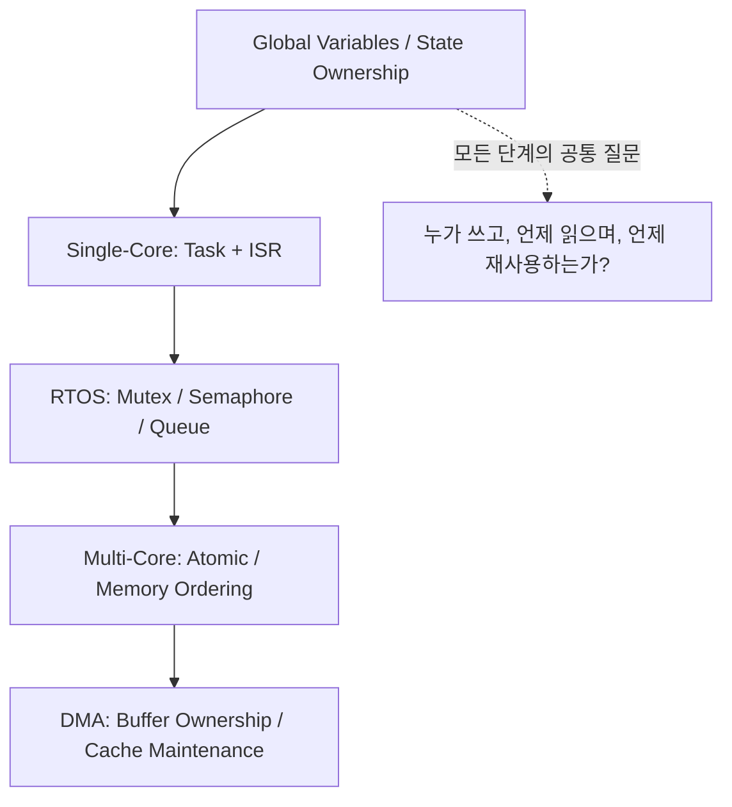

## Table of contents
{: .no_toc .text-delta }
- TOC
{:toc}
## 핵심 요약


동시성 문제는 코어 개수보다 공유 자원에 접근하는 실행 문맥에서 시작한다. 단일 코어에서도 ISR과 task의 선점으로 경쟁이 발생하며, 멀티 코어에서는 다른 코어의 실제 병렬 실행과 Memory Visibility까지 고려한다. Global Variable를 없애는 것만으로 해결되지 않으며 소유권·수명·원자성·순서·실패 처리를 함께 설계한다.


## Learning Path



먼저 각 데이터의 owner를 정하고 실행 문맥을 늘려가며 필요한 보호 수단을 선택한다. 코어가 하나여도 ISR과 Task가 공유 상태에 접근하면 race condition이 발생할 수 있다.

## 학습 순서

- Global Variables & State Ownership: static/extern/const/volatile과 수명·캡슐화를 구분한다.
- 단일 코어와 인터럽트: read-modify-write 경쟁, ISR에서 할 수 없는 작업, 짧은 Critical Section을 이해한다.
- RTOS 동기화: Mutex·Semaphore·Queue·Event를 목적에 맞게 선택하고 Priority Inversion·Deadlock·timeout을 설계한다.
- 멀티 코어와 메모리 모델: atomic·acquire/release·cache coherence·spinlock·IPC를 구분한다.
- DMA & Buffer Ownership: CPU 이외 실행 주체를 포함해 전송 시작부터 완료까지 메모리 수명을 관리한다.

## 플랫폼 적용 범위


S32K312 프로젝트의 드라이버 구현과 연결해 설명하지만 멀티 코어 부분은 멀티 코어 MCU로 확장할 때의 일반 설계다. 현재 MCU의 모든 메모리·캐시·Atomic operation·RTOS 기능을 가정하지 않는다. C11 예제와 FreeRTOS API 예제는 각각의 도구체인·RTOS 전제 아래 읽고, AUTOSAR OS나 다른 RTOS에 함수 이름만 바꿔 적용하지 않는다.


## 도구 선택 기준


```text
목적                              우선 검토할 방법
상태의 쓰기 주체를 하나로 제한      단일 owner task + Queue
task 간 공유 주변장치 보호         Mutex
ISR에서 task로 완료 알림           ISR-safe notification/semaphore
개수 있는 가용 자원                Counting semaphore
데이터와 알림을 함께 전달          Queue / message buffer
짧은 ISR-task 공유 상태 변경       해당 플랫폼 임계 구역 또는 검증된 atomic
코어 간 버퍼 전달                  IPC + ownership + 메모리 순서
CPU-DMA 버퍼 전달                  ownership + cache/완료 규약
```


