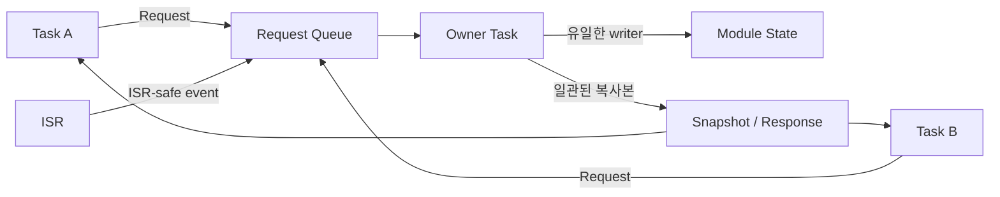

## Table of contents
{: .no_toc .text-delta }
- TOC
{:toc}
## 핵심 요약


전역 상태는 어느 파일에서든 접근할 수 있게 만드는 대신, 쓰기 주체와 읽기 API를 정해 관리한다. 파일 범위 static으로 가시성을 제한해도 ISR이나 여러 task가 같은 상태에 접근하면 동기화가 필요하다.


## Single Owner Pattern





여러 실행 문맥이 전역 구조체를 직접 수정하는 대신 Owner Task로 요청을 전달한다. Queue full 처리와 응답 timeout도 정의해야 한다. Snapshot을 공유 메모리로 직접 읽는 경우에는 별도 동기화가 필요하다.


## static·extern·const·volatile 구분

- 파일 범위 static: 해당 translation unit 내부 연결을 갖는다. 함수 내부 static: 호출 사이에 값이 유지된다. 어느 쪽도 자동 thread-safe를 뜻하지 않는다.
- extern: 다른 translation unit에 정의된 객체를 선언한다. 헤더에는 extern 선언, 한 소스 파일에 실체를 둔다. 여러 파일에 정의하거나 헤더에 mutable 전역 실체를 만들지 않는다.
- const: 해당 접근 경로에서 수정을 제한한다. 스레드 동기화나 메모리 보호를 제공하지 않는다. 실제 ROM 배치는 linker·플랫폼에 따른다.
- volatile: MMIO 등 지정된 접근을 컴파일러가 일반 변수처럼 생략·합치지 않도록 하는 용도다. atomicity·상호 배제·다른 데이터의 공개 순서·cache coherence를 보장하지 않는다.

## 전역 상태를 모듈로 감싸기


```c
/* can_state.h */
#include <stdbool.h>
#include <stdint.h>
typedef struct {
    uint32_t received;
    uint32_t dropped;
    bool bus_off;
} CanSnapshot;
void can_state_snapshot(CanSnapshot *out);

/* can_state.c 개념 구조 */
/* static CanSnapshot state; */
/* 쓰기는 CAN owner 문맥만 수행하고,
 * snapshot은 메시지 요청 또는 짧은 동기화 구간에서 복사한다.
 * 내부 포인터를 외부에 반환해 임의 수정하게 하지 않는다. */
```


여러 필드를 읽을 때 각각의 읽기가 원자적이어도 동일 시점의 snapshot은 아닐 수 있다. count는 새 값, status는 옛 값으로 조합될 수 있으므로 같은 lock 아래 복사하거나 owner에게 snapshot을 요청한다. 값 복사 API라는 이유만으로 동기화가 자동 제공되지는 않는다.


## 단순 카운터의 Atomic operation 예제


```c
#include <stdatomic.h>
static _Atomic unsigned dropped_frames;

void count_drop(void) {
    atomic_fetch_add_explicit(&dropped_frames, 1U, memory_order_relaxed);
}
unsigned read_drop_count(void) {
    return atomic_load_explicit(&dropped_frames, memory_order_relaxed);
}
```


다른 payload의 준비 완료를 알리지 않는 독립 통계 값이므로 relaxed를 사용했다. 복수 필드 일관성이나 메시지 공개에는 이 예제를 확장할 수 없다. ISR에서 사용할 때 atomic_is_lock_free·컴파일러 생성 코드·런타임 구현과 최악 실행시간을 확인한다. 라이브러리 lock을 사용하는 atomic은 ISR에서 안전하지 않을 수 있다.


## 초기화·수명·설정 변경

- 공유 객체 초기화는 task/IRQ가 접근하기 전에 완료한다. 재초기화는 별도 상태 전환으로 보호한다.
- 함수 내부 배열을 비동기 DMA·Queue 포인터로 넘기고 반환하지 않는다. heap 객체도 소비 완료 전 해제하지 않는다.
- 설정 구조체를 여러 필드에 걸쳐 갱신할 때는 lock 아래 교체 또는 owner 메시지를 사용한다. const 포인터를 넘겼다고 원본의 다른 writer가 사라지지는 않는다.

## 검증


모든 공유 변수에 writer, reader, 실행 문맥, 보호 수단, 수명, 초기화 시점을 적는다. 읽기 전용 데이터·task 전용 데이터·ISR 공유·DMA 공유를 구분한 뒤 불필요한 전역 공유를 줄인다. PC에서 race detector를 사용할 수 있어도 MCU의 IRQ·DMA·cache 오류까지 검출하지는 못한다.

