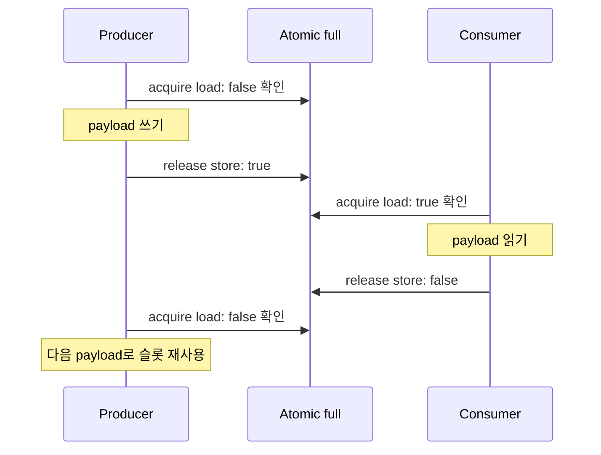

## Table of contents
{: .no_toc .text-delta }
- TOC
{:toc}
## 핵심 요약


멀티 코어에서는 로컬 IRQ 차단만으로 Shared State가 보호되지 않는다. atomicity, compiler/CPU ordering, cache coherence, 메모리 접근 속성과 ownership을 별도로 검토해야 한다. 아래 C11 예제는 같은 coherent 공유 메모리를 사용하는 C 실행 환경이 전제다. 별도 펌웨어가 도는 AMP MCU에 자동 적용되지 않는다.


## SPSC Slot: Release / Acquire



Producer 1개와 Consumer 1개인 단일 슬롯 예제다. coherent 공유 메모리와 C11 memory model을 전제로 release/acquire가 payload 접근 순서를 연결한다. AMP의 cache maintenance나 mailbox 설정까지 자동 보장하는 것은 아니다.

## SMP와 AMP

- SMP: 하나의 OS/RTOS가 여러 코어를 관리한다. 해당 포트가 제공하는 multicore lock·scheduler·atomic 규칙을 사용한다.
- AMP: 코어별 펌웨어·OS·주소 매핑이 다를 수 있다. 공유 메모리의 layout·alignment·version·초기화 owner·endianness와 mailbox/IP interrupt를 계약으로 정의한다.
- 공유 메모리를 같은 주소처럼 보이게 배치했더라도 hardware cache coherence가 없으면 CPU atomic이나 barrier만으로 최신 payload가 전달되지 않을 수 있다.

## C11 atomic: 데이터 공개 순서


아래는 producer 1개·consumer 1개의 단일 슬롯이다. release/acquire로 payload 쓰기가 공개된 후 읽게 하고 소비 완료 전 재사용하지 못하게 한다. 같은 쪽 함수를 여러 실행 주체가 동시에 호출하면 이 설계의 전제가 깨진다.


```c
#include <stdatomic.h>
#include <stdbool.h>
#include <stdint.h>
typedef struct { uint32_t sequence, value; } Message;
static Message payload;
static atomic_bool full = ATOMIC_VAR_INIT(false);

bool try_publish(Message message) { /* producer 한 개 */
    if (atomic_load_explicit(&full, memory_order_acquire)) return false;
    payload = message;
    atomic_store_explicit(&full, true, memory_order_release);
    return true;
}
bool try_consume(Message *out) { /* consumer 한 개 */
    if (!atomic_load_explicit(&full, memory_order_acquire)) return false;
    *out = payload;
    atomic_store_explicit(&full, false, memory_order_release);
    return true;
}
```


payload는 atomic이 아니지만 슬롯 소유권과 happens-before 관계로 동시에 접근하지 않게 했다. 단순 volatile bool로 full을 바꾸거나 release/acquire를 근거 없이 relaxed로 바꾸면 이 보장이 사라진다. 이 예제는 데이터가 꽉 차면 실패를 반환하며 무제한 spin하지 않는다.


## Spinlock과 Mutex


spinlock은 바쁜 대기이므로 아주 짧고 상한이 있는 구간에서, 해당 플랫폼의 선점·IRQ·코어 규칙과 함께 사용한다. 단일 코어에서 ISR이 선점된 task가 보유한 spinlock을 기다리면 task가 실행되지 못해 영원히 풀리지 않는다. 멀티 코어에서도 lock owner의 장시간 선점과 Priority Inversion·공정성을 고려한다.


## Barrier와 cache

- memory barrier는 필요한 순서를 제공하는 도구이며 상호 배제·atomic update를 자동 제공하지 않는다. ARM DMB/DSB/ISB의 역할도 서로 다르므로 임의로 삽입하지 않는다.
- cache clean은 수정 데이터를 메모리에 반영하는 동작, invalidate는 캐시 내용을 무효화하는 동작이다. 방향·순서·정렬을 잘못 적용하면 데이터를 잃을 수 있다.
- 코어별 잦은 counter가 같은 cache line에 있으면 false sharing으로 성능이 나빠질 수 있다. cache line 크기는 플랫폼에서 확인하고 측정 후 배치를 조정한다.

## IPC와 복구


공유 구조체에 version·length·sequence·owner 상태와 필요한 진단 정보를 포함한다. mailbox interrupt는 알림이며 payload 준비·cache 처리·Memory Ordering를 대체하지 않는다. 한 코어 reset 시 남은 lock·queue·descriptor의 복구 owner와 epoch를 정의해 이전 응답을 새 요청으로 오인하지 않도록 한다.


## 검증


동시 producer/consumer 부하, 강제 선점, 한 코어 정지·reset, queue full, stale notification을 시험한다. coherent/non-coherent 메모리 속성과 compiler optimization을 바꾸어도 정의된 프로토콜이 유지되는지 확인한다. PC thread test 통과는 MCU의 cache·IPC 구현 검증과 별개다.

