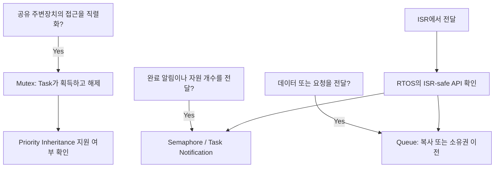
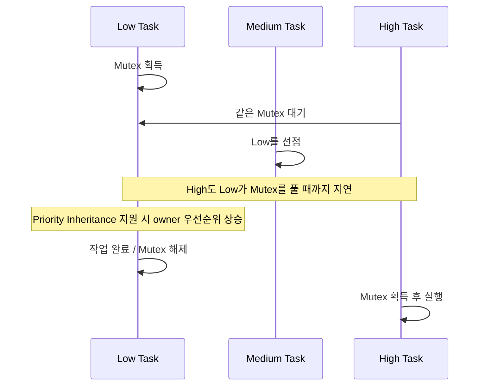

## SPI bus의 소유권과 수신 event를 task 사이에 전달하는 상황


Mutex는 자원 소유를, semaphore는 신호나 개수를, queue는 데이터 전달을 표현한다. 하나의 primitive로 모든 관계를 처리하면 ownership과 event 의미가 섞인다.


> Mutex는 소유권이 있는 상호 배제, Semaphore는 이벤트 또는 자원 개수, Queue는 데이터 전달에 사용한다. 이름이 비슷해도 역할·ISR 사용 가능 여부·우선순위 상속이 다르다.


## Mutex vs Semaphore vs Queue





Mutex는 ownership을 가진 상호 배제 도구이고 Semaphore는 신호·개수 전달에 사용한다. ISR에서는 Mutex를 기다리지 않는다. Queue에 pointer를 넣을 때는 대상 Buffer의 수명도 함께 관리한다.


## Priority Inversion





Priority Inheritance는 owner의 실행 지연을 줄이지만 긴 Critical Section이나 Deadlock을 없애지는 않는다. 실제 지원 범위와 nested Mutex 동작은 RTOS 구현을 확인한다.


## Mutex: 공유 자원 보호


SPI bus 같은 자원을 task끼리 공유할 때 하나의 transaction 전체를 보호한다. 일반적으로 획득한 task가 해제해야 한다. FreeRTOS mutex는 priority inheritance를 제공하지만 모든 RTOS lock의 동작이 같지는 않다. ISR에서 mutex를 획득하거나 해제하지 않는다.


```c
/* FreeRTOS task 문맥의 개념 예제 */
if (xSemaphoreTake(spi_mutex, pdMS_TO_TICKS(10)) == pdTRUE) {
    int result = board_spi_transaction();
    /* 성공/실패 모두 동일 경로에서 해제 */
    xSemaphoreGive(spi_mutex);
    report_result(result);
} else {
    report_bus_busy();
}
```


board_spi_transaction은 timeout과 CS 복구를 포함해 반환한다는 계약이 필요하다. 비동기 전송이 시작되자마자 lock을 풀면 다른 task가 동일 peripheral과 buffer를 사용할 수 있다. 장시간 전송은 주변장치 owner task가 요청 queue를 처리하는 구조가 더 명확할 수 있다.


## Semaphore·Notification·Event·Queue


| **항목**                 | **설명 및 적용 기준**                                                                                                        |
| ---------------------- | --------------------------------------------------------------------------------------------------------------------- |
| **Binary semaphore**   | 완료 또는 깨우기 알림. 미처리 상태에서 다시 give하면 이벤트 수가 누적되지 않을 수 있다.                                                                 |
| **Counting semaphore** | 사용 가능한 buffer 개수 또는 누적 이벤트 수. 최대 카운트와 overflow 처리를 정한다. FreeRTOS semaphore는 mutex와 같은 priority inheritance를 제공하지 않는다. |
| **Task notification**  | 지정 task에 값·비트·카운트를 전달하는 경량 방식. 어떤 action 모드를 쓰는지에 따라 덮어쓰기·누적 의미가 달라진다.                                                |
| **Event group**        | 여러 조건 비트의 조합 대기. 반복 횟수 보존용이 아니다. clear-on-exit와 여러 waiter의 의미를 확인한다.                                                  |
| **Queue**              | payload 복사 또는 포인터 전달. 포인터 queue는 대상 데이터의 소유권·수명까지 정의해야 한다. full일 때 block/drop/overwrite 정책을 메시지 종류에 맞춘다.              |


## Priority Inversion


```text
Low task가 mutex 보유
High task가 같은 mutex를 기다림
Medium task가 Low를 계속 선점 → High도 지연

Priority inheritance는 lock owner의 우선순위를 일시적으로 올려
관련 지연을 줄인다. 긴 critical section이나 deadlock을 없애지는 않는다.
```


priority inheritance 구현의 nested mutex 제한과 복구 시점을 RTOS 문서에서 확인한다. AUTOSAR OS에서는 Resource의 priority ceiling과 multicore Spinlock을 별도 규칙으로 다루므로 FreeRTOS mutex를 그대로 대응시키지 않는다.


## Deadlock 예방과 timeout

- 여러 lock을 잡아야 하면 전역적으로 같은 순서를 정한다. A→B와 B→A 획득 경로가 공존하지 않도록 한다.
- lock을 보유한 채 다른 task의 응답을 기다리고, 그 task가 같은 lock을 필요로 하는 순환을 피한다.
- recursive mutex는 자기 재진입에 제한적으로 사용한다. 여러 자원 사이 순환을 해결하지 않으며 획득/해제 횟수가 맞아야 한다.
- timeout을 반환하는 모든 경로에서 이미 얻은 자원·CS·DMA 상태를 정리한다. timeout을 무시하고 보호 없이 계속 접근하면 더 큰 오류가 된다.

## CAN/UART/SPI에 적용


CAN/UART 수신은 ISR→queue→parser task, SPI bus는 owner task 또는 transaction mutex, ADC DMA는 완료 buffer queue로 구성할 수 있다. 여러 task가 전역 peripheral handle에 직접 명령을 보내는 구조보다 한 owner가 상태 머신과 retry를 관리하면 ownership이 명확해진다.


## 검증


lock hold time·wait time·queue high-water mark·timeout 횟수를 기록한다. 고/중/저 우선순위 부하로 역전 시나리오를 재현하고, 강제 오류·timeout에서도 자원 반환과 다음 요청 처리가 가능한지 확인한다.


## 이해를 확인하는 질문


> Binary semaphore를 mutex 대신 쓰면 동작이 같을까?


Owner 규칙과 priority inheritance가 다를 수 있다. ISR 허용 여부와 RTOS 구현의 계약을 확인해야 한다.

