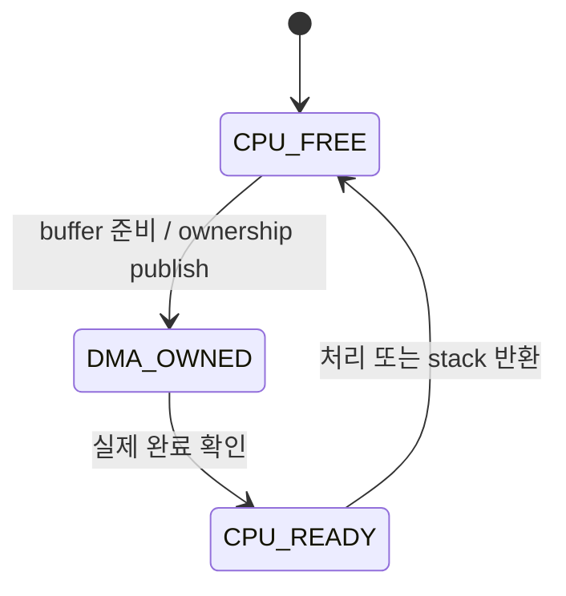

## Table of contents
{: .no_toc .text-delta }
- TOC
{:toc}


## Overview


> Ethernet MAC은 frame 송수신과 MAC 계층 기능을 처리하고, PHY는 실제 매체의 신호를 처리한다. MCU 쪽에서는 descriptor·DMA·buffer ownership·cache·interrupt·network stack의 계약을 이해하는 것이 핵심이다.


## Platform Scope


<blockquote class="notice">
<div class="callout">
<div class="callout-icon" markdown="1">
💡
</div>
<div class="callout-content" markdown="1">
모든 MCU에 Ethernet MAC이 있는 것은 아니다. S32K312에 MAC이 있다고 가정하여 존재하지 않는 ENET register나 API를 제시하지 않는다. 실제 대상 MCU의 peripheral 목록을 먼저 확인하고, MAC이 있는 MCU/SoC 또는 외부 Ethernet controller의 vendor 예제로 실습한다.
</div>
</div>
</blockquote>


| 계층                | 역할                                    | 설정 관점                                   |
| ----------------- | ------------------------------------- | --------------------------------------- |
| Network stack     | ARP/IP/UDP/TCP, socket, routing       | MTU, buffer pool, timer, thread context |
| MAC               | Ethernet frame 송수신, filter, FCS 관련 처리 | MAC address, duplex, descriptor, IRQ    |
| PHY               | 전기 신호, link negotiation, 매체 coding    | Mode, strap, reference clock, link 상태   |
| MAC-PHY interface | MAC과 PHY 데이터 전달                       | MII/RMII/RGMII 등 실제 지원 interface        |
| PHY management    | PHY register 관리                       | MDIO/MDC 주소·clock·reset sequence        |


## Initialization Order


Clock/reset/pin mux와 PHY strap 확인 → PHY 준비·관리 interface 확인 → DMA 접근 가능한 descriptor/buffer 구성 → MAC address/filter/MTU 설정 → RX descriptor를 hardware에 공급 → IRQ와 stack 연결 → link 상태에 맞춰 start 순으로 구성한다. PHY link up과 IP 통신 성공은 별도 단계다.


## Descriptor Ownership





RX descriptor에는 hardware가 쓸 buffer 주소·capacity를 먼저 준비하고 ownership을 마지막에 넘긴다. TX descriptor는 payload·length·flags가 hardware에 보이도록 한 뒤 ownership을 넘긴다. OWN bit 이름과 polarity는 IP마다 다르므로 고정 bit mask를 제시하지 않는다.


## Cache and Memory Ordering


DMA 접근 가능 영역·alignment·descriptor stride를 확인한다. Cache가 있는 platform에서는 cache line 공유, TX clean, RX invalidate, memory barrier의 vendor 순서를 따른다. Descriptor status를 volatile로 읽는 것만으로 dirty cache line이나 순서 문제가 해결되지 않는다. DMA가 쓰는 buffer를 CPU가 동시에 수정하지 않는다.


## Bounded RX Processing


아래 코드는 API 구조를 보여주는 adapter 예제다. board_rx_take는 DMA 완료·cache 동기화를 끝낸 frame만 반환하며 release 뒤에는 해당 pointer를 사용하지 않는다는 계약이다.


```c
#include <stddef.h>
#include <stdint.h>
#include <stdbool.h>
typedef struct { const uint8_t *data; size_t length; void *token; } Frame;
extern bool board_rx_take(Frame *out);
extern void board_rx_release(void *token);
extern void stack_input_copy(const uint8_t *data, size_t length);
void ethernet_poll(void) {
    Frame f;
    for (unsigned budget=0;budget<16 && board_rx_take(&f);budget++) {
        if (f.data && f.length>=14)
            stack_input_copy(f.data,f.length);
        board_rx_release(f.token);
    }
}
```


14는 기본 Ethernet header 길이의 최소 sanity check일 뿐이다. IP packet 검증·VLAN·jumbo frame·FCS 포함 여부는 MAC과 stack 계약에서 처리한다. Zero-copy stack이면 copy 함수 대신 buffer 반환 callback으로 lifetime을 연결해야 한다. IRQ는 완료를 알리고 bounded task/polling에서 frame을 처리한다.


## Link and Error Handling


PHY link down, descriptor ring exhaustion, RX overrun, malformed length, DMA bus error를 구분해 계수한다. Cable 재연결 후 MAC speed/duplex와 stack link state를 갱신한다. Packet flood가 application task를 영구적으로 굶기지 않도록 RX budget과 backpressure를 둔다.


## Vehicle Ethernet Connection


차량 통신의 Ethernet·100BASE-T1·1000BASE-T1·10BASE-T1S는 매체·토폴로지·PHY·차량 network 관점이다. MAC 쪽 descriptor ring과 cache 처리는 별도로 학습한다. 특히 MAC-PHY interface와 cable 쪽 BASE-T1 표준을 같은 이름의 interface로 취급하지 않는다.


## Verification


PHY 관리 접근 → link 상태 → 동일 subnet의 ARP/ICMP → UDP payload → TCP와 sustained load 순으로 확인한다. RX/TX descriptor 회수·packet loss·CPU 부하·cache 활성/비활성 차이·link flap·buffer pool 소진을 측정한다. 지원 여부가 확인되지 않은 timestamp offload·TSN 기능을 가정하지 않는다.
