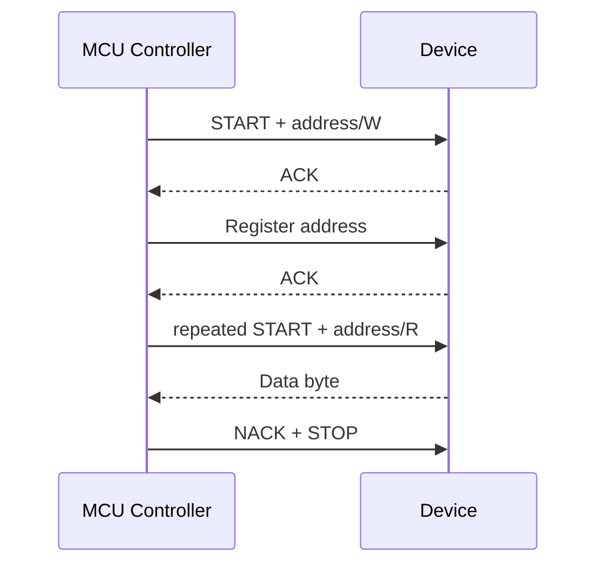

## Register address를 쓴 뒤 같은 장치의 값을 읽는 상황


Address와 ACK는 장치 선택·수신 상태를 나타내고 START/Repeated START/STOP은 transaction을 나눈다. Pull-up과 bus capacitance가 signal 상승 시간을 결정하므로 software sequence와 전기 조건을 함께 보아야 한다.


> I2C는 SDA/SCL을 공유하며 address, ACK/NACK, START/STOP으로 transaction을 구성한다. Open-drain과 pull-up, bus capacitance, clock stretching, timeout을 함께 검토한다.


## Board and Peripheral Setup


<blockquote class="notice">
<div class="callout">
<div class="callout-icon" markdown="1">
💡 
</div>
<div class="callout-content" markdown="1">
S32K312의 실제 I2C/LPI2C instance·pin mux·지원 speed·RTD API를 설치 패키지에서 확인한다. 아래 board_i2c_write_read는 repeated START를 지원한다고 명시한 설명용 adapter다.
</div>
</div>
</blockquote>


| 설정                | 확인할 내용                                                                   |
| ----------------- | ------------------------------------------------------------------------ |
| Voltage / Pull-up | 공급 전압·입력 허용치·open-drain 설정·외부 pull-up을 확인한다.                             |
| Speed             | Functional clock과 divider뿐 아니라 rise/fall time·filter·hold time을 확인한다.    |
| Address           | 7-bit address와 R/W를 포함한 wire byte를 구분한다. 0x50을 driver가 다시 shift하는지 확인한다. |
| Transfer          | Register address 폭·byte order·repeated START·STOP 조건은 장치 datasheet를 따른다.     |
| Timeout           | Address NACK, data NACK, stretching, arbitration loss와 bus stuck를 구분한다.  |


## Register Read Transaction





위는 1-byte register address와 1-byte read를 사용하는 가상 장치 예다. 모든 장치가 같은 protocol을 쓰지 않으며 마지막 read byte에 보내는 NACK는 정상 transaction 종료다.


## C Adapter Example


```c
#include <stdbool.h>
#include <stdint.h>
#include <stddef.h>
extern bool board_i2c_write_read(uint8_t address7,
    const uint8_t *tx, size_t tx_len,
    uint8_t *rx, size_t rx_len, uint32_t timeout_ms);
bool sensor_read_id(uint8_t *value) {
    if (!value) return false;
    const uint8_t reg = 0x0F; /* 가상 register */
    return board_i2c_write_read(0x50,&reg,1,value,1,10);
}
```


이 adapter는 동기식이며 반환 시 stack의 reg를 더 이상 참조하지 않는다는 계약이다. 비동기 driver라면 buffer를 완료 시점까지 유지한다. 0x50·0x0F·10 ms는 예제값이다.


## Pull-up and Rise Time


이상적인 RC 근사에서 30~70% rise time은 약 0.8473×R_pullup×C_bus다. 실제 I2C mode의 rise-time 한계와 device의 sink current·VOL 한계를 함께 만족시키는 범위를 찾는다. 저항을 무조건 작게 하면 low-level 전류가 증가한다. 내부 pull-up만으로 규격 충족을 단정하지 않는다.


## Bus Recovery


SDA low stuck이면 먼저 전원·pin mux·다른 controller의 소유 여부를 확인한다. Bus clear clock/STOP 생성은 제품과 controller가 허용하는 절차를 따른다. SCL이 계속 low면 clock pulse만으로 복구되지 않는다. Transaction 중 무조건 pin mux를 GPIO로 바꾸지 말고 driver를 정지하고 bus ownership을 확보한다.


## Verification


정상 ID read, 잘못된 address, 장치 미연결, NACK, 긴 stretching, 동시 bus 접근, 전원 순서 변화, stuck line을 시험한다. Logic analyzer decode와 scope의 rise time·VOL 측정을 함께 확인한다.


## 이해를 확인하는 질문


> ACK를 받으면 읽은 값도 항상 올바를까?


ACK는 해당 단계의 byte 수신 응답이다. Register 주소, repeated-start 요구, 데이터 길이와 byte order는 별도로 맞아야 한다.

