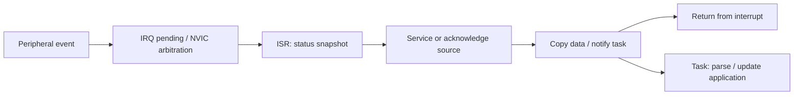

## 짧은 hardware event를 받아 긴 처리 작업을 시작하는 상황


Interrupt는 event를 빠르게 알리지만 ISR이 전체 작업을 끝낼 필요는 없다. Flag 처리와 데이터 보존을 짧게 수행하고 긴 처리를 task로 넘기면 latency와 실행 시간을 구분해 관리할 수 있다.


> Interrupt는 hardware event를 CPU 실행 흐름에 전달하는 mechanism이며, ISR은 해당 event를 처리하는 handler다. ISR에서 event를 짧게 수집하고 시간이 긴 처리는 task/main loop로 넘기는 구조를 기본으로 한다.


## S32K312 Setup


<blockquote class="notice">
<div class="callout">
<div class="callout-icon" markdown="1">
💡 
</div>
<div class="callout-content" markdown="1">
S32K312의 Cortex-M7/NVIC와 설치한 RTD release를 기준으로 한다. RTD interrupt manager, startup vector, peripheral driver의 handler 이름은 생성 코드와 예제에서 확인한다. 아래 board_* 함수는 설명용 adapter이며 실제 RTD API가 아니다.
</div>
</div>
</blockquote>


| 단계             | 설정과 확인                                                                                                  |
| -------------- | ------------------------------------------------------------------------------------------------------- |
| Event source   | Peripheral clock·pin mux·event 조건과 상태 flag를 먼저 확인한다.                                                    |
| Peripheral IRQ | Peripheral 내부 interrupt enable과 source flag clear 규칙을 확인한다.                                             |
| NVIC           | IRQ 번호·priority·pending 상태·enable을 설정한다. Peripheral enable과 별개다.                                        |
| Vector         | Vector table 위치·정렬·handler symbol·링커 section을 확인한다. Bootloader가 있다면 VTOR와 application vector의 관계를 확인한다. |
| Context        | Buffer와 task handle을 준비한 다음 IRQ를 enable한다. 초기화 전 callback을 허용하지 않는다.                                    |


## Priority and Masking


Cortex-M에서는 보통 수치가 작은 priority가 더 높은 urgency를 뜻한다. 구현 priority bit 수·grouping·사용 API의 shift 여부를 CMSIS/RTD 설정으로 확인한다. 모든 숫자 범위를 하드코딩하지 않는다. PRIMASK와 BASEPRI의 차이, fault/NMI에 미치는 영향을 구분한다. Critical Section을 나갈 때는 이전 mask 상태를 복원한다.


RTOS의 FromISR API는 ISR이라면 어디서나 호출할 수 있는 함수가 아니다. port의 maximum syscall interrupt priority 조건을 만족해야 한다. 높은 urgency의 IRQ에서는 RTOS API 대신 별도 handoff를 설계한다.


## ISR Execution Flow





## ISR to Task in C


다음은 완료 event를 하나의 bool로 합치는 bare-metal 예제다. Event 횟수와 payload를 보존해야 한다면 bounded queue나 counter가 필요하다. ISR와 main만 공유하는 단일 코어 모델이며 DMA·멀티 코어까지 보호하는 방식은 아니다.


```c
#include <stdbool.h>
#include <stdint.h>
static volatile bool rx_ready;
extern uint32_t board_irq_save_disable(void);
extern void board_irq_restore(uint32_t previous);
extern bool board_rx_done(void);
extern void board_rx_ack(void);
extern void process_rx_buffer(void);
void rx_irq_handler(void) {
    if (board_rx_done()) {
        board_rx_ack(); /* 실제 IP의 clear/서비스 순서를 따른다. */
        rx_ready = true; /* buffer 소유권/수명은 별도로 보장한다. */
    }
}
static bool take_rx_event(void) {
    uint32_t key = board_irq_save_disable();
    bool ready = rx_ready;
    rx_ready = false;
    board_irq_restore(key);
    return ready;
}
void application_step(void) {
    if (take_rx_event()) process_rx_buffer();
}
```


## Flag Handling


W1C flag에 일반적인 read-modify-write를 쓰면 다른 pending bit를 의도치 않게 지울 수 있다. 반대로 FIFO를 읽어야 해제되는 level source를 flag write만으로 처리하면 ISR이 반복된다. 해당 peripheral의 clear sequence와 driver ownership을 따른다. 진입 시 status를 읽고 처리한 source만 acknowledge한다.


## Latency and Execution Budget


Interrupt latency는 event 발생부터 handler 시작까지이며 ISR execution time과 다르다. mask 구간·높은 priority ISR·flash wait state·bus contention·cache 상태가 latency에 영향을 준다. GPIO marker 또는 지원되는 trace/cycle counter로 최악 경로를 관찰한다. printf·blocking lock·busy wait·flash erase를 handler에 넣지 않는다.


## Verification

- IRQ를 enable하기 전후의 pending event, 연속 event, queue overflow, 공유 IRQ에서 여러 source가 동시에 켜지는 경우를 확인한다.
- RTOS API 허용 priority 위반, 너무 긴 Critical Section, interrupt storm, nested IRQ를 시험한다.
- IRQ 횟수와 실제 수신 데이터 수를 비교한다. event flag가 여러 interrupt를 하나로 합치는 것이 요구사항에 맞는지 확인한다.

## 이해를 확인하는 질문


> ISR priority를 높이면 전체 반응 시간이 항상 줄어들까?


우선순위가 높은 ISR은 다른 작업을 지연시킨다. ISR 실행 시간, 중첩, task wakeup과 RTOS API 허용 priority를 함께 분석한다.

