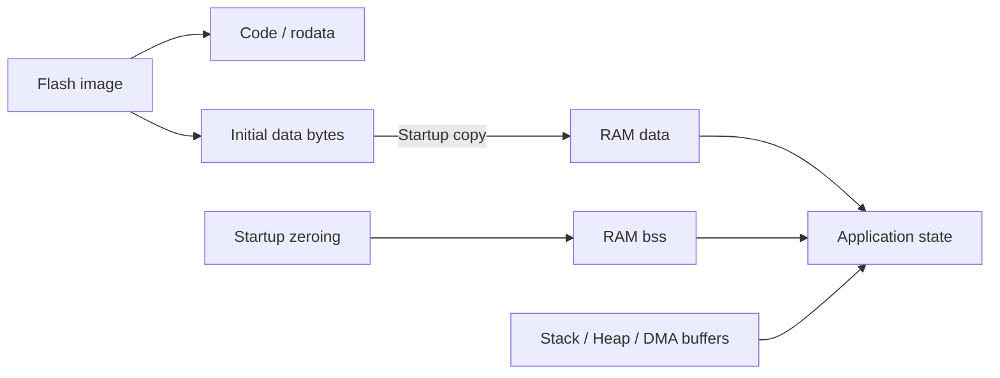

## Table of contents
{: .no_toc .text-delta }
- TOC
{:toc}
## Overview

> 주소 공간, 물리적 메모리, linker 배치, runtime 수명을 연결해 이해한다. RAM/ROM이라는 이름만으로 속도·보안·DMA 접근성·cache 속성을 판단하지 않는다.

## Software Sections

## Learning Path

RAM, ROM & Flash → Linker Script & Startup → Stack, Heap & Memory Safety 순서로 학습한다. 이미 작성된 DMA & Buffer Ownership과 Multi-Core & Memory Ordering은 runtime 접근 규칙을 보완한다.

## S32K312 Scope

정확한 SRAM·Flash 크기, 접근 가능한 master, ECC 초기화, cache/TCM 존재와 영역은 대상 부품의 memory map을 기준으로 확인한다. 다른 S32K3 모델의 linker 주소와 크기를 그대로 사용하지 않는다.

