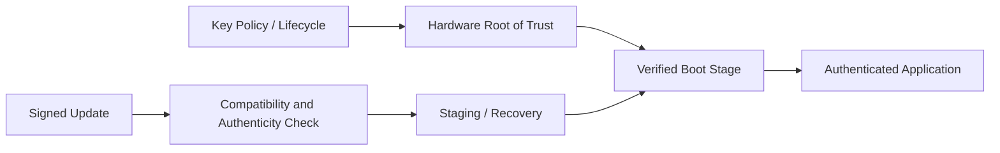

## Table of contents
{: .no_toc .text-delta }
- TOC
{:toc}
## Overview

> HSM/HSE, Key Management, Secure Boot와 Bootloader를 연결해 부팅 시 어떤 코드를 신뢰하고, 업데이트 시 무엇을 검증하며, 실패 시 어떻게 복구하는지 정리한다. 암호화·무결성·인증·권한·복구는 서로 다른 요구사항이다.

## Trust Chain

## S32K312 Scope

S32K3 계열의 보안 기능은 NXP HSE(인증·암호 서비스) 및 제품별 부팅 구조·lifecycle 규칙을 기준으로 확인한다. 정확한 S32K312 부품 revision, HSE firmware 패키지, 설치 RTD와 허용 기능 조합을 확인한다. 일반 HSM 설명을 특정 칩의 key slot 수나 fuse 주소로 간주하지 않는다.

## Learning Order

HSM & HSE → Key Management & Provisioning → Secure Boot → Bootloader & Firmware Update 순으로 학습한다. Memory Architecture의 Flash 배치·Linker Script·Startup을 함께 이해해야 부팅 주소와 이미지 범위를 올바르게 검증할 수 있다.
