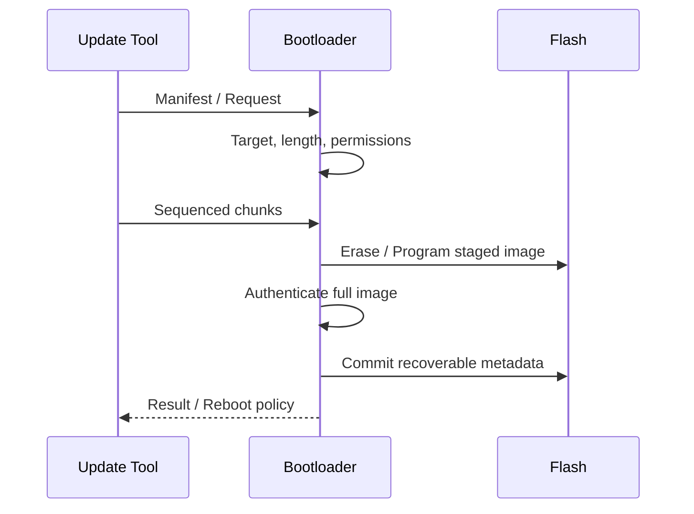

## Flash 기록 도중 전원이 꺼지는 상황


Download, validation, activation과 application handover는 다른 상태다. 저장 완료와 boot 가능성을 구분하고, 전원 손실 후에도 유효 image를 찾을 수 있는 metadata가 필요하다.


> Bootloader는 시작할 application 선택·검증·업데이트·복구를 담당한다. Boot ROM, vendor boot firmware, 사용자 Bootloader와 application의 경계를 구분한다. 업데이트 transport(CAN/UDS/UART/Ethernet)와 이미지 설치·검증 로직은 분리한다.


## Update Sequence





## Memory Layout


Bootloader·application slot·metadata·calibration·HSE 예약 영역을 분리한다. 실제 Flash erase sector와 program unit에 맞춰 배치하고, 업데이트 범위가 보호 영역에 겹치지 않게 한다. A/B는 여유 공간과 boot support가 있을 때 선택할 수 있는 구조이며 모든 MCU에서 가능한 기본값이 아니다.


## Bounds Check in C


아래는 slot 내부 byte 범위를 검사하는 독립 C 예제다. offset+length를 먼저 더하면 overflow가 생길 수 있어 뺄셈으로 검사한다. 실제 구현은 이 검사 외에도 erase/program alignment, target permission, chunk sequence, signature 검증이 필요하다.


```c
#include <assert.h>
#include <stdbool.h>
#include <stddef.h>
#include <stdint.h>
static bool range_ok(size_t offset, size_t length, size_t capacity) {
    return offset <= capacity && length <= capacity - offset;
}
int main(void) {
    assert(range_ok(100,20,128));
    assert(range_ok(128,0,128));
    assert(!range_ok(128,1,128));
    assert(!range_ok(SIZE_MAX-1,10,128));
    return 0;
}
```


## Flash Execution Constraints


실행 중 같은 Flash bank를 erase/program할 수 있는지, Flash driver를 RAM에서 실행해야 하는지, interrupt vector와 ISR도 영향을 받는지 확인한다. watchdog service·timeout·전원 조건을 설계한다. 성공 flag만 보지 말고 필요한 readback/ECC 상태를 확인한다.


## Application Handover


Cortex-M에서 vector table·stack·interrupt·timer·DMA·cache 상태를 고려해야 하지만 구체적인 jump 코드는 vendor startup/boot 요구에 맞춘다. application 주소를 함수 포인터로 호출하는 한 줄만으로 handover가 완성되지 않는다. 필요하면 reset을 통한 정식 boot 경로를 사용한다.


## Recovery Tests


각 chunk 전후, erase 중, verify 후 commit 전, metadata 갱신 중 전원 차단을 시험한다. 중복·순서 뒤바뀐 chunk와 재연결을 처리하고 인증되지 않은 부분 이미지를 실행하지 않는다. UDS download sequence와 실제 설치 상태를 구분해 진단 응답을 설계한다.


## 이해를 확인하는 질문


> 모든 byte를 썼으면 즉시 새 application으로 jump해도 될까?


Image 검증, activation 기록, vector·stack·interrupt·peripheral 상태와 rollback 조건을 맞춰야 한다.

