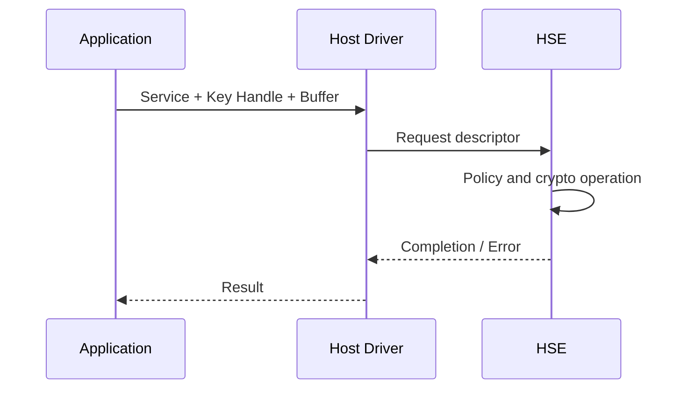

## Table of contents
{: .no_toc .text-delta }
- TOC
{:toc}
## Overview

> HSM(Hardware Security Module)은 키 보호와 암호 연산을 격리하는 보안 하위 시스템을 가리킨다. NXP HSE는 제품·firmware에 따라 제공되는 보안 서비스와 인터페이스를 갖는다. HSM이라는 일반 용어와 특정 HSE 구현을 동일한 레지스터/API로 취급하지 않는다.

## Host and Security Engine

## Service Model

Application은 가능한 경우 raw key 대신 key handle과 허용된 operation을 지정한다. Host-HSE 요청 buffer의 위치·정렬·수명·cache 처리를 해당 SDK 규칙에 맞춘다. 비동기 완료 전에 요청 구조체나 payload를 수정·해제하지 않는다. driver의 요청 성공과 실제 암호 검증 성공을 별도로 확인한다.

## Practical Workflow

설치한 HSE package의 호환표·release note 확인 → 보드 lifecycle 확인 → vendor의 무해한 hash 예제로 서비스 경로 확인 → 개발용 key를 이용한 MAC/서명 검증 → 잘못된 key·변조 데이터·timeout 시험 순으로 진행한다. key import·export 가능 여부는 key policy에 따른다.

## Crypto Choices

Hash는 데이터 요약이며 누구나 다시 계산할 수 있다. MAC은 공유 비밀키 기반 인증, Signature는 private key 서명과 public key 검증을 분리한다. Encryption은 기밀성 요구이며 인증이 자동 제공되지 않는 mode도 있다. AEAD를 사용해도 nonce uniqueness·tag 검증·키 수명 관리가 필요하다.

## Integration Failures

잘못된 key handle·usage permission·buffer alignment·length·service availability를 분리해 보고한다. timeout 뒤 서비스가 계속 실행 중인지 확인하고 늦은 완료를 다음 요청의 결과로 사용하지 않는다. HSE가 존재해도 Host application의 bounds check·권한 검증·메모리 안전 문제가 사라지는 것은 아니다.

## Verification

정상/변조 입력, 잘못된 key usage, 부팅 직후 서비스 준비 지연, 동시 요청과 reset을 시험한다. private key·평문 비밀·민감 descriptor를 로그에 남기지 않는다. 보드 검증 전에는 HSE 성공 응답을 실제 보안 요구 충족으로 단정하지 않는다.

