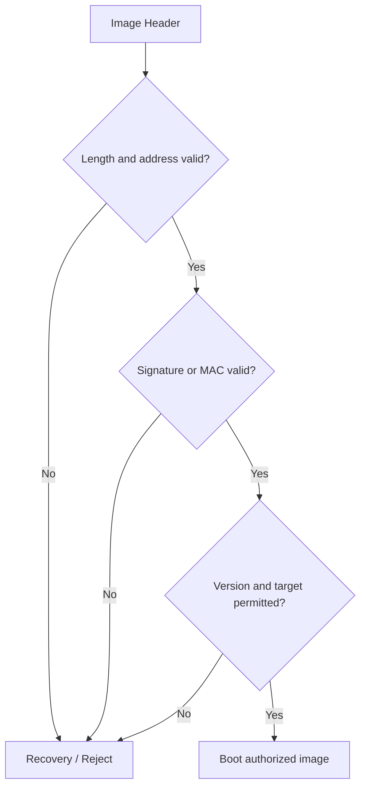

## Table of contents
{: .no_toc .text-delta }
- TOC
{:toc}
## Overview

> Secure Boot는 부팅할 코드와 필요한 metadata를 신뢰된 기준으로 인증하는 과정이다. 이미지 암호화, 디버그 차단, measured boot, Anti-Rollback과 역할을 구분한다. Secure Boot가 성공해도 실행 중 결함이 자동 방지되는 것은 아니다.

## Validation Flow

## What to Authenticate

실행 코드뿐 아니라 entry point·load address·image length·target hardware·version 등 실행 의미를 바꾸는 metadata도 인증 범위에 포함한다. 저장소의 CRC만 검사하면 공격자가 데이터를 바꾸고 CRC를 다시 계산할 수 있다.

## Root of Trust

최초 검증 단계의 코드·key 기준은 공격자가 동일한 방식으로 바꾸지 못하도록 보호되어야 한다. ROM 기반인지 보호된 Flash인지, HSE와 어느 부팅 단계에서 연동되는지는 제품별 Boot Architecture를 확인한다. 특정 MCU의 boot header 형식을 다른 제품에 복사하지 않는다.

## Anti-Rollback

유효하게 서명된 구버전도 취약할 수 있다. 허용 최소 version과 갱신 시점, 전원 중단 시 일관성, 정당한 복구 이미지를 정의한다. A/B rollback과 보안상 금지된 downgrade는 같은 의미가 아니다.

## Verification

payload·metadata·signature 각각 변조, 길이 overflow, 잘못된 entry, 다른 하드웨어 이미지, 구버전, 중간 전원 차단을 시험한다. 실패한 이미지로 jump하지 않고 정의된 recovery로 진입하는지 확인한다. digest 출력 비교만으로 signature 검증을 대신하지 않는다.
