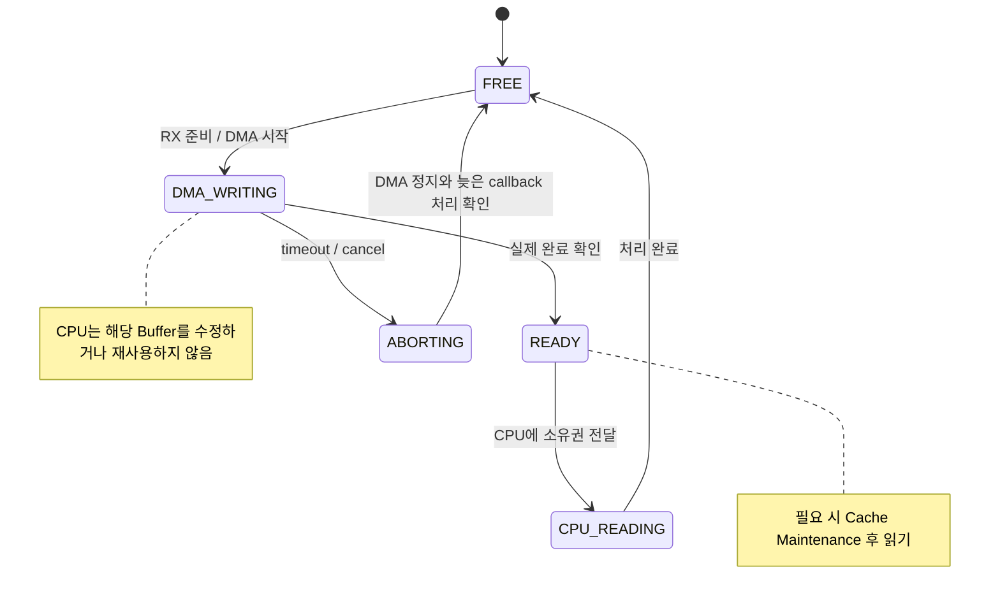

## Table of contents
{: .no_toc .text-delta }
- TOC
{:toc}
## 핵심 요약


DMA는 CPU의 mutex나 IRQ mask를 따르지 않고 메모리를 읽고 쓸 수 있다. DMA가 접근하는 buffer의 소유권과 실제 전송 완료를 기준으로 재사용 시점을 결정한다.


## RX Buffer Ownership



timeout이 발생해도 DMA가 즉시 정지했다고 가정하면 안 된다. abort 완료와 늦은 callback 처리까지 확인한 뒤 Buffer를 반환한다. 그림의 상태 전환 자체에도 실행 문맥에 맞는 동기화가 필요하다.

## 버퍼 상태 머신


```text
RX: FREE → DMA_WRITING → READY → CPU_READING → FREE
TX: FREE → CPU_WRITING → DMA_READING → FREE

상태 변경마다 owner·허용 접근·완료 조건을 명확히 한다.
DMA 완료가 주변장치의 wire-level 송신 완료인지 별도로 확인한다.
```


## TX와 RX cache 처리


캐시가 있는 non-coherent DMA 환경에서는 TX 시작 전에 해당 buffer의 수정 데이터를 메모리로 clean하고 필요한 순서를 보장한다. RX는 CPU dirty line이 DMA 결과를 나중에 덮어쓰지 않도록 시작 전 상태를 처리하고 완료 후 읽기 전에 필요한 invalidate를 수행한다. 정확한 API·순서는 MCU SDK의 DMA/cache 가이드에 따른다. cache가 없거나 coherent인 영역에는 같은 처리가 필요하지 않을 수 있다.

- cache line에 다른 변수가 함께 있으면 invalidate로 그 변수의 dirty 데이터까지 잃을 수 있다. DMA buffer alignment와 크기·메모리 영역을 맞춘다.
- descriptor와 payload 모두 DMA 접근 가능한 메모리에 있어야 한다. stack 수명·정렬·전송 폭·최대 길이를 검증한다.
- double buffering에서도 DMA가 다음 buffer로 넘어가기 전에 consumer가 처리했는지 확인한다. 처리 지연 시 overwrite/drop/backpressure 정책을 정의한다.

## timeout과 cancel


API timeout은 DMA 정지를 보장하지 않는다. abort 요청 후 하드웨어가 멈췄는지와 늦은 callback 가능성을 확인해야 buffer를 해제할 수 있다. 요청 generation/sequence를 두어 이전 전송의 완료 알림이 다음 요청을 완료시키지 않도록 한다.


## 주변장치별 적용

- UART: RX idle event는 메시지 경계와 항상 같지 않다. 수신 buffer의 유효 길이를 parser에 전달하고 framing은 별도로 처리한다.
- SPI: DMA TX 완료 뒤 FIFO/shift register가 남아 있을 수 있다. CS 해제는 실제 완료 조건을 따른다.
- ADC: half/full buffer 완료 시 소유권을 교환하고 채널 순서·sample counter·overrun을 확인한다.
- CAN: controller RAM과 소프트웨어 buffer의 소유권을 구분하고 다음 RX arm이 이전 데이터를 덮어쓰지 않도록 한다.

## 검증


지연 consumer, 강제 timeout·abort, 잘못된 길이, 반복 재시작, IRQ masking, DMA error를 재현한다. buffer 경계 guard·sequence·누락 카운터로 손상을 찾되 검증용 guard가 하드웨어 bounds 보호를 대신하지는 않는다.

