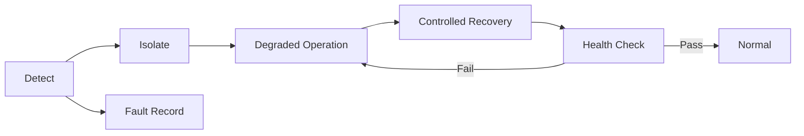

## Table of contents
{: .no_toc .text-delta }
- TOC
{:toc}
## Overview

> 분산 제어 시스템은 정상 데이터 경로뿐 아니라 fault 탐지·격리·복구·기록을 설계해야 한다. 로그가 있다는 사실과 시스템이 올바르게 복구된다는 사실은 다르다.

## Failure Handling

## End-to-End Protection

Sequence, Data ID, CRC, Timeout은 손상·누락·중복·잘못된 데이터 경로 탐지에 사용할 수 있다. CRC는 공격자 인증이 아니고 TCP 재전송도 application freshness를 보장하지 않는다. AUTOSAR E2E를 적용하면 profile과 보호 범위·counter·검증 상태를 해당 사양대로 사용한다.

## Practical Scenario

조명 명령의 Request ID·Expiry를 검사하고 timeout이면 기능별 정의된 degraded state로 전환한다. 재연결 시 오래된 Queue를 모두 재전송하지 않는다. 불필요한 출력 반복을 막기 위해 idempotency 또는 명령 generation을 관리한다.

## Observability

노드·SW version·boot/session ID·request/sequence·clock quality·queue depth·error counter를 기록한다. ISR에서 긴 printf를 수행하지 않는다. 중요 fault는 속도 제한·요약 정책을 두고 로그 부하가 제어 task를 방해하지 않는지 확인한다.

## Watchdog

한 task가 계속 watchdog을 갱신한다고 전체 시스템이 정상은 아니다. 필요한 task의 progress와 deadline을 확인하는 supervision을 설계한다. timeout마다 무조건 reboot하면 fault 원인을 잃거나 reboot loop가 생길 수 있으므로 reset reason·재시도 횟수·복구 단계를 남긴다.

## Verification Matrix

네트워크 단절, 서비스 crash, MCU reset, queue overflow, 센서 stuck, timestamp 이상, 만료 명령, 중복 응답을 각각 주입한다. 검출 시간·복구 시간·출력 영향·기록 내용·재발 조건을 표로 관리한다. Safety 관련 허용 동작은 시스템 분석과 요구사항에 따라 별도로 확정한다.

