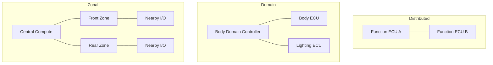

## 기능별 ECU를 중앙·영역 단위로 재배치하는 상황

Functional decomposition과 physical placement는 다른 축이다. Cable 길이를 줄이는 결정이 latency, failure domain과 service dependency를 어떻게 바꾸는지 함께 보아야 한다.

> E/E(Electrical/Electronic) Architecture는 ECU·센서·Actuator·전원·네트워크의 배치와 역할을 정의한다. Distributed, Domain, Zonal은 설계 관점이며 실제 차량에는 혼합 구조가 흔하다.

## Structural Comparison

## Partitioning Exercise

기존 ECU 기능 목록을 만든 뒤 기능별 주기·입출력 위치·전원·네트워크 부하·최악 허용 지연·재부팅 허용 여부를 적는다. 기능 기준으로 묶으면 Domain 관점, 물리적 위치 기준으로 I/O와 전원을 묶으면 Zonal 관점이다.

## Migration Example

후방 조명 ECU의 입력·출력은 Rear Zone으로 모으고 사용자 조명 정책은 중앙 서비스로 이동하는 후보를 작성한다. 통신 단절 시 Rear Zone이 어떤 출력 상태를 유지할지, 중앙 명령의 유효기간과 재연결 시 이전 명령 폐기 여부를 함께 정의한다.

## Verification

배선 길이·커넥터 수·네트워크 지연·CPU/메모리·전력·장애 영향 범위를 변경 전후 비교한다. ECU 개수 감소만으로 성공을 평가하지 않는다. Gateway에서 전송 주기와 우선순위가 바뀌면 실제 End-to-End Latency를 다시 측정한다.

## 이해를 확인하는 질문

> ECU 개수를 줄이면 복잡성도 같은 비율로 줄어들까?

Network·software dependency와 공유 자원 관리가 늘 수 있다. 물리 통합과 논리적 책임 분리를 함께 설계한다.

