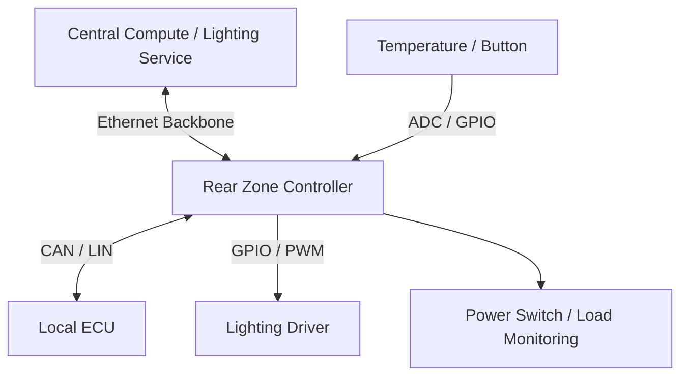

## Table of contents
{: .no_toc .text-delta }
- TOC
{:toc}
## Overview

Zonal Architecture는 차량의 물리적 영역별로 I/O·전원 분배·네트워크 접속을 모으고 중앙 연산 자원과 연결하는 구조다. Zone Controller는 단순 CAN-to-Ethernet 변환기가 아니라 로컬 제어·상태 관리·진단·전원 제어를 맡을 수 있다.

## Example Topology

## Interface Contract

입력 이벤트에는 Signal ID, Value, Unit, Timestamp, Sequence, Validity를 정의한다. 출력 명령에는 Request ID, Target, Value, Expiry와 승인·적용·실패 상태를 구분한다. 네트워크에 전송됐다는 사실과 실제 Actuator에 반영됐다는 사실은 다르다.

## Local vs Central

빠른 제어 루프·전류 제한·통신 단절 시 필요한 동작은 요구사항에 따라 로컬에 둔다. 중앙은 여러 Zone에 걸친 정책·사용자 설정을 담당할 수 있다. 모든 기능의 안전 상태가 Off인 것은 아니므로 조명·도어·전원 등 기능별 분석 결과를 따른다.

## Fault Injection

중앙 서비스 정지, Backbone 단절, Zone 재부팅, 센서 고정값, 전원 스위치 과전류를 각각 주입한다. 상태 전이가 구분되는지와 재연결 후 만료된 명령이 재실행되지 않는지 확인한다. ACK 누락이 발생했을 때 재전송이 중복 동작을 만들지 않도록 Request ID 처리 정책을 정한다.

## Timing Budget

센서 acquisition → MCU task 대기 → Gateway queue → Backbone → 중앙 처리 → 하행 전송 → 출력 반영으로 지연을 분해한다. 평균만 보지 말고 높은 부하·재연결 조건의 p99와 최악 관측값을 기록한다. 실측 최댓값은 WCET 증명과 다르다.

