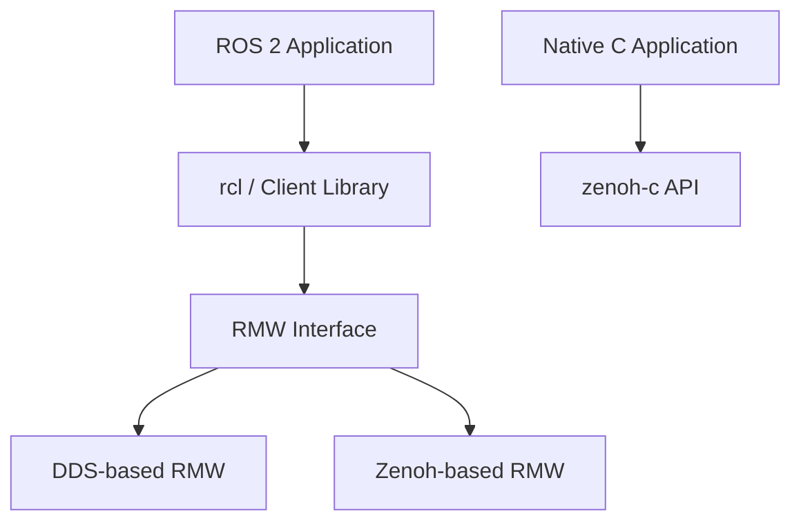

## Table of contents
{: .no_toc .text-delta }
- TOC
{:toc}
## Overview

ROS 2는 Node·Topic·Service·Action과 실행·개발 도구를 제공하는 생태계다. DDS는 ROS 2에서 많이 사용하는 통신 기반이고 Zenoh는 Pub/Sub·Query 등을 제공하는 별도 통신 기술다. 셋을 같은 계층으로 비교하지 않는다.

## Layer View

## Learning Exercise

같은 가상 온도 데이터를 ROS 2 Topic으로 전달한 뒤 Reliability·History·subscriber 종료 조건을 바꾸어 관찰한다. 이후 Zenoh 적용 시 native API, ROS bridge, RMW 교체 중 무엇을 비교할지 정한다. 서로 다른 경로의 결과를 단순히 프로토콜 속도 차이로 해석하지 않는다.

## Platform Boundary

ROS 2 전체 스택을 S32K312에 그대로 올리는 전제로 시작하지 않는다. MCU는 CAN/Ethernet adapter, 지원되는 micro-ROS 구성 또는 별도 IPC를 통해 Linux 애플리케이션과 연결할 수 있다. micro-ROS는 RTOS·transport·메모리·Agent 지원 여부와 실제 board port가 필요하다.

