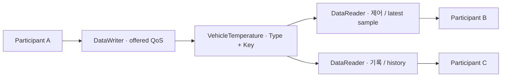
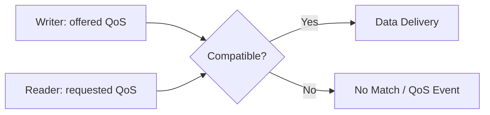

## 같은 온도를 빠른 제어기와 느린 기록기가 함께 구독하는 상황

DataWriter와 DataReader가 같은 Topic을 사용해도 타입, 발견 경로, 요청·제공 QoS가 맞아야 연결된다. 최신값이 중요한 제어와 모든 기록이 중요한 저장 작업은 같은 데이터를 보면서도 다른 자원·지연 정책을 요구한다.

## 한 Topic, 서로 다른 소비자

VehicleTemperature Topic을 제어 task와 logger가 함께 읽는다고 하자. 제어는 최신 sample을 제시간에 받는 것이 중요하고 logger는 누락된 sample을 복구하는 것이 중요할 수 있다. Topic과 type이 같아도 두 소비자의 전달·저장 요구는 다르다.



그림 1. DDS의 논리적 data space. Topic은 중앙 server 자체가 아니며, 발견과 실제 data 전달 경로는 구현·설정에 따라 달라진다.

| 개념 | 의미 | 온도 사례 |
| --- | --- | --- |
| DomainParticipant | DDS domain에 참여하는 entity | ECU 또는 process의 참여 단위 |
| Topic / Type | 데이터 이름과 구조 | VehicleTemperature와 sensor·sequence·temperature 필드 |
| Key / Instance | 같은 Topic 안의 논리 객체 식별 | sensor_id를 key로 정하면 sensor별 instance 구분 |
| DataWriter | Sample 제공 endpoint | Sensor producer |
| DataReader | Sample 소비 endpoint | 제어와 logger의 각 endpoint |

자체 8-byte packet을 쓰던 프로그램을 DDS로 옮길 때는 그 byte 배열을 그대로 DDS wire format이라고 해석해서는 안 된다. DDS type, representation과 key를 정의하고 serialization은 사용하는 DDS 구현의 계약에 맞춘다.

## QoS의 질문을 분리하기

| QoS | 답하는 질문 | 함께 고려할 비용 |
| --- | --- | --- |
| Reliability | 손실을 복구하려고 시도하는가? | 재전송·지연·writer/reader resource |
| Durability | 늦게 참가한 reader가 이전 값을 받을 수 있는가? | 보관 범위·lifetime·구현 지원 |
| History / ResourceLimits | 어떤 sample을 얼마나 저장하는가? | Instance 수·sample 수·메모리 |
| Deadline | 기대한 갱신 간격이 지켜지는가? | Missed event 처리와 application 반응 |
| Lifespan | 오래된 sample을 언제 무효화하는가? | 최신성 요구와 유효 데이터 감소 |
| Liveliness | Writer의 생존성을 어떻게 관찰하는가? | Lease 시간·탐지 지연·false alarm |

Deadline은 CPU task의 deadline scheduling을 제공하는 정책이 아니다. Liveliness 역시 센서가 올바른 값을 측정했는지 보장하지 않는다. Middleware가 관찰한 endpoint 상태와 application의 health 판단은 별개다.

## Match와 데이터 품질을 따로 검증하기

먼저 domain·Topic·type과 requested/offered QoS compatibility를 확인한다. 그 다음 data가 전달되는 상태에서 loss, burst와 느린 consumer를 주입한다. Match가 성립하는 것과 전달된 sample이 제어에 사용할 만큼 최신인 것은 다른 조건이다.

예를 들어 100 Hz sample의 Keep Last depth가 10이라면 단순한 주기 계산으로 100 ms 분량을 떠올릴 수 있지만, 실제 memory 한계와 reader 처리, per-instance history 및 middleware 동작에 따라 결과가 달라진다. Depth를 latency 보장값으로 사용하지 않고 timestamp와 sequence로 실제 Age를 관찰한다.


> DDS는 Data-Centric Publish/Subscribe 통신 모델과 QoS를 제공한다. ROS 2의 많은 RMW 구현이 DDS를 사용하지만 모든 RMW가 DDS를 사용하는 것은 아니다. Discovery 성공과 데이터 전달 성공은 별도로 확인한다.


## QoS Contract


Reliability는 Best Effort/Reliable, Durability는 늦게 참가한 reader에게 이전 값을 제공할지에 관한 정책이다. History/Depth는 저장 이력 범위를 결정한다. Deadline, Lifespan, Liveliness는 기대 주기·데이터 유효기간·writer 생존성 관찰에 관련된다. 지원 범위와 이벤트 처리 방식은 RMW와 버전에 따른다.


## Practical Profiles


빠르게 갱신되는 온도·위치 센서는 오래된 데이터 재전송보다 최신값이 중요할 수 있다. 설정값은 늦게 참가한 Node가 최근 상태를 필요로 할 수 있다. 명령은 Reliable을 사용해도 최종 적용 ACK·중복 처리·만료 정책이 별도로 필요하다.





## CLI Practice


Publisher의 실제 QoS를 먼저 확인하고 subscriber를 맞춘다. Best Effort writer에 Reliable reader를 요청하면 Reliability 요구가 충족되지 않을 수 있다.


```bash
ros2 topic info /chatter --verbose
ros2 topic echo /chatter --qos-reliability best_effort
```


## Resource Budget


메시지 크기×History Depth×연결 수는 메모리·대기열 부하를 증가시킨다. Reliable 재전송과 느린 reader의 영향을 부하 시험으로 관찰한다. Depth를 무작정 늘려 오래된 데이터의 Age를 키우지 않는다.


## Verification


의도적으로 Reliability를 불일치시킨 경우와 일치시킨 경우를 비교한다. subscriber 재시작, packet loss, burst, CPU 지연 조건에서 전달률·최신 데이터 Age·메모리 사용량을 기록한다. QoS 설정은 Safety 메커니즘이나 네트워크 인증을 대체하지 않는다.

## 이해를 확인하는 질문

> Reliable이면 센서값이 항상 최신일까?

재전송은 전달 가능성을 높이지만 대기열과 복구 시간이 늘 수 있다. sequence와 timestamp로 누락과 Age를 따로 측정하고 History·Lifespan·처리 속도를 함께 정한다.
