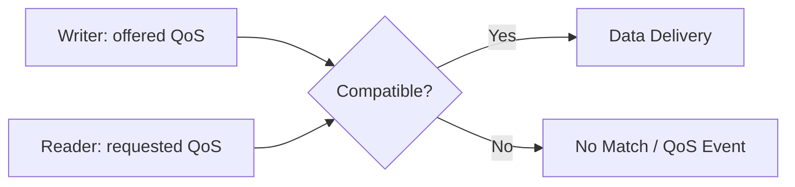

## Table of contents
{: .no_toc .text-delta }
- TOC
{:toc}
## Overview


> DDS는 Data-Centric Publish/Subscribe 통신 모델과 QoS를 제공한다. ROS 2의 많은 RMW 구현이 DDS를 사용하지만 모든 RMW가 DDS를 사용하는 것은 아니다. Discovery 성공과 데이터 전달 성공은 별도로 확인한다.


## QoS Contract


Reliability는 Best Effort/Reliable, Durability는 늦게 참가한 reader에게 이전 값을 제공할지에 관한 정책이다. History/Depth는 저장 이력 범위를 결정한다. Deadline, Lifespan, Liveliness는 기대 주기·데이터 유효기간·writer 생존성 관찰에 관련된다. 지원 범위와 이벤트 처리 방식은 RMW와 버전에 따른다.


## Practical Profiles


빠르게 갱신되는 온도·위치 센서는 오래된 데이터 재전송보다 최신값이 중요할 수 있다. 설정값은 늦게 참가한 Node가 최근 상태를 필요로 할 수 있다. 명령은 Reliable을 사용해도 최종 적용 ACK·중복 처리·만료 정책이 별도로 필요하다.





## CLI Practice


Publisher의 실제 QoS를 먼저 확인하고 subscriber를 맞춘다. Best Effort writer에 Reliable reader를 요청하면 Reliability 요구가 충족되지 않을 수 있다.


```bash
ros2 topic info /chatter --verbose
ros2 topic echo /chatter --qos-reliability best_effort
```


## Resource Budget


메시지 크기×History Depth×연결 수는 메모리·대기열 부하를 증가시킨다. Reliable 재전송과 느린 reader의 영향을 부하 시험으로 관찰한다. Depth를 무작정 늘려 오래된 데이터의 Age를 키우지 않는다.


## Verification


의도적으로 Reliability를 불일치시킨 경우와 일치시킨 경우를 비교한다. subscriber 재시작, packet loss, burst, CPU 지연 조건에서 전달률·최신 데이터 Age·메모리 사용량을 기록한다. QoS 설정은 Safety 메커니즘이나 네트워크 인증을 대체하지 않는다.
