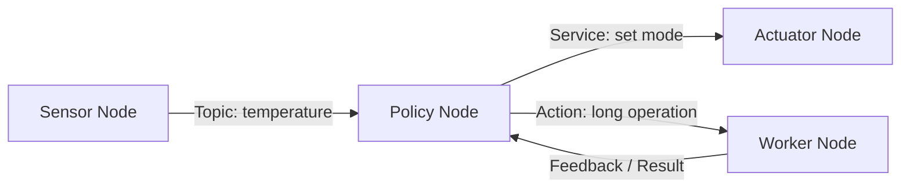

## Table of contents
{: .no_toc .text-delta }
- TOC
{:toc}
## Overview


> ROS 2는 로봇·분산 시스템의 Node와 통신·도구를 제공한다. ROS 1과 달리 RMW 추상화와 분산 Discovery 등을 사용하지만 hard real-time이나 차량 Safety 적합성을 자동 보장하지 않는다. 새 학습은 ROS 2를 중심으로 하고 ROS 1은 기존 시스템 이관 시 별도로 비교한다.


## Node and Interface





## Topic / Service / Action


Topic은 지속적인 데이터 흐름, Service는 짧은 Request/Response, Action은 진행 상황·결과·취소가 필요한 장시간 작업에 적합하다. Blocking Service 처리로 Executor가 정지하지 않게 한다. Topic 이름뿐 아니라 메시지 타입과 QoS가 호환되어야 연결된다.


## CLI Practice


설치한 ROS 2 배포판의 setup.bash를 source하고 demo_nodes_cpp 패키지가 설치되어 있어야 한다. 아래 두 실행은 각각 다른 terminal에서 진행한다. ROS_DOMAIN_ID는 실습 분리용이며 보안 경계가 아니다.


```bash
# terminal A
export ROS_DOMAIN_ID=42
ros2 run demo_nodes_cpp talker
# terminal B: 같은 ROS 환경과 ROS_DOMAIN_ID 설정 후
export ROS_DOMAIN_ID=42
ros2 run demo_nodes_cpp listener
# terminal C
ros2 node list
ros2 topic list -t
ros2 topic info /chatter --verbose
ros2 topic echo /chatter
ros2 topic hz /chatter
```


## C Implementation Path


C API는 rcl을 기반으로 한다. micro-ROS/rclc를 사용하는 경우 제공되는 Executor와 Timer/Subscription 예제를 해당 배포판에 맞춰 사용한다. 본 CLI 실습은 설치된 C++ demo 실행이며 사용자 구현 예제를 C++로 전환하라는 뜻은 아니다. MCU용 실제 C 초기화 코드는 지원 RTOS·transport·allocator가 확정된 후 작성한다.


## Executor and Callback


Single-threaded Executor에서도 callback이 오래 걸리면 다른 callback 처리 지연이 커진다. Multi-threaded Executor에서는 Callback Group과 Shared State 보호가 필요하다. 모든 callback을 병렬화하는 대신 처리 시간·ownership을 먼저 설계한다.


## Verification


Node 종료·재시작, 서로 다른 Domain, QoS 불일치, subscriber 처리 지연, 네트워크 인터페이스 변경을 시험한다. topic hz는 관측 지점의 수신 빈도이며 원래 센서 sampling 주기나 End-to-End Latency를 직접 증명하지 않는다.
