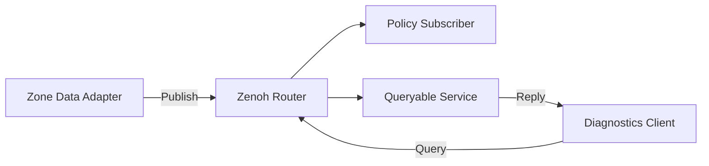

## Table of contents
{: .no_toc .text-delta }
- TOC
{:toc}
## Overview

> Zenoh는 Key Expression을 기반으로 Pub/Sub·Query 등을 제공하는 통신 기술다. Router/Peer/Client 배치와 네트워크 조건에 따라 동작을 설계한다. ROS 2 연동과 native Zenoh 애플리케이션은 서로 다른 통합 경로다.

## Example Topology

## Key and Payload Design

예: vehicle/testcar/zone/rear/temperature. 차량·Zone·신호를 분리하고 wildcard 구독 범위와 권한을 설계한다. Payload에는 단위·timestamp·sequence·validity·schema를 넣는다. Key에 민감 정보나 매번 바뀌는 무제한 식별자를 넣으면 관리가 어려워진다.

## Three ROS Integration Paths

Native zenoh-c는 C 애플리케이션이 Zenoh Session·Publisher·Subscriber를 직접 사용한다. ROS bridge는 기존 ROS 측과 Zenoh 네트워크 사이를 연결하며 지원되는 interface·type·QoS 범위를 확인해야 한다. rmw_zenoh 경로는 ROS 2의 RMW를 바꾸는 방식이므로 해당 ROS 배포판과 패키지 조합을 따른다. 이 세 경로의 topology·discovery·serialization 비용은 같지 않다.

## C Practice Plan

zenoh-c의 release/tag를 고정하고 함께 제공되는 C Publisher/Subscriber 예제를 먼저 빌드한다. 같은 Key로 수신 확인 → payload에 sequence 추가 → Router 종료/재시작 → subscriber 재연결 순으로 검증한다. API와 owned/loaned handle 규칙은 버전에 따라 바뀔 수 있으므로 임의 버전의 초기화 코드를 섞지 않는다.

## Resource Ownership

Callback의 payload 포인터를 함수 종료 뒤에도 쓰려면 해당 API의 clone/copy와 수명 규칙을 따른다. Session 종료 전에 subscriber·publisher handle과 작업 thread의 종료 순서를 정한다. callback에서 오래 걸리는 연산 대신 bounded queue로 전달한다.

## Query vs Pub/Sub

Query는 Queryable의 응답을 요청하는 경로이며 모든 Publish 데이터를 자동으로 영구 저장하거나 재전송한다는 뜻은 아니다. 과거 데이터·late joiner 요구는 storage·cache·replay 기능과 지원 버전을 별도로 설계한다.

## Verification

Router 재시작·다중 경로·잘못된 endpoint·연결 단절·큰 payload·느린 subscriber를 시험한다. DDS와 비교할 때 같은 payload·QoS 의미·hop 수·보안·transport·CPU 조건을 맞춘다. 특정 기술이 항상 더 빠르다고 일반화하지 않는다.

