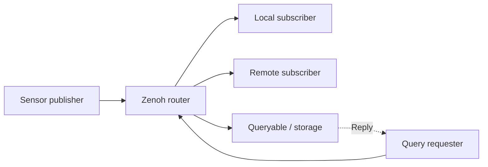
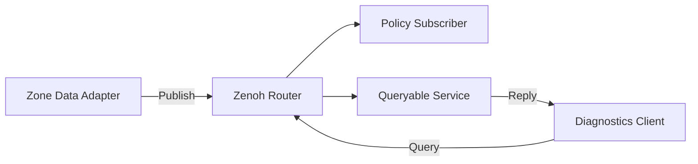

## 차량의 센서값을 로컬 제어와 원격 조회에 함께 사용하는 상황

Key expression은 데이터의 이름과 구독 범위를 결정하고 payload는 값의 형식을 결정한다. Pub/Sub의 실시간 전달과 Query의 요청·응답은 목적이 다르다. Router의 배치, 저장 주체, 연결 복구 정책을 합쳐야 데이터 경로를 설명할 수 있다.

## 데이터 이름과 전송 경로를 분리하기

vehicle/zone/front/temperature라는 key에 온도 sample을 발행한다고 하자. Key expression은 관심 범위를 표현하고 payload encoding은 값의 해석 규칙을 표현한다. 같은 key 이름만으로 단위, version이나 binary layout이 자동 합의되지는 않는다.

그림 1. Router를 경유하는 구성 예. Zenoh는 배치에 따라 peer/client/router 역할을 사용하며, 이 그림이 모든 설치에서 필수인 topology는 아니다.

| 경계 | 정할 항목 | 예시 |
| --- | --- | --- |
| Key | Namespace와 구독 범위 | vehicle/zone/front/temperature |
| Payload | Type, unit, byte order와 version | sensor_id, sequence, temperature, timestamp |
| Freshness | Sample의 생성 시점과 만료 | 재접속 뒤 오래된 값 제외 |
| Query | 응답 주체·대상·시간 제한 | 최근 저장값을 제공하는 queryable |
| Resource | Session·subscriber·buffer lifetime | 종료 시 callback과 buffer 접근 순서 |

## Pub/Sub과 Query는 다른 질문에 답한다

Pub/Sub은 발행되는 data를 관심 있는 subscriber에 전달한다. Query는 key에 대응하는 응답 주체에 데이터를 요청한다. Query로 과거 값을 얻으려면 그 값을 제공하는 queryable 또는 storage가 있어야 한다. Router 연결만으로 모든 sample의 영속 보관이 생기는 것은 아니다.

구독자가 재시작하면 새 sample을 기다릴지, Query로 최근 값을 가져온 뒤 live stream으로 전환할지 정해야 한다. 두 경로를 함께 사용할 때는 timestamp와 sequence를 이용해 중복과 역순 적용을 처리한다.

## ROS 2와 연결하는 세 가지 경계

| 방식 | 연결 경계 | 확인할 호환성 |
| --- | --- | --- |
| Native Zenoh application | Zenoh API와 application payload | Key·encoding·resource ownership |
| DDS / ROS bridge | 기존 DDS 또는 ROS graph와 Zenoh network 사이 | Bridge 지원 type·discovery·QoS mapping |
| Zenoh 기반 RMW | ROS 2 middleware abstraction 아래 | ROS 배포판·RMW 지원 API와 동작 |

세 방식은 package 설치 방법만 다른 동일 구성이 아니다. Application interface와 discovery, QoS 의미가 연결되는 위치가 다르므로 장애 관측 지점도 달라진다. Bridge를 사용하면서 native Zenoh 예제의 encoding을 그대로 ROS message type으로 해석해서는 안 된다.

## 최신값과 복구를 관찰하기

단일 정상 publish보다 router 재시작, subscriber 지연, link 단절 후 복구를 비교하는 것이 유용하다. 수신률과 별도로 sequence gap, data Age, memory 사용량과 재접속 시간을 기록한다. Reliable한 transport를 사용해도 application command의 만료·중복 방지·적용 확인은 별도 계약이다.

> Zenoh는 Key Expression을 기반으로 Pub/Sub·Query 등을 제공하는 통신 기술다. Router/Peer/Client 배치와 네트워크 조건에 따라 동작을 설계한다. ROS 2 연동과 native Zenoh 애플리케이션은 서로 다른 통합 경로다.

## Example Topology

## Key and Payload Design

예: vehicle/testcar/zone/rear/temperature. 차량·Zone·신호를 분리하고 wildcard 구독 범위와 권한을 설계한다. Payload에는 단위·timestamp·sequence·validity·schema를 넣는다. Key에 민감 정보나 매번 바뀌는 무제한 식별자를 넣으면 관리가 어려워진다.

## Three ROS Integration Paths

Native zenoh-c는 C 애플리케이션이 Zenoh Session·Publisher·Subscriber를 직접 사용한다. ROS bridge는 기존 ROS 측과 Zenoh 네트워크 사이를 연결하며 지원되는 interface·type·QoS 범위를 확인해야 한다. rmw_zenoh 경로는 ROS 2의 RMW를 바꾸는 방식이므로 해당 ROS 배포판과 패키지 조합을 따른다. 이 세 경로의 topology·discovery·serialization 비용은 같지 않다.

## C Practice Plan

zenoh-c의 release/tag를 고정하고 함께 제공되는 C Publisher/Subscriber 예제를 먼저 빌드한다. 같은 Key로 수신 확인 → payload에 sequence 추가 → Router 종료/재시작 → subscriber 재연결 순으로 검증한다. API와 owned/loaned handle 규칙은 버전에 따라 바뀔 수 있으므로 임의 버전의 초기화 코드를 섞지 않는다.

## Resource Ownership

Callback의 payload 포인터를 함수 종료 뒤에도 쓰려면 해당 API의 clone/copy와 수명 규칙을 따른다. Session 종료 전에 subscriber·publisher handle과 작업 thread의 종료 순서를 정한다. callback에서 오래 걸리는 연산 대신 bounded queue로 전달한다.

## Query vs Pub/Sub

Query는 Queryable의 응답을 요청하는 경로이며 모든 Publish 데이터를 자동으로 영구 저장하거나 재전송한다는 뜻은 아니다. 과거 데이터·late joiner 요구는 storage·cache·replay 기능과 지원 버전을 별도로 설계한다.

## Verification

Router 재시작·다중 경로·잘못된 endpoint·연결 단절·큰 payload·느린 subscriber를 시험한다. DDS와 비교할 때 같은 payload·QoS 의미·hop 수·보안·transport·CPU 조건을 맞춘다. 특정 기술이 항상 더 빠르다고 일반화하지 않는다.

## 이해를 확인하는 질문

> Router에 연결하면 과거 센서값도 조회할 수 있을까?

Router 자체가 모든 값을 자동 저장하는 것은 아니다. Queryable 또는 storage의 제공 범위, 데이터 수명, 응답 선택 정책을 정해야 한다.
