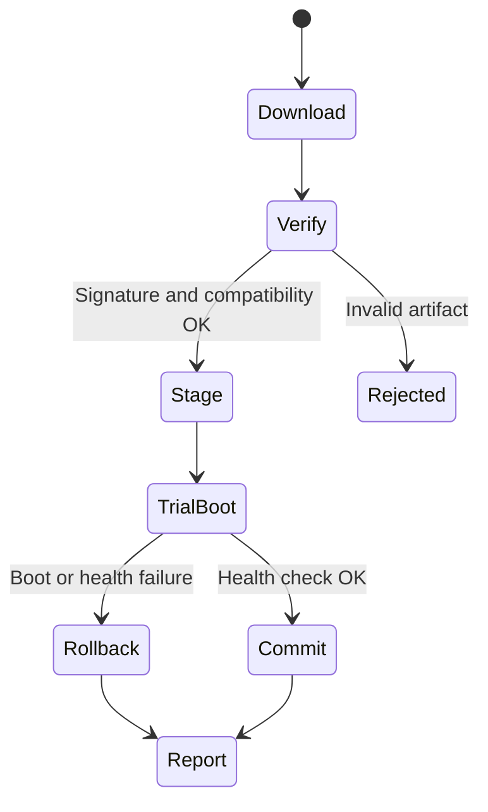

## 여러 ECU의 software를 순차적으로 업데이트하는 상황

Package 전달, 검증, 설치, 활성화와 rollback은 분리된 단계다. 중간 version 조합과 전원·통신 손실을 고려해야 전체 시스템이 일관된 상태로 복귀할 수 있다.

> OTA는 다운로드뿐 아니라 대상 호환성·서명 검증·설치·부팅·Health Check·Rollback을 포함하는 Lifecycle이다. 전송 암호화, Artifact 서명, Secure Boot, Anti-Rollback은 서로 다른 역할을 가진다.

## Update State Machine

## Practical Design

A/B partition은 가능한 설계 중 하나이며 S32K312의 flash 배치와 bootloader가 자동 지원한다고 가정하지 않는다. MCU와 중앙 SW의 dependency·최소 호환 버전·전원 조건·안전한 업데이트 시점을 manifest에 기록한다.

## Recovery Contract

trial boot 성공 판정 시점과 timeout, rollback 슬롯 유효성, boot counter, power-loss-safe metadata를 설계한다. 새 버전이 영구 데이터를 변경하면 코드만 되돌려도 예전 버전이 읽지 못할 수 있으므로 data migration과 rollback 호환성을 함께 설계한다.

## Security Boundaries

서명 검증은 신뢰된 공급자 확인, Secure Boot는 부팅 이미지 검증, Anti-Rollback은 허용되지 않은 구버전 부팅 방지를 담당한다. 정당한 복구 경로와 Anti-Rollback 정책이 충돌하지 않도록 키·version 정책을 설계한다. 비밀 키를 펌웨어 저장소에 넣지 않는다.

## Verification

각 상태에서 전원을 차단하고 재시작한다. 잘못된 서명·다른 하드웨어 이미지·부분 다운로드·저장 공간 부족·반복 부팅 실패를 시험한다. 업데이트 완료 응답뿐 아니라 실제 실행 버전·노드별 상태·복구 시간을 확인한다.

## 이해를 확인하는 질문

> Download가 완료되면 update 성공으로 기록해도 될까?

Activation과 재부팅 후 health, dependency version을 확인해야 한다. 저장 성공은 운용 성공과 다르다.

