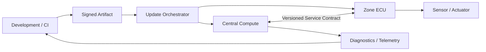

## Table of contents
{: .no_toc .text-delta }
- TOC
{:toc}
## Overview

> SDV(Software-Defined Vehicle)는 차량 기능을 소프트웨어로 지속적으로 개발·배포·관리할 수 있도록 하드웨어, 플랫폼, 서비스와 운영 체계를 설계하는 접근이다. ECU를 Linux 컴퓨터로 바꾸거나 OTA 기능 하나를 추가했다고 완성되는 것은 아니다.

## System View

## Practical Design

조명 색상 정책 변경을 예로 들면 UI·정책 소프트웨어만 업데이트하고 MCU의 전류 제한·출력 제어는 유지하도록 경계를 설계할 수 있다. 그러나 새로운 명령 필드나 의미 변경이 생기면 MCU와 중앙 소프트웨어의 호환성 계약도 바뀐다. 각 변경에서 배포 대상·최소 호환 버전·되돌리기 조건을 작성한다.

## Deployment Contract

Artifact ID, Software Version, Hardware Compatibility, Schema Version, Dependency, Signature와 Health Check를 release manifest로 관리한다. Version 문자열이 다르다는 이유만으로 호환 불가로 판단하지 말고 지원하는 메시지와 기능을 기준으로 결정한다.

## Verification

구버전 MCU+신버전 중앙 SW, 신버전 MCU+구버전 중앙 SW를 시험한다. 업데이트 도중 전원 중단, 통신 단절, 저장 공간 부족과 재부팅 반복을 주입한다. 기능 동작뿐 아니라 복구 시간·사용자 영향·실패 원인을 기록한다.

## Trade-offs

중앙 집중은 공통 기능 재사용에 유리하지만 장애 영향 범위와 자원 간섭이 커질 수 있다. 독립적인 제어·시간 제약·Safety 요구가 있는 기능을 무조건 중앙으로 옮기지 않는다. 기능 분할과 보안·안전 분석을 함께 수행한다.

