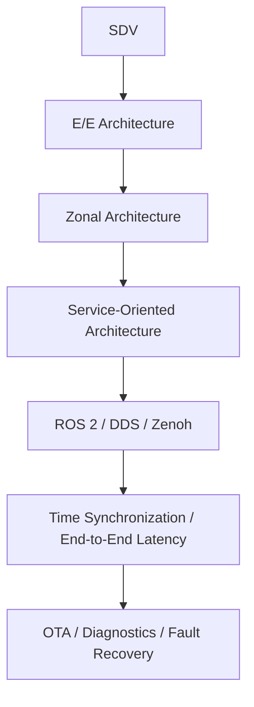

## Application부터 차량 I/O까지 책임을 배분하는 상황

SDV의 software lifecycle, E/E의 배치, middleware의 통신과 MCU의 제어는 같은 시스템을 다른 관점에서 설명한다. 각 경계의 입력·출력과 실패 조건을 연결해야 전체 동작을 이해할 수 있다.

> 차량 구조, Service 설계, Middleware, 배포·운영을 연결하는 학습 경로다. 기존 차량 통신 문서의 CAN·Ethernet·SOME/IP·TSN은 전송과 설정을 다루고, 이 목차는 시스템 전체에서 어떤 역할로 조합하는지 다룬다. S32K312는 MCU 주변 제어 예시이며 Linux·ROS 2 실행 환경과 동일하다고 가정하지 않는다.

## Learning Path

## Practice Scenario

Zone MCU가 버튼·온도 입력을 수집하고 Central Compute가 조명 정책을 계산한 뒤 Zone MCU가 RGB 출력에 반영하는 가상 시스템을 사용한다. 실제 차량 구현 경험이나 안전 인증을 의미하지 않는다. 메시지 단위·유효기간·Sequence·명령 ACK·오류 시 동작을 먼저 정하고 Middleware를 선택한다.

## Environment

MCU 쪽 구현 예제는 C를 우선한다. ROS 2 CLI·운영 명령은 셸 코드로 제공한다. ROS 2 실습은 설치된 배포판의 demo_nodes_cpp를 전제로 하며 실제 차량 제어 장치 대신 격리된 테스트 네트워크에서 진행한다. ROS 2의 RMW·Zenoh API는 설치 버전을 기록하고 해당 버전 문서에 맞춘다.

## 이해를 확인하는 질문

> 한 계층의 정상 동작으로 전체 기능의 정상성을 판단할 수 있을까?

경계를 통과하는 데이터의 의미, 시간과 유효성을 끝까지 확인해야 한다.
