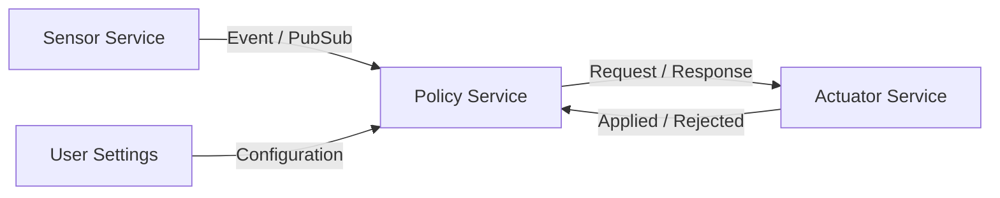

## 기능의 위치를 바꾸어도 consumer가 같은 의미로 사용하는 상황

Service contract는 이름과 endpoint뿐 아니라 데이터 타입, timing, error와 version을 포함한다. 위치 독립성은 실행 순서와 장애 처리를 없애지 않는다.

> SOA(Service-Oriented Architecture)는 기능을 명시적인 Interface와 계약으로 제공하는 설계 방식이다. 서비스 구현 위치와 사용자를 분리하되 Versioning·Discovery·Timeout·권한·실패 처리를 함께 정의한다.

## Communication Patterns

## Contract Example

SetAmbientColor 요청에 request_id, zone_id, RGB 값의 범위·색 공간, transition_ms, expiry를 정의한다. 응답은 수신됨·검증 통과·출력 반영됨을 구분한다. 상태 Event는 현재 색·전원 상태·fault·timestamp를 제공한다. 문자열 명령만 전송하고 단위와 범위를 암묵적으로 공유하지 않는다.

## Versioning

필드 추가 시 기본값·구버전 reader 동작을 정한다. 필드 삭제·단위 변경·enum 의미 변경은 호환성 파괴가 될 수 있다. Capability 조회와 Schema Version을 활용하되 지원하지 않는 기능은 명시적으로 거절한다.

## Choosing Middleware

SOME/IP, DDS, Zenoh 등은 동일한 API를 가진 대체품이 아니다. Discovery, Data Model, QoS, 실행 환경, 보안·운영 도구와 통합 비용을 비교한다. 서비스 계약을 먼저 작성하고 transport adapter가 serialization·reconnect·timeout을 담당하도록 분리한다.

## C Boundary

C 구조체의 메모리를 그대로 wire payload로 사용하지 않는다. 고정 폭 정수, 명시적인 endianness, 길이 검증과 오류 코드를 사용한다. 공유 상태 수정은 owner task나 적절한 동기화로 보호한다. API 성공은 기능의 최종 성공과 구분한다.

## Verification

알 수 없는 enum, 이전 Schema, 중복 Request ID, 만료 요청, 재시작 중 요청과 늦게 도착한 응답을 시험한다. Interface unit test와 실제 network 단절 시험을 분리해 수행한다.

## 이해를 확인하는 질문

> Service discovery가 location dependency를 모두 해결할까?

주소 탐색은 해결해도 초기화 순서, 권한, version과 장애 복구 계약은 남는다.

