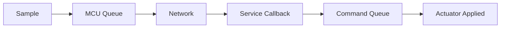

## Table of contents
{: .no_toc .text-delta }
- TOC
{:toc}
## Overview

> 분산 시스템에서는 Clock Synchronization과 Latency Measurement를 구분해야 한다. 서로 다른 장치의 timestamp를 빼려면 clock offset과 오차를 알아야 한다. 같은 장치의 timeout에는 역행 가능한 wall clock보다 monotonic clock을 사용한다.

## Timing Chain

## Budget Example

가상 목표 20 ms에 대해 acquisition 2, MCU queue 2, uplink 3, 중앙 처리 4, downlink 3, 출력 2, 여유 4 ms로 예산을 나눈다. 이는 설계 예제이며 실제 시스템의 보장값이 아니다. 각 구간에 timestamp와 sequence를 넣어 어느 구간이 초과하는지 확인한다.

## PTP / gPTP

IEEE 1588 PTP와 IEEE 802.1AS gPTP의 적용 profile·timestamp 지원·switch 역할을 확인한다. 시간 동기화만으로 TSN scheduling이나 bounded latency가 자동 제공되지는 않는다. Grandmaster 변경, link 재연결, sync loss 중 clock quality를 함께 전달한다.

## Measurement

동일 Clock의 구간 측정, 서로 다른 Clock 사이의 보정된 one-way 측정, round-trip 측정을 구분한다. RTT/2는 대칭 지연을 가정하므로 one-way 지연의 보장값이 아니다. p50/p95/p99, max observed, loss, 데이터 Age를 함께 기록한다.

## Verification

CPU 부하·혼잡·sync loss·clock step·Grandmaster 변경을 주입한다. 만료 명령 처리에 잘못된 wall clock을 쓰면 과거 명령이 살아나거나 정상 명령이 거절될 수 있으므로 timestamp domain을 명시한다.
