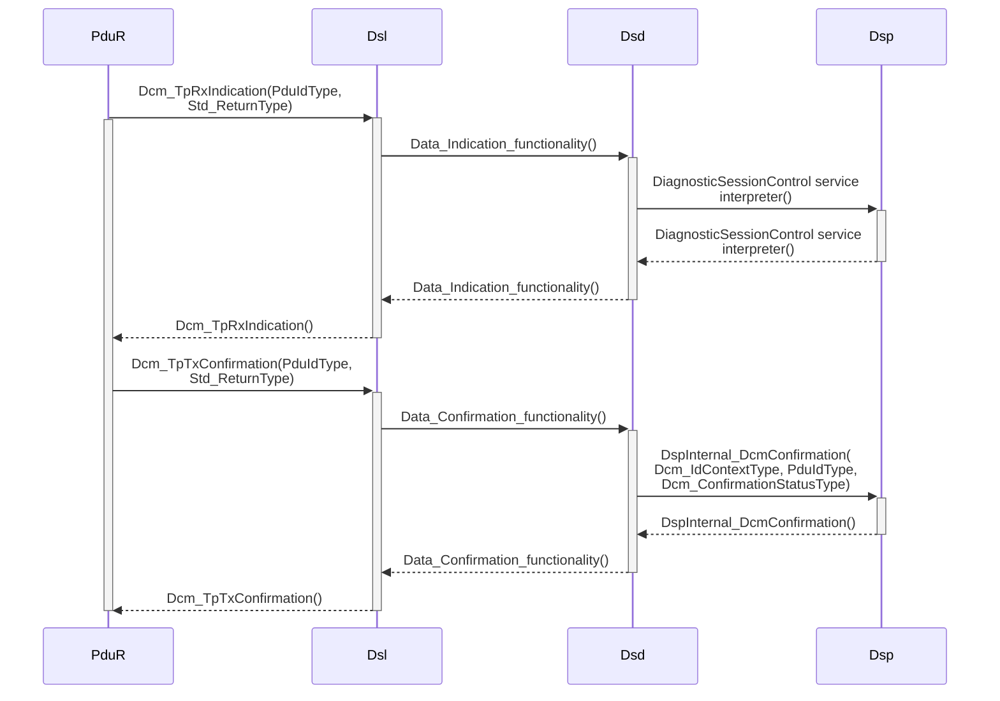
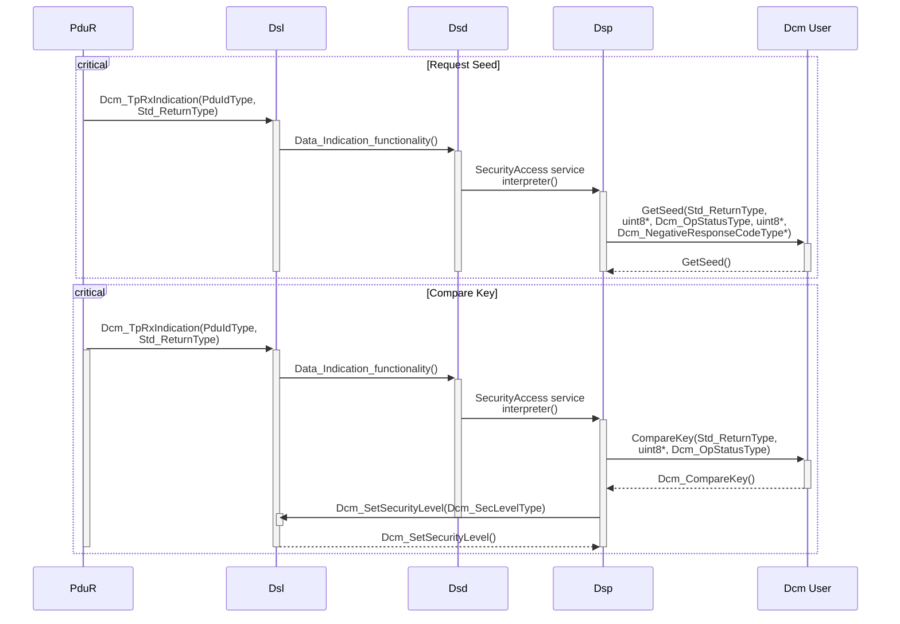
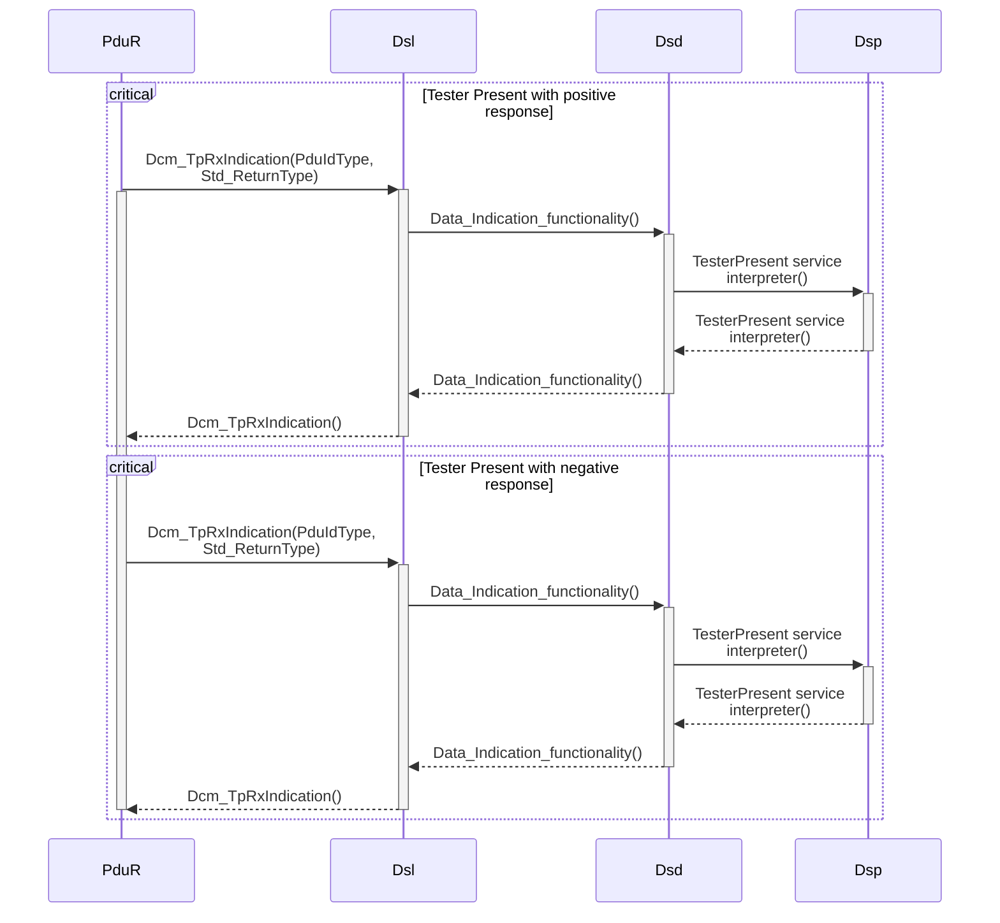

# UDS serivce Identifiers(SIDs)

| UDS SID (request) | UDS SID (response) | Service                                | Details                                                                 | Sub function types               | Sub function |
| ----------------- | ------------------ | -------------------------------------- | ----------------------------------------------------------------------- | -------------------------------- | ------------ |
| **0x10**          | **0x50**           | **Diagnostic Session Control**         | **Control which UDS services are available**                            | **Diagnostic session type**      | 0x01 - 0x04  |
| **0x11**          | **0x51**           | **ECU Reset**                          | **Reset the ECU (“hard reset”, “key off", “soft reset”)**               | **Reset type**                   | 0x01 - 0x05  |
| **0x27**          | **0x67**           | **Security Access**                    | **Enable use of security-critical services via authentication**         | **Security access type**         | 0x01 - 0x10  |
| **0x28**          | **0x68**           | **Communication Control**              | **Turn sending/receiving of messages on/off in the ECU**                | **Control type**                 | 0x00 - 0x03  |
| 0x29              | 0x69               | Authentication                         | Enable more advanced authentication vs. 0x27 (PKI based exchange)       |                                  |              |
| **0x3E**          | **0x7E**           | **Tester Present**                     | **Send a "heartbeat" periodically to remain in the current session**    | **“Zero Sub function”**          | 0x00         |
| **0x83**          | **0xC3**           | **Access Timing Parameters**           | **View/modify timing parameters used in client/server communication**   | **Timing parameter access type** | 0x01 - 0x02  |
| 0x84              | 0xC4               | Secured Data Transmission              | Send encrypted data via ISO 15764 (Extended Data Link Security)         |                                  |              |
| **0x85**          | **0xC5**           | **Control DTC Settings**               | **Enable/disable detection of errors (e.g. used during diagnostics)**   | **DTC setting type**             | 0x01 - 0x02  |
| **0x86**          | **0xC6**           | **Response On Event**                  | **Request that an ECU processes a service request if an event happens** | **Event type**                   | 0x00 - 0x02  |
| **0x87**          | **0xC7**           | **Link Control**                       | **Set the baud rate for diagnostic access**                             | **Link control type**            | 0x01 - 0x05  |
| 0x22              | 0x62               | Read Data By Identifier                | Read data from targeted ECU - e.g. VIN, sensor data values etc.         |                                  |              |
| 0x23              | 0x63               | Read Memory By Address                 | Read data from physical memory (e.g. to understand software behavior)   |                                  |              |
| 0x24              | 0x64               | Read Scaling Data By Identifier        | Read information about how to scale data identifiers                    |                                  |              |
| 0x2A              | 0x6A               | Read Data By Identifier Periodic       | Request ECU to broadcast sensor data at slow/medium/fast/stop rate      |                                  |              |
| **0x2C**          | **0x6C**           | **Dynamically Define Data Identifier** | **Define data parameter for use in 0x22 or 0x2A dynamically**           | **Definition type**              | 0x01 - 0x03  |
| 0x2E              | 0x6E               | Write Data By Identifier               | Program specific variables determined by data parameters                |                                  |              |
| 0x3D              | 0x7D               | Write Memory By Address                | Write information to the ECU's memory                                   |                                  |              |
| 0x14              | 0x54               | Clear Diagnostic Information           | Delete stored DTCs                                                      |                                  |              |
| **0x19**          | **0x59**           | **Read DTC Information**               | **Read stored DTCs, as well as related information**                    | **Report type**                  | 0x01 - 0x0D  |
| 0x2F              | 0x6F               | Input Output Control By Identifier     | Gain control over ECU analog/digital inputs/outputs                     |                                  |              |
| **0x31**          | **0x71**           | **Routine Control**                    | **Initiate/stop routines (e.g. self-testing, erasing of flash memory)** | **Routine control type**         | 0x01 - 0x03  |
| 0x34              | 0x74               | Request Download                       | Start request to add software/data to ECU (incl. location/size)         |                                  |              |
| 0x35              | 0x75               | Request Upload                         | Start request to read software/data from ECU (incl. location/size)      |                                  |              |
| 0x36              | 0x76               | Transfer Data                          | Perform actual transfer of data following use of 0x74/0x75              |                                  |              |
| 0x37              | 0x77               | Request Transfer Exit                  | Stop the transfer of data                                               |                                  |              |
| 0x38              | 0x78               | Request File Transfer                  | Perform a file download/upload to/from the ECU                          |                                  |              |
| 0x7F              | \<                 | Negative Response                      | Sent with a Negative Response Code when a request cannot be handled     |                                  |              |

### Diagnostic Session Control (0x10)

- ECU가 진단 모드로 전환
- 차량의 정상 모드에서 테스트 모드로 전환할 때 사용

<blockquote class="example">

📝 

0x10 - 진단 세션을 시작하여 ECU를 테스트 모드로 전환

</blockquote>

| Diagnostic session type (sub function value) | Diagnostic session              | Description                                      |
| ----------------------------------------------- | ------------------------------- | ------------------------------------------------ |
| 0x01                                            | Default Session                 | On Start of ECU, ECU runs in to default session. |
| 0x02                                            | Programming Session             | Used to upload software.                         |
| 0x03                                            | Extended Diagnostic Session     | Used to unlock additional diagnostic functions.  |
| 0x04                                            | Safety System Diagnostic System |                                                  |

### ECU Reset (0x11)

- ECU를 재설정
- 하드 리셋, 키 오프 또는 소프트 리셋을 포함

<blockquote class="example">

📝 

0x11 - 하드 리셋 명령을 보내 ECU를 재부팅

</blockquote>

| Reset type (sub function value) | Reset                         | Description                                              |
| ------------------------------- | ----------------------------- | -------------------------------------------------------- |
| 0x01                            | Hard Reset                    | Completely reboots the ECU.                              |
| 0x02                            | Key Off On Reset              | Simulates turning the key off and on, resetting the ECU. |
| 0x03                            | Soft Reset                    | Resets the ECU software without a full reboot.           |
| 0x04                            | Enable Rapid Power Shut Down  | Activates rapid power shut down.                         |
| 0x05                            | Disable Rapid Power Shut Down | Deactivates rapid power shut down.                       |

### Security Access (0x27)

- 보안이 중요한 서비스를 사용하기 위해 인증을 활성화

<blockquote class="example">

📝 

0x27 - ECU 보안 접근을 위해 암호화된 키를 요청

</blockquote>

| Security Access type (Sub function value)                 | Security Access | Description                                      |
| ------------------------------------------------------------ | --------------- | ------------------------------------------------ |
| 0x01 0x03 0x05 0x07 0x09 0x0B 0x0D 0x0F | Request Seed    | Requests a seed for security access.             |
| 0x02 0x04 0x06 0x08 0x0A 0x0C 0x0E 0x10 | Send Key        | Sends a key corresponding to the requested seed. |

### Communication Control (0x28)

- ECU의 메시지 송수신 기능을 켜거나 끔

<blockquote class="example">

📝 

0x28 - ECU의 모든 통신을 비활성화

</blockquote>

| Control type (Sub function value) | Control                  | Description                                        |
| ------------------------------------ | ------------------------ | -------------------------------------------------- |
| 0x00                                 | Enable Rx and Tx         | Enables both reception (Rx) and transmission (Tx). |
| 0x01                                 | Enable Rx and Disable Tx | Enables reception and disables transmission.       |
| 0x02                                 | Disable Rx and Enable Tx | Disables reception and enables transmission.       |
| 0x03                                 | Disable Rx and Tx        | Disables both reception and transmission.          |

### Authentication (0x29)

- 더 발전된 인증 절차를 사용하여 ECU에 접근

<blockquote class="example">

📝 

0x29 - PKI 기반 인증을 사용하여 ECU 접근을 요청

</blockquote>

### Tester Present (0x3E)

- 현재 세션을 유지하기 위해 주기적으로 “Heart Beat" 메시지를 전송

<blockquote class="example">

📝 

0x3E - ECU가 현재 세션을 종료하지 않도록 Heart Beat를 전송

</blockquote>

| (Sub function value) | function          | Description                      |
| -------------------- | ----------------- | -------------------------------- |
| 0x00                 | Zero Sub-Function | Indicates the tester is present. |
|                      |                   |                                  |

### Access Timing Parameters (0x83)

- 클라이언트/서버 통신에 사용되는 타이밍 매개변수를 조회하거나 수정

<blockquote class="example">

📝 

0x83 - 타이밍 매개변수를 수정하여 통신 지연 시간을 줄임

</blockquote>

| Timing parameter access Type (Sub function value) | Timing parameter access | Description                          |
| ---------------------------------------------------- | ----------------------- | ------------------------------------ |
| 0x01                                                 | Set Timing Parameters   | Sets specific timing parameters.     |
| 0x02                                                 | Get Timing Parameters   | Retrieves current timing parameters. |

### Secured Data Transmission (0x84)

- ISO 15764를 통해 암호화된 데이터를 전송

<blockquote class="example">

📝 

0x84 - 암호화된 진단 데이터를 ECU에 전송

</blockquote>

### Control DTC Settings (0x85)

- 오류 감지를 활성화하거나 비활성화

<blockquote class="example">

📝 

0x85 - 특정 오류 코드 감지를 비활성화

</blockquote>

| DTC Setting type (Sub function value) | DTC Setting     | Description              |
| ---------------------------------------- | --------------- | ------------------------ |
| 0x01                                     | DTC Setting On  | Activates DTC setting.   |
| 0x02                                     | DTC Setting Off | Deactivates DTC setting. |

### Response On Event (0x86)

- 이벤트가 발생했을 때 ECU가 서비스 요청을 처리하도록 요청

<blockquote class="example">

📝 

0x86 - 특정 조건이 만족되면 ECU가 응답하도록 설정

</blockquote>

| Event type (Sub function value) | Event                            | Description                                              |
| ---------------------------------- | -------------------------------- | -------------------------------------------------------- |
| 0x00                               | Report Events                    | Sends a response when specified events occur.            |
| 0x01                               | Clear Event Reporting            | Disables event reporting.                                |
| 0x02                               | Report Events with Enhanced Data | Sends a response with additional data when events occur. |

### Link Control (0x87)

- 진단 액세스를 위한 통신 속도를 설정

<blockquote class="example">

📝 

0x87 - ECU와의 통신 속도를 500 kbps로 설정

</blockquote>

| Link control type (Sub function value) | Link control                     | Description                     |
| ----------------------------------------- | -------------------------------- | ------------------------------- |
| 0x01                                      | Verify Link Control              | Verifies the link status.       |
| 0x02                                      | Transition to Communication Mode | Switches to communication mode. |
| 0x03                                      | Transition to Link Control Mode  | Switches to link control mode.  |
| 0x04                                      | Transition to Sleep Mode         | Switches to sleep mode.         |
| 0x05                                      | Terminate Communication          | Ends the communication session. |

### Read Data By Identifier (0x22)

- 타겟 ECU로부터 데이터를 읽어옴

<blockquote class="example">

📝 

0x22 - 차량의 VIN 번호를 ECU로부터 읽어옴

</blockquote>

### Read Memory By Address (0x23)

- 타켓 ECU로부터 물리적 메모리에서 데이터를 읽어옴

<blockquote class="example">

📝 

0x23 - ECU의 특정 메모리 주소에서 데이터를 읽어옴

</blockquote>

### Read Scaling Data By Identifier (0x24)

- 데이터 식별자의 스케일링 정보를 읽어옴 

<blockquote class="example">

📝 

0x24 - 센서 데이터의 스케일링 정보를 조회

</blockquote>

### Read Data By Identifier Periodic (0x2A)

- ECU에 센서 데이터를 주기적으로 방송하도록 요청

<blockquote class="example">

📝 

0x2A - ECU가 센서 데이터를 초당 1회 주기로 방송하도록 설정

</blockquote>

### Dynamically Define Data Identifier (0x2C)

- 0x22 또는 0x2A에서 동적으로 사용할 데이터 매개변수를 정의

<blockquote class="example">

📝 

0x2C - 새로운 데이터 식별자를 동적으로 정의

</blockquote>

| Definition type (Sub function value) | Definition                                | Description                                                       |
| --------------------------------------- | ----------------------------------------- | ----------------------------------------------------------------- |
| 0x01                                    | Define By Identifier                      | Defines a data identifier dynamically using existing identifiers. |
| 0x02                                    | Define By Memory Address                  | Defines a data identifier dynamically using memory addresses.     |
| 0x03                                    | Clear Dynamically Defined Data Identifier | Clears previously defined data identifiers.                       |

### Write Data By Identifier (0x2E)

- 데이터 매개변수에 의해 결정된 특정 변수를 프로그래밍

<blockquote class="example">

📝 

0x2E - ECU의 특정 설정 값을 업데이트

</blockquote>

### Write Memory By Address (0x3D)

- ECU 메모리에 정보를 작성

<blockquote class="example">

📝 

0x3D - ECU의 특정 메모리 위치에 데이터를 작성

</blockquote>

### Clear Diagnostic Information (0x14)

- 저장된 DTC(진단 트러블 코드)를 삭제

<blockquote class="example">

📝 

0x14 - ECU에서 모든 DTC를 삭제

</blockquote>

### Read DTC Information (0x19)

- 저장된 DTC와 관련 정보를 읽어옴

<blockquote class="example">

📝 

0x19 - ECU에서 현재 저장된 모든 DTC를 읽어옴

</blockquote>

| Report type (sub function value) | Report                                     | Description                                                                |
| ----------------------------------- | ------------------------------------------ | -------------------------------------------------------------------------- |
| 0x01                                | Number of DTC by Status Mask               | Reports the number of DTCs matching the status mask.                       |
| 0x02                                | DTC by Status Mask                         | Reports the DTCs matching the status mask.                                 |
| 0x03                                | DTC Snapshot Identification                | Reports the identification of DTC snapshots.                               |
| 0x04                                | DTC Snapshot Record by DTC Number          | Reports the snapshot records by DTC number.                                |
| 0x05                                | DTC Stored Data by Record Number           | Reports the stored DTC data by record number.                              |
| 0x06                                | DTC Extended Data Record by DTC Number     | Reports the extended data records by DTC number.                           |
| 0x07                                | Number of DTC by Severity Mask Record      | Reports the number of DTCs matching the severity mask.                     |
| 0x08                                | DTC by Severity Mask Record                | Reports the DTCs matching the severity mask.                               |
| 0x09                                | Severity Information of DTC                | Reports the severity information of a specific DTC.                        |
| 0x0A                                | Supported DTC                              | Reports the supported DTCs.                                                |
| 0x0B                                | First Failed DTC                           | Reports the first failed DTC.                                              |
| 0x0C                                | First Confirmed DTC                        | Reports the first confirmed DTC.                                           |
| 0x0D                                | Most Recent Failed DTC                     | Reports the most recent failed DTC.                                        |
| 0x0E                                | Most Recent Confirmed DTC                  | Reports the most recent confirmed DTC.                                     |
| 0x0F                                | Mirror Memory DTC by Status Mask           | Reports the mirror memory DTCs matching the status mask.                   |
| 0x10                                | Mirror Memory DTC by DTC Number            | Reports the mirror memory DTCs by DTC number.                              |
| 0x11                                | Number of Mirror Memory DTC by Status Mask | Reports the number of mirror memory DTCs matching the status mask.         |
| 0x12                                | Number of Emissions OBD DTC by Status Mask | Reports the number of emissions-related OBD DTCs matching the status mask. |
| 0x13                                | Emissions OBD DTC by Status Mask           | Reports the emissions-related OBD DTCs matching the status mask.           |
| 0x14                                | DTC Fault Detection Counter                | Reports the DTC fault detection counter.                                   |
| 0x15                                | DTC with Permanent Status                  | Reports the DTCs with permanent status.                                    |
| 0x16                                | DTC Extended Data Record by Record Number  | Reports the extended data records by record number.                        |
| 0x17                                | User Defined Memory DTC by Status Mask     | Reports the user-defined memory DTCs matching the status mask.             |
| 0x18                                | User Defined Memory DTC Snapshot by Number | Reports the user-defined memory DTC snapshots by number.                   |
| 0x19                                | User Defined Memory DTC Record by Number   | Reports the user-defined memory DTC records by number.                     |
| 0x42                                | WWH-OBD DTC by Status Mask Record          | Reports the WWH-OBD DTCs matching the status mask.                         |
| 0x55                                | WWH-OBD DTCs with Permanent Status         | Reports the WWH-OBD DTCs with permanent status.                            |

### Input Output Control By Identifier (0x2F)

- ECU 아날로그/디지털 입력/출력을 제어

<blockquote class="example">

📝 

0x2F - 특정 출력 핀을 활성화

</blockquote>

### Routine Control (0x31)

- 테스트 루틴을 시작하거나 중지합니다 (예: 자가 테스트, 플래시 메모리 지우기)

<blockquote class="example">

📝 

 0x31 - ECU의 자가 테스트 루틴을 시작

</blockquote>

| Routine control type (Sub function value) | Routine control         | Description                                  |
| -------------------------------------------- | ----------------------- | -------------------------------------------- |
| 0x01                                         | Start Routine           | Starts a specified routine.                  |
| 0x02                                         | Stop Routine            | Stops a specified routine.                   |
| 0x03                                         | Request Routine Results | Requests the results of a specified routine. |

### Request Download (0x34)

- ECU에 소프트웨어/데이터 추가를 요청합니다 (위치/크기 포함)

<blockquote class="example">

📝 

0x34 - ECU에 새로운 소프트웨어를 다운로드

</blockquote>

### Request Upload (0x35)

- ECU에서 소프트웨어/데이터를 읽어오도록 요청합니다 (위치/크기 포함)

<blockquote class="example">

📝 

0x35 - ECU에서 데이터를 업로드

</blockquote>

### Transfer Data (0x36)

- 0x74/0x75 명령 후 실제 데이터를 전송

<blockquote class="example">

📝 

0x36 - ECU로 데이터 전송을 수행

</blockquote>

### Request Transfer Exit (0x37)

- 데이터 전송을 중지

<blockquote class="example">

📝 

0x37 - 현재 진행 중인 데이터 전송을 중지

</blockquote>

### Request File Transfer (0x38)

- ECU와의 파일 다운로드/업로드를 수행

<blockquote class="example">

📝 

0x38 - ECU와 파일 업로드를 수행

</blockquote>

### Negative Response (0x7F)

- 요청이 처리될 수 없을 때 부정 응답 코드와 함께 전송

<blockquote class="example">

📝 

0x7F - 요청된 서비스가 지원되지 않는 경우 부정 응답을 반환

</blockquote>

