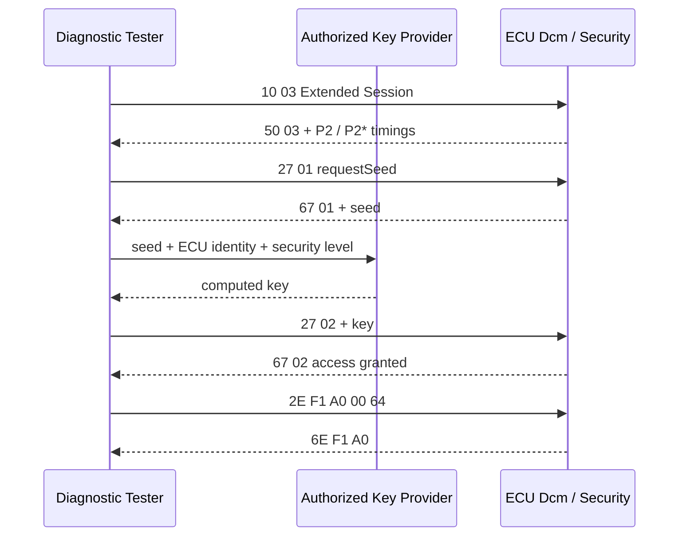
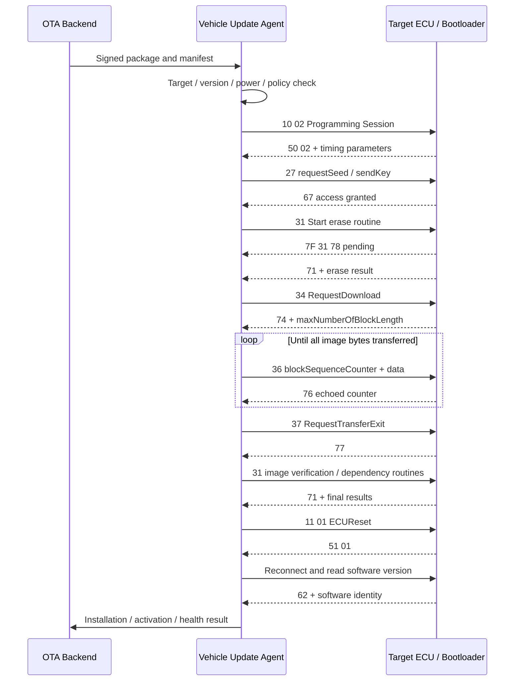

## Table of contents
{: .no_toc .text-delta }
- TOC
{:toc}
## 실제 UDS 진단 흐름


> 진단은 SID 하나를 보내는 작업이 아니라 Session·Security level·ECU 동작 조건을 맞추고, 요청과 최종 응답을 확인하면서 상태를 전환하는 과정이다. 여기서는 설정값 읽기·쓰기와 firmware update를 하나의 통신 흐름으로 연결한다.


## 예제의 주소와 데이터 범위


아래 Hex는 ISO-TP 재조립 이후의 UDS payload다. CAN ID, PCI, padding은 포함하지 않는다. Tester → ECU는 요청, ECU → Tester는 응답이다. Bench의 physical addressing을 사용하며 ECU 진단 사양에서 지원 Session, DID, Security level, Routine ID와 NRC 우선순위를 먼저 확인한다.


| 항목             | 예제와 적용 범위                                                                                                      |
| -------------- | -------------------------------------------------------------------------------------------------------------- |
| CAN 주소         | 설명용 Tester Tx 0x7E0 / ECU Tx 0x7E8. 실제 주소·11/29-bit·CAN FD 설정은 ECU 사양에 따른다.                                    |
| Session        | 0x03 Extended, 0x02 Programming. 진입 조건과 전환 순서는 ECU별로 다르다.                                                      |
| SecurityAccess | 0x01 requestSeed / 0x02 sendKey는 예시 level이다. Extended와 Programming에서 같은 level이 허용된다고 가정하지 않는다.                 |
| DID            | 0xF190은 VIN 읽기 예시. 0xF1A0은 이 문서에서 정의한 2-byte 설정값 예시이며 범용 표준 설정값이 아니다.                                          |
| Routine ID     | 0xF000 erase, 0xF001 image verify, 0xF002 dependency check는 설명용 OEM 정의다. 실제 ECU의 ID·option/status record로 바꾼다. |
| Firmware 주소    | 0x00100000과 16-byte 데이터는 전송 계산용 가상 값이다. 실제 flash layout이나 유효한 서명 이미지가 아니다.                                     |


예제의 성공 응답은 기대 trace이며 실제 측정 로그가 아니다. Security key는 승인된 OEM 알고리즘·보안 서비스로 계산한다. 아래 seed/key 바이트는 길이와 순서를 보여주는 가상 값이며 둘 사이의 계산 관계를 정의하지 않는다.


## 1. DiagnosticSessionControl로 진단 상태 진입


| 방향           | UDS payload       | 해석과 다음 동작                                                      |
| ------------ | ----------------- | -------------------------------------------------------------- |
| Tester → ECU | 10 03             | SID 0x10, Extended Diagnostic Session 요청                       |
| ECU → Tester | 50 03 00 32 01 F4 | Session 전환 성공. P2Server_max=50 ms, P2*Server_max=500×10 ms=5 s |
| Tester → ECU | 3E 00             | 응답을 요구하는 TesterPresent                                         |
| ECU → Tester | 7E 00             | TesterPresent 정상 응답                                            |


Client timeout은 서버의 P2/P2* 값에 transport/network 여유를 반영해 설정한다. S3Server는 이 0x50 응답에 포함되지 않는다. Session 유지 주기는 ECU 사양에 따라 S3보다 충분히 짧게 정한다. 3E 80은 suppressPosRspMsgIndicationBit를 사용하므로 positive response가 없는 것이 정상일 수 있다.


장시간 요청을 기다리는 동안 다른 진단 요청을 임의로 끼워 넣지 않는다. TesterPresent 병행 여부·physical/functional 주소·다중 connection 처리는 ECU와 tool 정책에 맞춘다. Session 변경이나 Reset 뒤 Security 상태가 유지되는지도 별도로 확인한다.


## 2. SecurityAccess: requestSeed → sendKey





| 단계      | 요청 → 응답 예시                       | 검증 포인트                                                                             |
| ------- | -------------------------------- | ---------------------------------------------------------------------------------- |
| Seed 요청 | 27 01 → 67 01 12 34 56 78        | 응답 subfunction과 seed 길이를 ECU 사양과 대조한다. 필요한 securityAccessDataRecord가 있으면 요청에 추가한다. |
| Key 계산  | 외부 보안 서비스 또는 승인된 library 호출      | ECU identity·level·seed를 올바르게 연결한다. 실제 seed/key를 공개 로그에 남기지 않는다.                   |
| Key 제출  | 27 02 A1 B2 C3 D4 → 67 02        | 예시 key이며 실제 seed에서 산출된 값이 아니다. 성공 응답 후에만 보호 서비스를 진행한다.                             |
| 잘못된 순서  | seed 교환 없이 sendKey → 7F 27 24 가능 | RequestSequenceError. 지원 조건과 NRC 우선순위에 따라 판정한다.                                    |
| 잘못된 Key | sendKey → 7F 27 35 가능            | InvalidKey. 무조건 반복 시도하지 않는다.                                                       |
| 시도 제한   | 7F 27 36 또는 7F 27 37             | ExceedNumberOfAttempts / RequiredTimeDelayNotExpired. ECU의 lockout·delay 규칙을 따른다.  |


홀수 requestSeed와 바로 다음 짝수 sendKey는 한 쌍이다. Seed 길이·key 길이·알고리즘은 UDS가 하나로 고정하지 않는다. 이미 해당 level이 unlocked인 경우 all-zero seed를 반환하는 동작은 적용 사양에 따라 처리한다. 모든 0x27 응답을 성공으로 처리하거나 zero seed에 다시 key를 계산해서 보내지 않는다.


0x27은 접근 권한을 여는 절차이며 firmware 서명 검증이나 transport 암호화를 대신하지 않는다. 0x29 Authentication을 쓰는 ECU에서는 별도의 인증 흐름과 권한 정책이 적용된다.


## 3. RDBI: ReadDataByIdentifier로 값 읽기


| 방향           | Payload                                                     | 해석                                                |
| ------------ | ----------------------------------------------------------- | ------------------------------------------------- |
| Tester → ECU | 22 F1 90                                                    | VIN DID 읽기                                        |
| ECU → Tester | 62 F1 90 54 45 53 54 30 30 30 30 30 30 30 30 30 30 30 30 31 | 설명용 ASCII 17-byte TEST0000000000001. 실제 VIN이 아니다. |
| Tester → ECU | 22 F1 A0                                                    | 2-byte 설정 DID 읽기                                  |
| ECU → Tester | 62 F1 A0 00 32                                              | 예제 DID의 big-endian unsigned 값 50                  |


Positive SID는 0x62이고 응답 DID가 요청 DID와 일치해야 한다. F1A0의 2-byte·big-endian·단위는 이 문서의 예제 정의다. 모든 DID가 같은 길이나 byte order인 것은 아니다. VIN 0xF190 읽기에 SecurityAccess가 항상 필요한 것도 아니다.


여러 DID를 22 F1 90 F1 A0처럼 한 요청에 묶을 수 있는지 ECU가 지원하는 조합과 최대 응답 길이를 확인한다. 응답 record마다 DID와 정의된 data length를 이용해 분리한다. 데이터 안에 DID와 같은 바이트가 나올 수 있으므로 단순 검색으로 경계를 찾지 않는다.


## 4. WDBI: WriteDataByIdentifier와 Read-back


설정 DID F1A0의 값을 50에서 100으로 바꾸는 예다. Extended Session과 Security unlock이 필요하다고 가정한다. 실제 ECU에서는 전압·차속·ignition·variant 조건도 쓰기를 제한할 수 있다.


| 순서     | 요청 → 응답                       | 판정                                             |
| ------ | ----------------------------- | ---------------------------------------------- |
| 기존값 저장 | 22 F1 A0 → 62 F1 A0 00 32     | 변경 전 값 50과 timestamp를 저장                       |
| 설정 쓰기  | 2E F1 A0 00 64 → 6E F1 A0     | 0x2E 성공 응답은 DID만 echo하며 기록 데이터는 포함하지 않음        |
| 즉시 확인  | 22 F1 A0 → 62 F1 A0 00 64     | 실제 적용값 100 확인                                  |
| 재시작 확인 | 사양에 따른 Reset/전원 재인가 후 다시 RDBI | 비휘발성 설정이면 값 유지 확인. Session/Security 필요 시 다시 진입 |
| 원복     | 2E F1 A0 00 32 → 6E F1 A0     | 시험 종료 시 초기값 복구와 Read-back                      |


6E를 받았다는 사실만으로 전원 차단 후 영속성까지 증명되지는 않는다. Dcm callback, 비동기 NvM write 완료 시점, positive response 시점의 제품 계약을 함께 확인한다. 응답 timeout 뒤 WDBI를 즉시 재전송하기보다 읽기와 ECU 상태를 통해 실제 반영 여부를 판단한다.


| 실패 조건            | 가능한 응답   | 확인할 항목                         |
| ---------------- | -------- | ------------------------------ |
| 잘못된 data length  | 7F 2E 13 | DID data length와 요청 길이         |
| 보호된 DID, 권한 없음   | 7F 2E 33 | 현재 Session·Security level      |
| 미지원 DID / 범위 밖 값 | 7F 2E 31 | DID 목록, 값 범위, 해당 Session 허용 여부 |
| 전압·운전 상태 미충족     | 7F 2E 22 | ECU condition check            |


NRC는 가능한 사례다. 서로 여러 조건이 잘못된 요청에서는 ECU가 적용하는 서비스별 검사 순서와 NRC 우선순위를 기대값으로 사용한다.


## 5. RoutineControl의 세 가지 동작


| 요청 형식                            | 의미                    | Positive response                |
| -------------------------------- | --------------------- | -------------------------------- |
| 31 01 RID_H RID_L [optionRecord] | StartRoutine          | 71 01 RID_H RID_L [statusRecord] |
| 31 02 RID_H RID_L [optionRecord] | StopRoutine           | 71 02 RID_H RID_L [statusRecord] |
| 31 03 RID_H RID_L [optionRecord] | RequestRoutineResults | 71 03 RID_H RID_L [statusRecord] |


모든 routine이 Stop이나 Results를 지원하는 것은 아니다. StatusRecord의 00=완료 같은 정의도 OEM별이다. Positive response를 받았어도 statusRecord가 running이면 완료가 아니다. 한 routine은 0x78로 기다렸다가 최종 응답을 보내고, 다른 routine은 Start 성공 후 Results polling을 요구할 수 있다. 두 방식 중 실제 계약을 따른다.


예를 들어 31 01 F0 01로 검증을 시작하고 71 01 F0 01 01에서 01=running으로 정의했다면, 정해진 간격으로 31 03 F0 01을 요청해 71 03 F0 01 00의 00=success를 확인한다. 이 status encoding은 설명용이며 CRC, signature, dependency 결과를 실제 ECU 정의에 따라 구분한다.


## 6. OTA와 UDS Programming의 경계


> OTA backend는 package 전달·대상 선정·배포 정책을 담당하고, 차량의 update agent 또는 gateway가 ECU와 UDS Programming을 수행할 수 있다. RoutineControl만으로 firmware를 전송하는 것은 아니다. 전형적인 UDS 데이터 전송은 0x34 → 0x36 → 0x37이다.





이 흐름은 하나의 예시다. Application에서 Programming 진입 후 bootloader로 재접속해야 할 수 있고, 0x10 전후 보안 절차도 달라진다. Multi-ECU update 순서, A/B slot, rollback counter, campaign resume는 UDS SID 자체가 모두 정의하지 않는다.


## 7. Programming trace를 바이트 단위로 읽기


다음은 16-byte 전송을 이용한 계산 실습이다. 실제 firmware update는 완전한 image·manifest·signature와 ECU의 허용 flash range가 필요하다. 예제 주소를 실제 flash erase 요청에 그대로 사용하지 않는다.


| 단계             | Tester → ECU                                          | ECU → Tester / 해석                                                                 |
| -------------- | ----------------------------------------------------- | --------------------------------------------------------------------------------- |
| Programming 진입 | 10 02                                                 | 50 02 00 32 01 F4. 새로운 timing과 보안 상태 확인                                           |
| Unlock         | 27 01, 이후 27 02 + key                                 | 67 01 + seed, 67 02. 실제 programming level로 대체                                     |
| Erase          | 31 01 F0 00 00 10 00 00 00 00 00 10                   | optionRecord를 4-byte 주소+4-byte 크기로 가정. 7F 31 78 후 71 01 F0 00 00, 예제 status 00=완료 |
| Download 협상    | 34 00 44 00 10 00 00 00 00 00 10                      | 74 20 00 12. 최대 TransferData 요청 길이 0x0012=18 bytes                                |
| Block 1 전송     | 36 01 00 01 02 03 04 05 06 07 08 09 0A 0B 0C 0D 0E 0F | 76 01. SID 1 + counter 1 + data 16 = 총 18 bytes                                   |
| 전송 종료          | 37                                                    | 77. 추가 transfer parameter record가 없는 예                                            |
| Image 검증       | 31 01 F0 01                                           | 71 01 F0 01 00. 예제 status 00=검증 성공                                                |
| Dependency 확인  | 31 01 F0 02                                           | 71 01 F0 02 00. 적용 대상·버전·호환성 검사 성공 가정                                             |
| Reset          | 11 01                                                 | 51 01 후 재기동. 재접속 지연은 ECU 사양에 따름                                                   |
| 설치 확인          | 22 + 실제 software version DID                          | 62 + 동일 DID + 새 version. boot health와 activation 결과까지 확인                          |


RequestDownload의 00은 dataFormatIdentifier로 compression/encryption 없음이다. Package의 서명 여부와 다른 개념이다. 44는 addressAndLengthFormatIdentifier로 상위 nibble=memorySize 길이 4 bytes, 하위 nibble=memoryAddress 길이 4 bytes다. 주소와 크기는 그 순서로 big-endian 인코딩한다.


0x74의 20은 maxNumberOfBlockLength가 2-byte임을 뜻한다. 이 최대 길이는 전체 0x36 요청에 대한 값이므로 일반적인 SID+counter 구성에서는 data capacity=maxLength−2다. 추가 transfer record가 정의되어 있으면 그 overhead도 반영한다. 실제 flash erase 범위와 정렬은 sector 단위 계약에 맞추며 16-byte 실습 크기를 실제 erase granularity로 오해하지 않는다.


BlockSequenceCounter는 첫 block에서 0x01로 시작하고 0xFF 다음 0x00으로 순환한다. Positive response 0x76의 counter가 일치한 뒤 다음 block으로 진행한다. 응답 유실 시에는 동일 counter와 동일 data의 재전송 처리를 사양에 맞게 사용하고, 임의로 counter를 증가시키거나 전체 Download를 재개하지 않는다. 7F 36 73은 WrongBlockSequenceCounter이므로 마지막으로 확정된 block과 ECU의 transfer 상태를 확인한다.


CRC는 전송 손상 검출 용도이며 서명·인증을 대체하지 않는다. Update agent와 bootloader의 검증 책임, trust anchor, anti-rollback policy를 정하고, 검증 실패 시 bootable image나 활성 slot을 바꾸지 않도록 한다. 0x37 성공은 firmware 활성화 성공과 동일하지 않다.


## 8. ISO-TP 프레임과 UDS payload 구분


Classical CAN, normal addressing, 8-byte frame 기준 예다. RDBI 요청 22 F1 90은 CAN data 03 22 F1 90 00 00 00 00으로 전송할 수 있다. 맨 앞 03은 Single Frame PCI의 payload 길이이며 나머지 00은 예제 padding이다.


앞의 VIN 응답은 UDS 20 bytes이므로 First Frame은 10 14 62 F1 90 54 45 53처럼 시작한다. 10 14는 총 UDS 길이 0x014=20을 뜻한다. Tester의 FlowControl 예시 30 00 00 00 00 00 00 00 뒤 ECU가 Consecutive Frame을 전송한다. FC의 BS=0, STmin=0은 이 예제일 뿐 실제 값은 tool/ECU 설정을 따른다.


ISO-TP CF sequence number와 0x36 BlockSequenceCounter는 서로 다른 값이다. 0x36 하나가 여러 CAN frame으로 나뉠 수 있다. FC 누락·CF 유실·STmin 위반을 UDS NRC나 application timeout과 혼동하지 않는다. Extended addressing, CAN FD, DoIP에서는 framing을 해당 transport 규칙으로 해석한다.


## 9. C 예제: RDBI 응답 파싱과 TransferData 길이 계산


아래 코드는 재조립된 payload를 검사하는 host 실습이다. Transport 송수신·Security key 계산·ECU flash 작업은 포함하지 않는다. Positive SID만 보지 않고 길이, DID echo와 byte order를 검사한다.


```c
#include <assert.h>
#include <stdbool.h>
#include <stddef.h>
#include <stdint.h>

static bool read_example_did(const uint8_t *p, size_t n,
                             uint16_t *value)
{
    if (!p || !value || n != 5 || p[0] != 0x62 ||
        p[1] != 0xF1 || p[2] != 0xA0) return false;
    *value = (uint16_t)(((uint16_t)p[3] << 8) | p[4]);
    return true;
}

/* This example accepts only a two-byte maxNumberOfBlockLength. */
static bool download_capacity(const uint8_t *p, size_t n,
                              size_t local_limit, size_t *data_size)
{
    if (!p || !data_size || n != 4 || p[0] != 0x74 ||
        p[1] != 0x20) return false;
    size_t total = ((size_t)p[2] << 8) | p[3];
    if (total <= 2 || local_limit == 0) return false;
    size_t available = total - 2;
    *data_size = available < local_limit ? available : local_limit;
    return true;
}

int main(void)
{
    uint16_t value = 0;
    size_t capacity = 0;
    const uint8_t read_ok[] = {0x62, 0xF1, 0xA0, 0x00, 0x64};
    const uint8_t negative[] = {0x7F, 0x22, 0x31};
    const uint8_t download_ok[] = {0x74, 0x20, 0x00, 0x12};
    const uint8_t too_small[] = {0x74, 0x20, 0x00, 0x02};
    assert(read_example_did(read_ok, sizeof read_ok, &value));
    assert(value == 100);
    assert(!read_example_did(read_ok, 4, &value));
    assert(!read_example_did(negative, sizeof negative, &value));
    assert(download_capacity(download_ok, sizeof download_ok, 64, &capacity));
    assert(capacity == 16);
    assert(download_capacity(download_ok, sizeof download_ok, 8, &capacity));
    assert(capacity == 8);
    assert(!download_capacity(too_small, sizeof too_small, 64, &capacity));
    return 0;
}
```


0x7F 응답은 별도 경로에서 최소 길이와 original SID를 검사한다. 7F 31 78처럼 NRC=0x78이면 진행 중 상태를 유지하고 P2* 기준으로 최종 응답을 기다린다. 다른 NRC는 해당 요청의 실패로 처리한다. 전체 작업 deadline과 허용 pending 정책도 두어 무한 대기를 피한다.


## 10. 실무 검증 시나리오와 증적


| 시험            | 준비와 자극                                  | 기대 결과와 남길 증적                                |
| ------------- | --------------------------------------- | ------------------------------------------- |
| Session 유지    | S3 이내/초과 idle 후 보호 서비스 요청               | Session 복귀와 권한 변화, TesterPresent timestamp  |
| Security 정상   | 정상 seed/key 한 쌍 교환                      | 67 응답·권한 확인. 공개 증적에서는 key/seed 마스킹          |
| Security 제한   | 승인된 bench에서 invalid key·delay 조건 시험     | 적용 attempt/delay 정책과 NRC. 반복 대입 시험으로 바꾸지 않음 |
| RDBI 형식       | 정상/미지원 DID, 짧은 요청                       | 값·길이·DID echo 또는 사양의 NRC                    |
| WDBI 영속성      | 쓰기 → 읽기 → 재기동 → 읽기 → 원복                 | 값 일치, NvM 완료 시점, 원복 결과                      |
| Pending 처리    | erase/verify 지연                         | P2 이내 0x78, P2* 내 후속/최종 응답과 전체 deadline     |
| Transfer 경계   | 최소/최대/초과 길이, counter wrap, 동일 block 재전송 | 최대 길이 준수, duplicate 처리, counter 확인          |
| 응답 유실         | 0x76 수신 유실을 재현                          | 동일 block 재시도 정책과 중복 기록 방지                   |
| Package 검증 실패 | 손상 데이터·잘못된 서명·금지된 버전                    | 설치 거절, 활성 image 보존, 실패 원인 구분                |
| 전원 중단         | erase·write·verify·activation 단계별 중단    | recovery/rollback 요구사항 충족, 재부팅 결과와 slot 상태  |
| Reset 이후      | ECU 재접속, version/DTC/health 확인          | 새 version뿐 아니라 실행 상태·복구 가능성 확인              |


로그에는 monotonic timestamp, Tx/Rx, CAN ID 또는 DoIP logical address, 재조립 payload, Session, Security level, block counter, P2/P2* deadline, 최종 판정을 기록한다. ECU log와 Tester log의 시간 기준을 맞추고, 응답 없음·transport 실패·최종 NRC·pending timeout을 별도 결과로 남긴다.


AUTOSAR Classic 구현에서는 DSL의 Session·Security·timing, DSD의 서비스 접근 검사, DSP의 DID·routine callback을 순서대로 확인한다. WDBI는 application/NvM 완료 경로, RoutineControl은 비동기 완료·취소 경로, Programming은 bootloader flash driver와 metadata commit까지 추적한다. 구체적인 모듈 배치는 ECU 구현에 따라 다르다.

