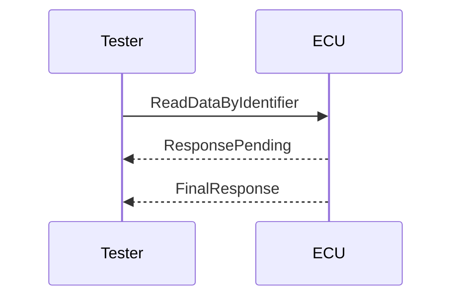

## 핵심 요약


> Markdown은 제목·목록·표·코드 등을 일반 텍스트로 표현하는 문법이다.


## 적용 범위


<blockquote class="notice">
<div class="callout">
<div class="callout-icon" markdown="1">
💡
</div>
<div class="callout-content" markdown="1">
실행 예제의 주소·선택자·인터페이스·설정값은 시험 환경에 맞게 변경한다. 규격의 적용 판과 도구 버전을 확인한다.
</div>
</div>
</blockquote>


## 본문


### 제목과 문단


입력:


```markdown
# 문서 제목
## 목적
진단 요청과 응답을 분석한다.

## 준비 조건
대상 ECU와 시험 도구의 설정을 확인한다.
```


출력 확인: 제목 계층과 문단 간격이 구분되는지 본다. H1은 문서 제목, H2는 주요 절, H3는 세부 절로 사용하며 화면 크기 조절용으로 제목 수준을 건너뛰지 않는다.


### 목록과 체크리스트


```markdown
1. 요청 형식을 확인한다.
2. 세션과 보안 조건을 확인한다.
   - 현재 세션
   - 보안 접근 상태

- [ ] 원본 로그 보존
- [ ] 예상 응답 확인
- [x] 시험 조건 기록
```


번호 목록과 하위 목록의 들여쓰기를 확인한다. 체크리스트 지원은 렌더러의 확장 문법에 따라 다르므로 Notion 변환 결과와 사이트 화면을 각각 확인한다.


### 링크와 이미지


```markdown
[기술 문서](https://autosar.dev/)

```


이미지 경로는 설명용이다. 실제 파일 존재·빌드 후 경로·대체 설명을 확인한다. 문서 제목 변경 시 permalink와 내부 링크의 영향을 확인한다.


### 코드 블록


```markdown
인라인 표기는 `NRC 0x78`처럼 작성한다.
여러 줄 코드는 fenced code block을 사용하고 언어를 지정한다.
```


코드와 설명을 분리하고 입력·기대 결과·실패 조건을 함께 적는다. 코드 안의 줄바꿈과 특수문자가 변환 후 보존되는지 비교한다.


### 표


```markdown
| 항목 | 예시 | 확인 방법 |
| --- | --- | --- |
| 요청 SID | 0x22 | 요청 원본 확인 |
| 응답 NRC | 0x78 | 최종 응답까지 관찰 |
```


표는 GFM 등 확장 지원을 확인한다. 긴 코드·문단을 표에 넣지 않고 상세 절로 분리한다. 모바일에서 가로 폭도 확인한다.


### Jekyll front matter


```yaml
---
title: 진단 요청 분석
layout: default
permalink: /practice/diagnostic-request/
---
```


Front matter는 문서 맨 앞에 배치한다. YAML과 본문을 구분하고 title·layout·permalink가 테마에서 어떻게 사용되는지 확인한다.


### Mermaid 연결


Markdown에서 mermaid 언어의 코드 블록을 사용하더라도 렌더러·테마가 이를 지원해야 실제 그림으로 표시된다. Notion 원본·변환된 Markdown·최종 HTML을 비교한다.


실습용 다이어그램 본문:





### 실습 과제


진단 요청 분석 문서를 하나 작성한다. 목적·준비 조건·요청·예상 응답·검증 결과·참고 자료를 포함하고, 표 1개·코드 1개·링크 1개를 넣는다.


Notion 변환 파일과 원본을 비교하고 Jekyll 빌드 → HTML 검사 → 브라우저 표시 순서로 확인한다. 미실행 시험은 결과 대신 시험 계획으로 적는다.


### 오류 해결


| **증상**                | **확인 및 대응**                 |
| --------------------- | --------------------------- |
| **목록이 합쳐짐**           | 들여쓰기·빈 줄·변환기 출력을 확인한다.      |
| **이미지가 깨짐**           | 파일 존재·URL·공백과 특수문자를 확인한다.   |
| **코드가 실행·치환됨**        | Liquid 처리와 escape 설정을 확인한다. |
| **표·체크리스트가 본문처럼 표시됨** | 렌더러 확장과 변환 지원을 확인한다.        |
