## 모듈의 관계와 message 순서를 그림으로 설명하는 상황


Flowchart는 관계와 분기, sequence diagram은 참여자와 시간 순서를 표현한다. Diagram 종류를 질문에 맞추고 화살표가 의미하는 데이터·제어·시간을 구분해야 한다.


> 텍스트로 다이어그램을 표현하는 문법과 예제를 정리한 문서다.


## 적용 범위


<blockquote class="notice">
<div class="callout">
<div class="callout-icon" markdown="1">
💡 
</div>
<div class="callout-content" markdown="1">
규격·도구 버전에 따른 동작 차이를 확인한다.
</div>
</div>
</blockquote>


# **Sequence Diagram**


```c
sequenceDiagram
	participant Alice
	participant John
	Alice->>John: Hello John, how are you?
	John-->>Alice: Great!
	Alice-)John: See you later!
```


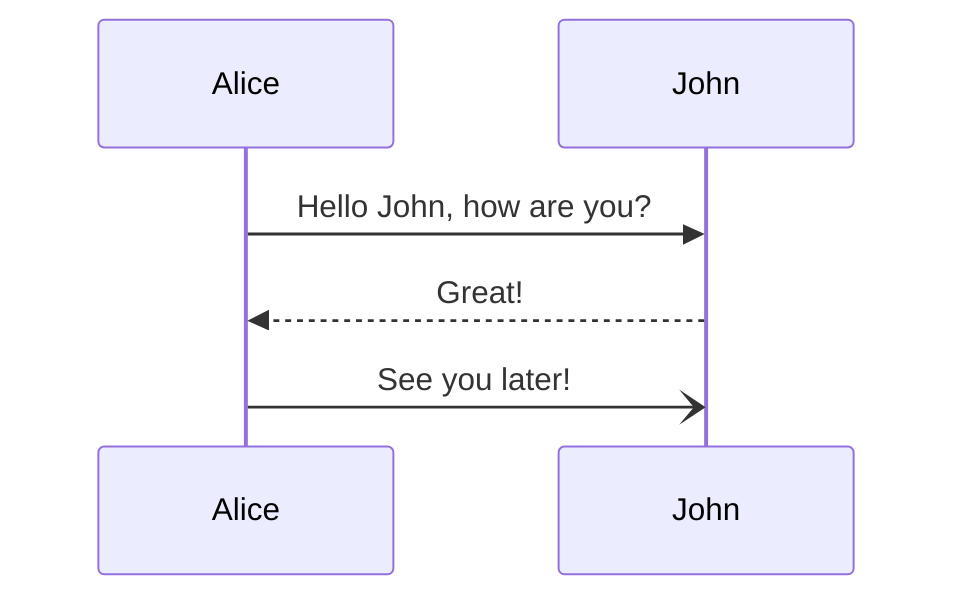


## message 및 화살표 유형 (A~B: Text)


<blockquote class="notice">
<div class="callout">
<div class="callout-icon" markdown="1">
💡 
</div>
<div class="callout-content" markdown="1">
[Actor][Arrow][Actor]: Message text
</div>
</div>
</blockquote>


```c
sequenceDiagram
	Alice->John: 선
	John-->Alice: 점선
	Alice->>John: 동기 요청 Sync request
	John-->>Alice: 동기 반환 Sync responese ( Return )
	Alice-xJohn: 요청 실패
	John--xAlice: 반환 실패
	Alice-)John: 비동기 요청 Async request
	John--)Alice: 비동기 반환 Async responese  ( Return )
	Alice->>Alice: 자체 메세지
```


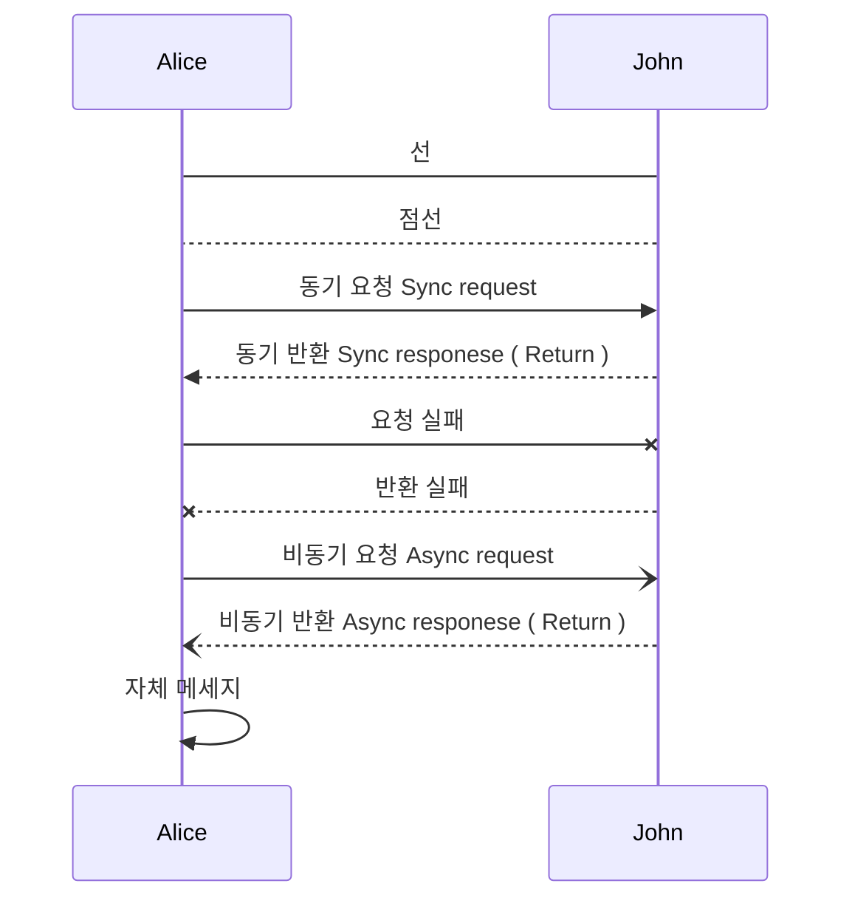


## Actor 스타일 및 명칭 변경 (participant, actor)


```c
sequenceDiagram
	participant Alice
	actor J as John
	actor softer
	
	J->Alice : text
```


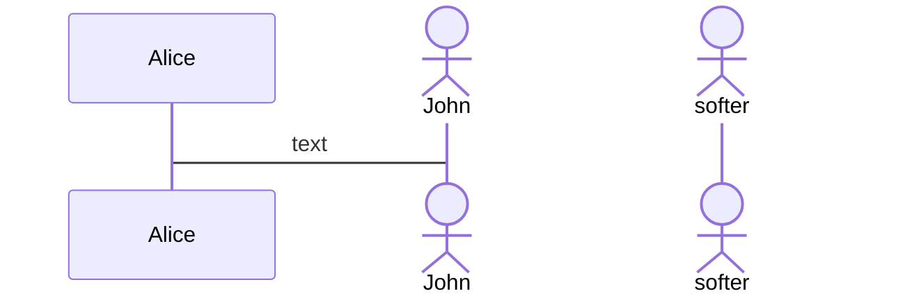


## Actor 별 stack 활성화 (activate, deactivate)


> Arrow 뒤에 +, -를 붙여서 activate, deactivate를 사용할 수 있으나, 한 단계의 stack만 적용된다.  
> 한번에 여러 단계의 stack을 적용하려면 activate, deactivate를 하단에 적용하면 된다.


```c
sequenceDiagram
	Alice->>+John: 1번째: 냠
	activate John
	Alice->>John: 2번째 : 고냥
	activate John
	Alice->>+John: 3번째
	Alice->>+John: 4번째
	John-->>-Alice: 마이너스 1번째 : 냠
	John-->>-Alice: 마이너스 2번째 : 고냥
	deactivate John
	deactivate John
	John-->>Alice: 마이너스 3번째
	John-->>-Alice: 마이너스 4번째
```


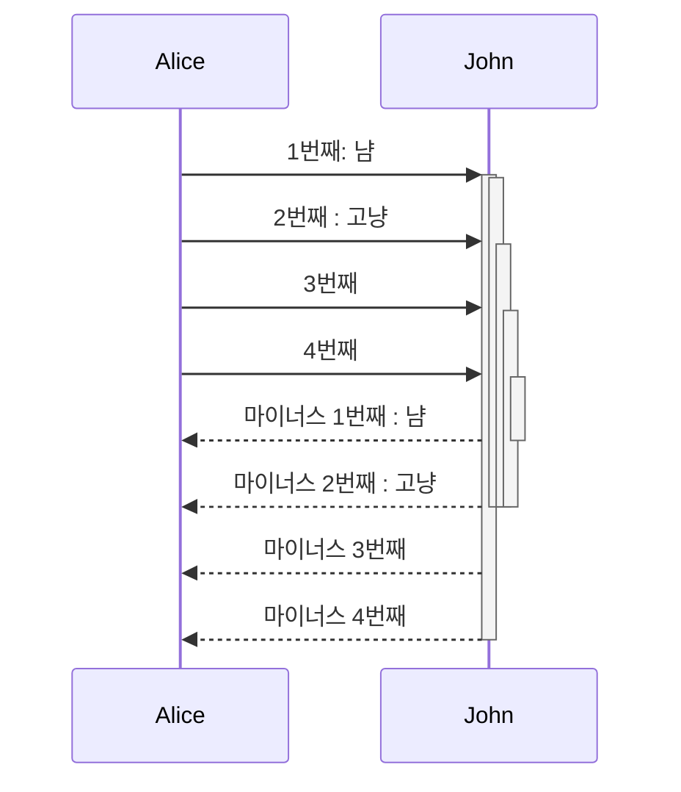


## 메모 (Note)


```c
sequenceDiagram
		participant test
		participant John
		participant Alice
		Note left of test: 엑터 줄의 왼쪽
		Note right of Alice: 엑터 줄의 오른쪽
    Alice->John: Hello John, how are you?
    Note over Alice,test : 지정된 엑터를 감싸는
```


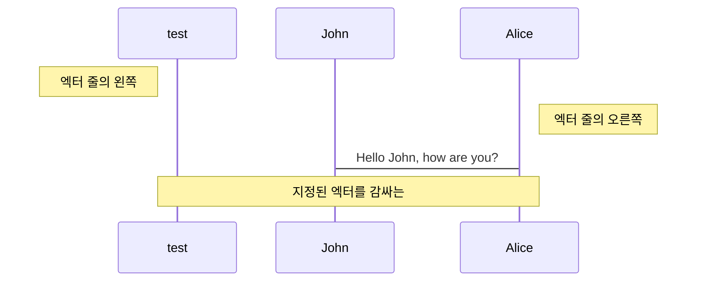


## 루프 (Loop)


```c
sequenceDiagram
    Alice->>John: 1분마다 신호를 줘! , 10분동안!
    loop Every minute
        John-->>Alice: ping!
    end
	John-->>Alice: 10분 지남!
```


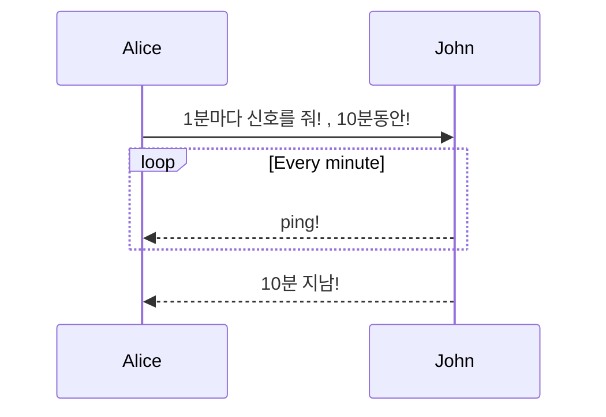


## 특정 sequence grouping (~ end)


### 선택지와 옵션을 표시 (alt ~ else, opt)


```c
sequenceDiagram
    Alice->>Bob: 선택지 질문
    alt 1번을 선택한다
        Bob->>Alice: 이긴다
    else 2번을 선택한다
        Bob->>Alice: 진다
    end
    opt 그 외 행동을 했다
        Bob->>Alice: 규정 위반으로 탈락
    end
```


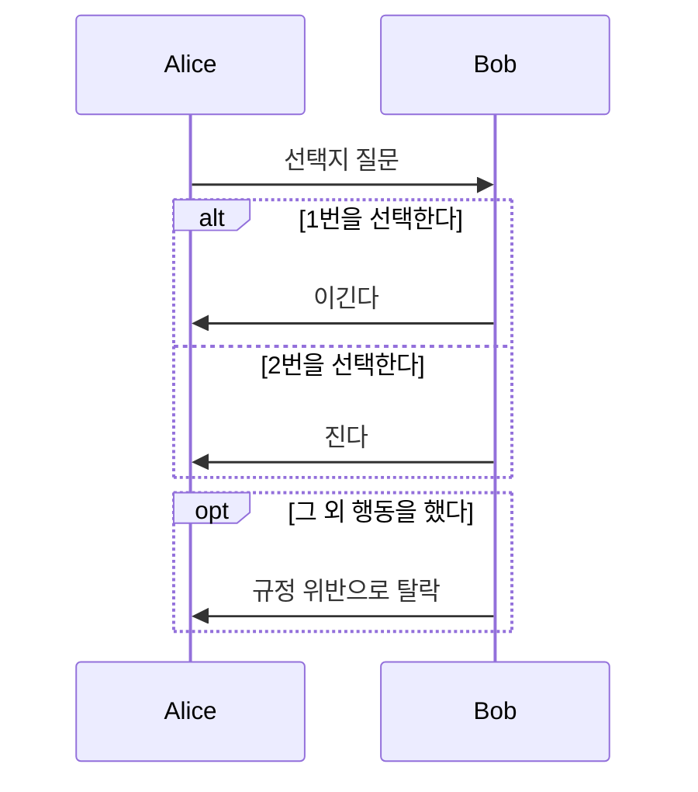


## 병렬 표시 (par)


```c
sequenceDiagram
	par Alice to Bob
	Alice->>Bob: Go help John
	and Alice to John
	Alice->>John: I want this done today
		par John to Charlie
		  John->>Charlie: Can we do this today?
		and John to Diana
		  John->>Diana: Can you help us today?
		end
	end
```


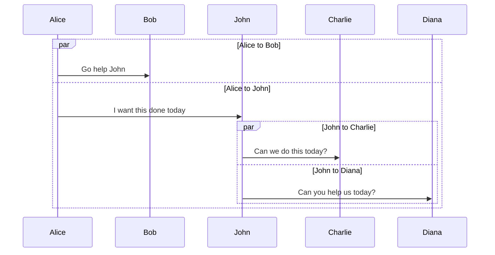


## 색상 부여 (rect)


```c
sequenceDiagram
	participant Alice
	participant John
	rect rgb(191, 223, 255)
		note right of Alice: Alice calls John.
		Alice->>+John: Hello John, how are you?
		rect rgb(200, 150, 255)
			Alice->>+John: John, can you hear me?
			John-->>-Alice: Hi Alice, I can hear you!
		end
	John-->>-Alice: I feel great!
	end
	Alice ->>+ John: Did you want to go to the game tonight?
	John -->>- Alice: Yeah! See you there.
```


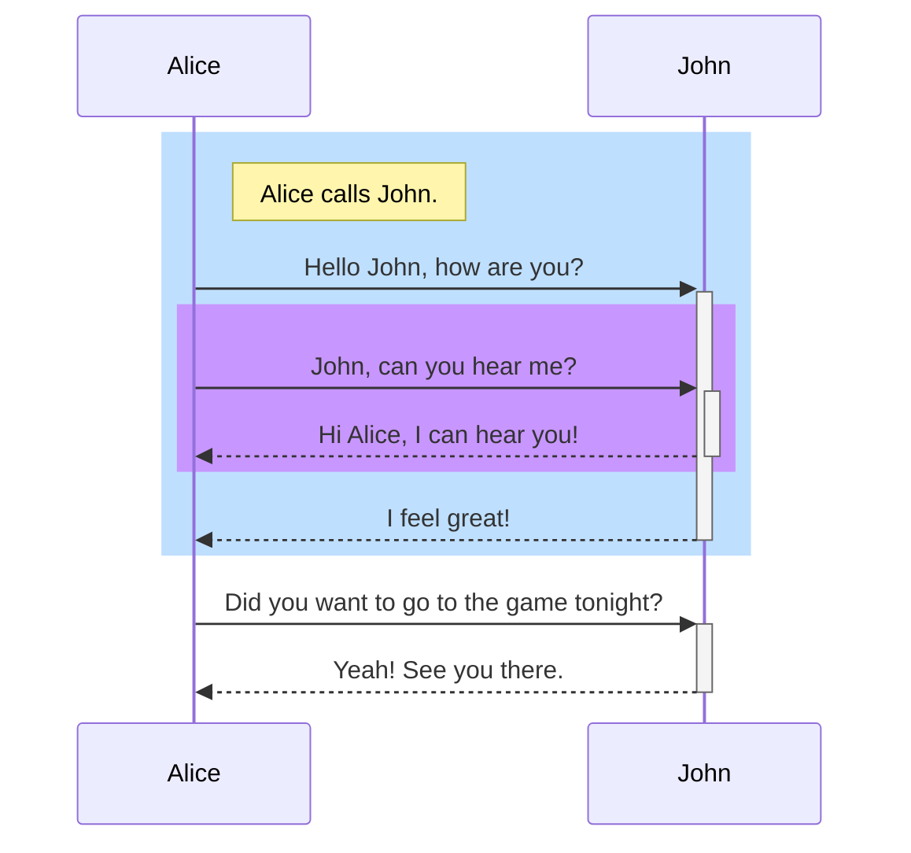


## 주석 (comment)


```c
sequenceDiagram
    Alice->>John: 안에 주석 있음
    %% comment
    John-->>Alice: 안보여!
```


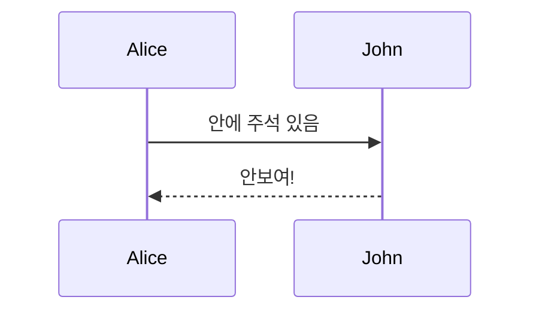


## 번호, 순번 (autonumber)


```c
sequenceDiagram
    autonumber
    Alice->>John: Hello John, how are you?
    loop Healthcheck
        John->>John: Fight against hypochondria
    end
    Note right of John: Rational thoughts!
    John-->>Alice: Great!
    John->>Bob: How about you?
    Bob-->>John: Jolly good!
```


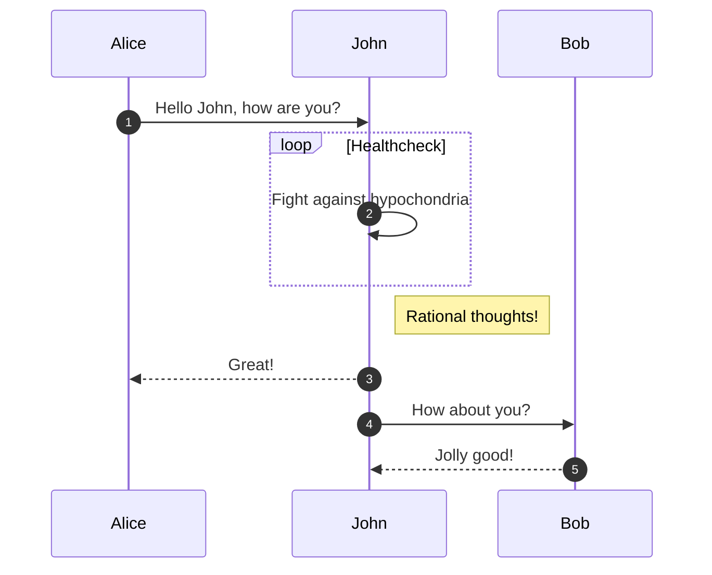


## 기타


### 특수문자


```c
sequenceDiagram
    A->>B: I #9829; you!
    B->>A: I #9829; you #infin; times more!
```


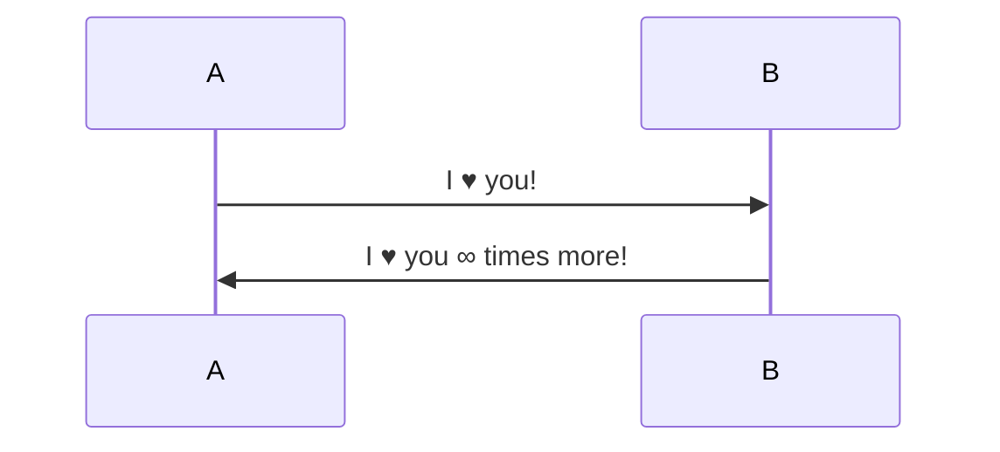


### Actor에 link (link)


```c
sequenceDiagram
    participant Alice
    participant John
    link Alice: Dashboard @ https://dashboard.contoso.com/alice
    link Alice: Wiki @ https://wiki.contoso.com/alice
    link John: Dashboard @ https://dashboard.contoso.com/john
    link John: Wiki @ https://wiki.contoso.com/john
    Alice->>John: Hello John, how are you?
    John-->>Alice: Great!
    Alice-)John: See you later!
```


### 중요 지역 표시 (critical)


```c
sequenceDiagram
    critical Establish a connection to the DB
        Service-->DB: connect
    end
```


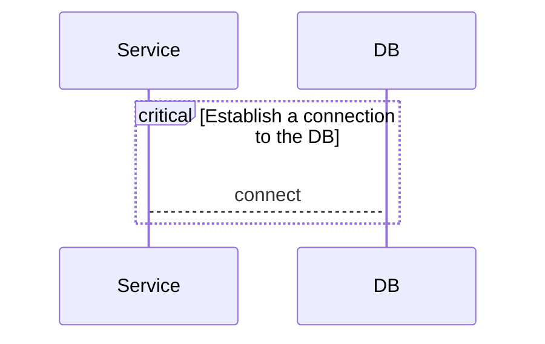


### 중단점 (break)


```c
sequenceDiagram
    Consumer-->API: Book something
    API-->BookingService: Start booking process
    break when the booking process fails
        API-->Consumer: show failure
    end
    API-->BillingService: Start billing process
```


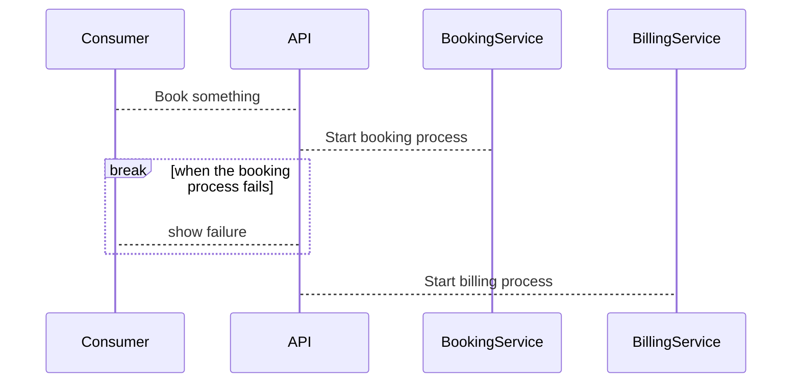


## 이해를 확인하는 질문


> 연결선이 있으면 동시 실행이나 시간 순서까지 의미할까?


Flowchart 연결만으로는 timing을 확정할 수 없다. Sequence나 state diagram 등 목적에 맞는 표현을 선택한다.

