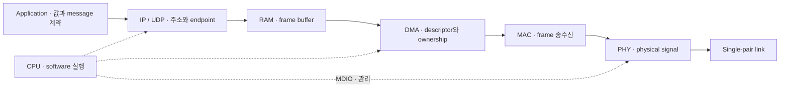

## 센서 1의 25.00°C가 다른 ECU에 도착하는 상황

응용이 만든 숫자는 RAM의 바이트, DMA descriptor, Ethernet frame, PHY의 신호를 거쳐 다시 숫자가 된다. 각 단계는 저장 위치와 완료 조건이 다르다. 송신 API의 성공과 상대 application의 처리 완료를 구분해야 문제를 좁힐 수 있다.

## 한 측정값이 wire에 도달하기까지

Sensor 1의 온도 25.00°C를 전송한다고 하자. Application이 다루는 값과 wire에 실리는 bit는 같은 정보의 서로 다른 표현이다. 먼저 sensor ID, sequence, 단위와 byte order를 합의하고, 그 표현을 UDP/IP와 Ethernet으로 감싼다. 아래 8-byte 형식은 설명용 application 계약이며 Ethernet·DDS의 표준 payload 형식은 아니다.

| Byte | 필드 | 예시 | 의미 |
| --- | --- | --- | --- |
| 0–1 | sensor_id | 00 01 | Sensor 1, unsigned big-endian |
| 2–3 | sequence | 00 02 | 두 번째 sample, 16-bit wraparound |
| 4–7 | temperature | 00 00 09 C4 | 2500 × 0.01°C = 25.00°C, signed 32-bit big-endian |

```c
#include <stdint.h>
#include <stddef.h>
#include <stdbool.h>

static bool encode_temperature(uint8_t *out, size_t capacity,
                               uint16_t sensor, uint16_t sequence,
                               int32_t centi_celsius)
{
    if (out == NULL || capacity < 8u) return false;
    uint32_t value = (uint32_t)centi_celsius;
    out[0] = (uint8_t)(sensor >> 8);
    out[1] = (uint8_t)sensor;
    out[2] = (uint8_t)(sequence >> 8);
    out[3] = (uint8_t)sequence;
    out[4] = (uint8_t)(value >> 24);
    out[5] = (uint8_t)(value >> 16);
    out[6] = (uint8_t)(value >> 8);
    out[7] = (uint8_t)value;
    return true;
}
```

C structure의 메모리를 그대로 보내지 않고 각 byte를 명시적으로 구성한다. Structure padding과 host endianness에 의존하지 않기 위해서다. 수신 측도 길이·단위·범위와 sequence를 확인한 뒤 값을 복원한다. 함수 성공은 8-byte encoding 완료만 의미하며 network 전송을 수행하지 않는다.

## 기능 계층과 구현 자원을 나누어 보기



그림 1. 한 송신의 논리 경로. 실제 MAC·DMA의 결합 방식과 memory interconnect는 MCU에 따라 다르다. 점선은 실행·관리 관계이며 payload 전송 경로와 구분한다.

OSI는 기능을 분류하는 모델이고 CPU·RAM·DMA는 그 기능을 구현하는 자원이다. RAM을 한 OSI layer에 대응시키거나 PHY를 application의 전송 성공 판정자로 취급하면 원인 분석의 경계가 흐려진다. 같은 subnet의 destination MAC을 모르면 ARP 처리가 선행될 수 있으며, 다른 subnet이면 next-hop gateway로 전송한다.

## 완료를 네 단계로 나누기

| 관측 지점 | 알 수 있는 것 | 아직 알 수 없는 것 |
| --- | --- | --- |
| 송신 API 반환 | API 계약에 따른 수락·복사·대기 결과 | 실제 wire 전송과 상대 처리 |
| DMA / TX completion | Driver 계약에 따른 buffer 회수 가능 시점 | 상대 application 수신·적용 |
| TCP ACK | 상대 TCP stack의 byte 수신 | 해당 byte의 application 처리 완료 |
| Application response | Protocol이 정의한 처리 단계의 결과 | 영속 저장 등 응답 계약에 없는 후속 동작 |

UDP에는 TCP ACK가 없다. 신뢰성이나 적용 확인이 필요하면 application sequence·response·timeout을 별도로 설계한다. 재전송 시에는 중복 적용과 이미 만료된 command의 실행을 방지해야 한다.

## 지연 예산과 관측 위치

End-to-end latency는 sampling, software scheduling, serialization, queue, link 전송과 수신 처리 시간의 합이다. Link bitrate는 이 중 일부만 줄인다. Packet loss, receiver restart와 CPU 부하를 바꾸면서 sequence 누락, 데이터 Age와 tail latency를 함께 기록하면 평균 throughput에 가려진 문제를 찾을 수 있다.

관측 timestamp가 서로 다른 ECU의 clock에서 생성되었다면 offset과 synchronization 오차를 별도로 고려한다. 한 장치의 timestamp만으로 측정 가능한 round-trip과 여러 장치의 clock을 비교하는 one-way latency는 조건이 다르다.


> 자동차 Ethernet의 PHY·프레임·스위칭과 IP 상위 프로토콜을 구분해 정리한다.


## 적용 범위


<blockquote class="notice">
<div class="callout">
<div class="callout-icon" markdown="1">
💡
</div>
<div class="callout-content" markdown="1">
IEEE 802.3 물리·MAC 계층과 IEEE 802.1 기능을 구분한다. 실제 구현 규격과 PHY 데이터시트를 확인한다.
</div>
</div>
</blockquote>


### 계층 구분


10BASE-T1S·100BASE-T1·1000BASE-T1은 물리 계층 규격이다. Ethernet 프레임·MAC 주소·스위칭은 링크 계층 관점이다. IP·TCP·UDP 및 서비스·진단 프로토콜은 별도 계층이다.


### 프레임과 스위칭


목적지·출발지 MAC, EtherType, 페이로드와 FCS를 구분한다. VLAN 태그를 사용할 경우 식별과 우선순위 설정을 확인한다. 스위치는 프레임을 전달하며 라우터는 IP 네트워크 사이의 전달을 다룬다.


### 토폴로지와 자동차 PHY


단일 페어 링크와 스위치 기반 구성, zonal/domain 구조, 게이트웨이와 연결 상태를 확인한다. 모든 single-pair Ethernet이 multidrop을 지원하는 것은 아니다.


### 성능과 지연


물리 링크 속도는 애플리케이션의 실제 처리량과 다르다. 패킷 크기, 오버헤드, 스위치 큐, 트래픽 경쟁, 손실·재전송과 호스트 처리가 지연에 영향을 준다.


### 분석 순서


PHY link 상태 → MAC·VLAN → IP 주소와 경로 → transport 연결 → 서비스 상태 → 애플리케이션 판정 순서로 문제를 좁힌다.


### 검증 항목

- link up/down과 복구.
- VLAN·주소·라우팅 설정의 일치.
- 패킷 손실·지연·지터·대역폭.
- 멀티캐스트·브로드캐스트의 영향.
- 진단·서비스·미디어 트래픽의 동시 부하.

### 실습: 계층별 연결 점검


Linux 예제 인터페이스 eth0를 사용한다. 실제 장치의 인터페이스 이름과 주소로 바꾼다.


```bash
ip -br link show
ip -br addr show eth0
ip route show
ethtool eth0
ip -s link show eth0
sudo tcpdump -i eth0 -nn -s0 -w capture.pcap
```


Link 상태와 주소·경로를 먼저 확인하고, 캡처에서 실제 요청·응답을 분석한다. Ping 성공은 서비스 정상 동작을 입증하지 않으며 ICMP를 차단하는 장치의 무응답도 link 실패와 구분한다.


### 장애 분석 예제


Link는 up인데 서비스가 보이지 않는 경우 VLAN·subnet·routing·multicast 설정 → transport 포트 → 서비스 제공 상태 순서로 확인한다. 스위치 포트 카운터와 송수신 캡처를 비교해 손실 지점을 좁힌다.


## 차량 Network 설계 관점


차량 Ethernet에서는 backbone/zone topology, link speed와 cable·connector·EMC, switch forwarding/VLAN, traffic priority, time synchronization, startup/recovery를 함께 검토한다. PHY link up, IP 설정, service discovery와 application readiness를 각각 구분한다.


100BASE-T1·1000BASE-T1·10BASE-T1S 같은 매체 규격은 MCU MAC과 PHY 사이의 MII/RMII/RGMII interface와 구분한다. ECU 내부 MAC의 descriptor ring·DMA·cache 처리는 MCU Peripheral의 Ethernet MAC & DMA 문서에서 다룬다.

## 이해를 확인하는 질문

> Link가 올라왔는데 온도값이 오지 않으면 어디부터 구분할까?

Link 상태 다음에 frame 수신, IP 주소·route, transport endpoint, payload 해석을 차례로 나눈다. 각 계층의 성공은 바로 위 계층의 성공을 보장하지 않는다.
