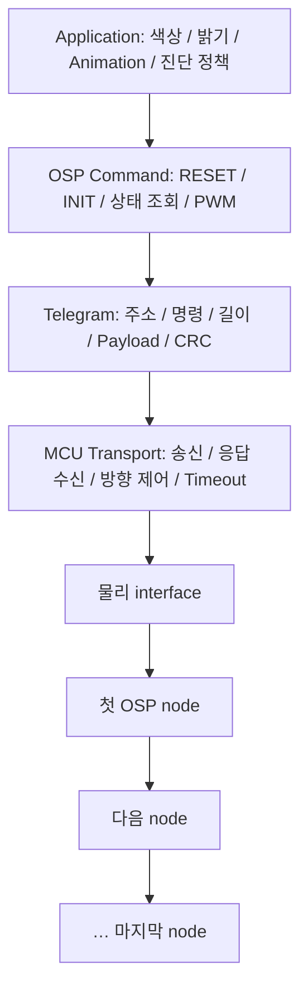

## RGB node에 주소를 할당한 뒤 원하는 색을 적용하는 상황


물리 waveform, telegram 형식, node enumeration과 출력 설정은 각각 다른 단계다. SPI peripheral을 waveform 생성에 사용하더라도 일반 register SPI device와 같은 transaction은 아니다.


> OSP(Open System Protocol)는 ams OSRAM의 RGB 조명·지능형 driver node를 daisy chain으로 제어하는 통신 protocol이다. LED 밝기 값을 쓰는 것뿐 아니라 node 초기화·주소 할당·상태 조회·오류 처리까지 포함한다. SPI는 MCU 측 전송 수단으로 사용될 수 있지만 OSP 전체를 일반적인 CS/MOSI/MISO 방식의 SPI 장치로 취급해서는 안 된다.


## 적용 범위와 hardware 구분


<blockquote class="notice">
<div class="callout">
<div class="callout-icon" markdown="1">
💡 
</div>
<div class="callout-content" markdown="1">
OSP 공개 구현의 대표 node는 RGB가 내장된 OSIRE E3731i(RGBi)와 외부 LED를 구동하는 AS1163(SAID)이다. 제조사 예제는 OSP32/Arduino 기반이며 S32K312에서는 SPI·GPIO·timing 관련 포팅이 필요하다.
</div>
</div>
</blockquote>


## 1. 시스템 구성과 계층





공개 aolibs는 aoosp가 telegram 생성·응답 해석을, aospi가 hardware 송수신을 담당하도록 분리한다. S32K312 포팅에서는 이 분리를 유지하여 검증된 telegram 로직과 CRC는 재사용하고 ESP32/Arduino 의존 전송·시간 측정·GPIO 부분을 별도로 구현한다.


## 2. BiDir와 Loop 응답 경로

- BiDir: 응답이 체인을 역방향으로 돌아와 첫 node 쪽 MCU interface에 도착한다. 송신 후 MCU가 신호선을 계속 구동하면 node의 응답과 충돌할 수 있다.
- Loop: 체인의 끝을 MCU 수신 경로에 연결하여 응답이 순방향으로 진행한 뒤 돌아오게 한다. 배선과 수신 입력 선택이 BiDir와 달라진다.

제조사 OSP32 보드는 송신용 SPI와 수신용 SPI, 방향 MUX와 buffer enable을 사용한다. 이것은 평가 보드 구현 예이며 모든 사용자 보드에 같은 MUX가 있다는 뜻은 아니다. 체인 종단·레벨 시프터·응답 경로는 실제 회로도를 기준으로 확인한다.


## 3. 일반 SPI와 다른 MCU 물리 모드

<div class="image-flex">
<div class="image-item">
<div class="image-item-img">
<a data-fslightbox="/_images/차량_통신/OSP/1.webp" href="/_images/차량_통신/OSP/1.webp" data-type="image" aria-label="This is fslightbox">
<div class="skeleton-loading">
<div class="skeleton-img"></div>
</div>
<figure>

<figcaption>Type A Manchester의 mid-bit transition과 Type B의 별도 clock/data 경로를 설명하는 개념도다. 그림은 1=Low→High, 0=High→Low라는 설명용 convention을 명시한다. 실제 측정 파형이 아니다.</figcaption>
</figure>
</a>
</div>
</div>
</div>


<blockquote class="notice">
<div class="callout">
<div class="callout-icon" markdown="1">
💡 
</div>
<div class="callout-content" markdown="1">
그림 읽기와 실측 확인: 이 convention을 실제 OSP encoder 설정값으로 복사하지 않는다. 사용 부품·MCU mode의 polarity, bit order, 인코딩과 idle 조건을 제조사 규격과 측정 파형으로 확인한다. 파형 생성용 SPI SCK와 OSP bit rate는 구분한다.
</div>
</div>
</blockquote>


제조사 aospi 문서는 MCU mode type A를 1-wire Manchester, type B를 2-wire SPI로 구분한다. RGBi와 기본 OTP의 SAID는 type A 관련 조건을 확인해야 하며 OSP32의 첫 SAID는 type B에 맞게 구성되어 있다. type B 기본 예제를 RGBi 직접 연결에 그대로 적용하면 통신하지 않을 수 있다.

- type A: clock과 데이터가 Manchester 신호에 실린다. 공개 구현은 telegram 비트를 인코딩하여 SPI로 파형을 생성한다. OSP 비트레이트와 파형 생성용 SPI SCK를 구분한다.
- type B: 송신 시 두 신호를 사용하며 공개 구현의 기준은 2.4 MHz, MSB first, SPI mode 0이다. telegram 내부의 바이트 사이에 불필요한 공백이 생기지 않도록 한다. 해당 칩 사양의 주파수 허용 오차를 따른다.
- 응답은 일반 SPI read의 dummy clock 방식으로만 생각하면 안 된다. 공개 보드에서는 OSP node가 응답 clock을 생성하고 MCU가 수신 측 역할을 한다. 수신 buffer와 경로를 응답 시작 전에 준비해야 한다.
- 공개 aospi 문서에서 BiDir 수신은 mode 0, Loop 수신은 mode 3의 특성을 설명한다. 실제 driver는 초기화·idle 레벨·보드 배선을 함께 처리하므로 수신 설정 숫자 하나만 바꿔 포팅을 완료했다고 판단하지 않는다.

## 4. S32K312에서 clock과 전송 계층 설계


먼저 OSP node의 MCU mode와 보드의 송신/수신 경로를 확정한다. LPSPI로 type B 송신을 구현한다면 f_functional, prescaler, SCKDIV로 실제 SCK를 계산한다. type A라면 Manchester 비트 확장 방식과 출력 파형을 별도로 검증한다. 공개 aospi 구현은 type A에서 4.8 MHz, type B에서 2.4 MHz를 기준으로 설정한다.


```text
가정: LPSPI functional clock = 48 MHz
PRESCALE = 0 → 분주비 1

Type B 파형: SCKDIV = 18
48 MHz / (1 × (18 + 2)) = 2.4 MHz

Type A의 비트 확장 출력: SCKDIV = 8
48 MHz / (1 × (8 + 2)) = 4.8 MHz

48 MHz는 계산 가정이며 보드 기본 클록이 아니다.
Type A는 raw telegram을 그대로 보내는 대신 Manchester 인코딩이 필요하다.
```


보드의 clock 트리에서 48 MHz가 허용되는지 먼저 확인한다. DMA 또는 FIFO를 이용해 telegram 중간의 불필요한 gap을 방지하고, 물리 전송 완료를 확인한 뒤 output enable을 해제한다. MCU가 송신을 멈춘 시점과 주변장치 핀을 실제 high-impedance로 만든 시점은 다를 수 있다.


첫 단계에서는 송신과 응답 수신 기능을 독립적으로 검증한다. 외부 clock을 받는 수신용 LPSPI peripheral 설정, PCS 입력 처리, buffer enable, timeout timer를 설계한다. 하나의 SPI 블록을 동적으로 전환하는 구성은 방향 전환 지연과 핀 mux 시간을 포함해 측정해야 하며 충분한 시간 여유가 있다고 가정하지 않는다.


## 5. 첫 점등보다 먼저 확인할 RESET와 INIT


제조사 bring-up 절차는 먼저 RESET telegram이 다음 node로 전달되는지 파형으로 확인한다. LED 점등에는 주소·상태·PWM·전류 설정이 모두 필요하므로 불이 켜지지 않는 것만으로 물리 통신 실패를 판단하면 원인 분리가 어렵다.


```text
제조사 공개 예제의 telegram:
RESET broadcast: A0 00 00 22
INITBIDIR, 시작 주소 1: A0 04 02 A9
INITLOOP, 시작 주소 1:  A0 04 03 86

공개 bring-up 예제는 RESET 후 150 us 대기한다.
실제 제품 사양의 reset 완료 시간과 인터페이스 복구 조건을 확인한다.
```


RESET 후 node가 interface 모드를 다시 판단할 수 있으므로 SIO.P/SIO.N의 pull 상태와 출력 buffer 해제 상태를 확인한다. 잘못된 idle/pull 조합으로 다른 모드가 선택되면 전원 재인가 전까지 통신이 되지 않는 상황이 생길 수 있다. 평가 보드의 특정 pull-up 실험 배선을 다른 회로에 그대로 적용하지 않는다.


## 6. 주소 할당에서 RGB 제어까지


```text
1. 전원·I/O 레벨·체인·종단 확인
2. MCU transport 및 응답 수신 경로 준비
3. RESET → 규정된 대기
4. 배선에 맞춰 INITBIDIR 또는 INITLOOP
5. 마지막 주소·응답 CRC·상태로 탐색 결과 확인
6. 오류 원인을 확인하고 필요한 초기 상태 처리
7. 장치별 허용 전류·PWM 설정과 ACTIVE 상태 전환
8. 첫 노드 한 채널을 낮은 밝기로 점등
9. R/G/B 단색 → 여러 노드 → 동기 갱신 순으로 확장
```


주소 할당 결과가 예상 node 수와 일치하는지 확인한다. 임의 node 번호를 고정해 두고 PWM부터 보내면 재배선·체인 단선 시 다른 LED를 제어할 수 있다. node 종류에 따라 PWM 명령이 다르므로 RGBi용 setpwm과 SAID 채널용 setpwmchn을 구분한다.


제조사 aoosp_min 예제는 RESET·INIT 후 CLRERROR·GOACTIVE와 SAID 채널 PWM 설정을 수행한다. 실제 적용에서는 오류 원인을 확인하지 않고 반복해서 clear하지 않으며, 반환 상태가 실패하면 다음 단계로 진행하지 않는다.


```c
#include <stdint.h>
/* 사용자 C transport/OSP 계층에서 구현할 어댑터. NXP/aoosp API가 아니다.
 * 초기화·주소 할당·ACTIVE 전환이 완료된 SAID의 channel 0을 가정한다.
 * 함수는 전송 결과를 반환하며 오류이면 다음 단계로 진행하지 않는다.
 */
extern int osp_set_pwm_channel(uint16_t node, uint8_t channel,
                               uint16_t red, uint16_t green, uint16_t blue);
extern void board_delay_ms(uint32_t ms);
int test_rgb(void) {
    const uint16_t colors[4][3] = {
        {0x0800,0,0}, {0,0x0800,0}, {0,0,0x0800}, {0,0,0}
    };
    for (unsigned i=0; i<4; ++i) {
        int rc=osp_set_pwm_channel(1,0,colors[i][0],colors[i][1],colors[i][2]);
        if (rc != 0) return rc;
        board_delay_ms(500); /* task/main 문맥에서만 호출 */
    }
    return 0;
}
```


이 코드는 호출 형태를 보여주는 조각이며 전체 펌웨어가 아니다. 제품별 PWM 범위·허용 전류·상태 전환 조건을 확인한다. 색상 보정·온도 보상·휘도 매핑은 통신 성공과 별개의 단계다. 동일한 R/G/B 수치가 시각적으로 동일한 밝기 또는 정확한 백색을 보장하지 않는다.


## 7. CRC를 PC에서 먼저 검증하기


공개 aoosp_crc 구현은 CRC-8 다항식 0x2F, 초기값 0, MSB-first, 최종 XOR 0에 해당한다. 아래 독립 구현은 공개 RESET·INIT telegram의 CRC와 대조한다. payload 또는 헤더를 바꾸면 CRC도 다시 계산해야 한다.


```c
#include <assert.h>
#include <stdint.h>
#include <stdbool.h>
#include <stddef.h>
#include <stdio.h>
static uint8_t osp_crc(const uint8_t *data, size_t size) {
 uint8_t crc = 0;
 for (size_t i = 0; i < size; ++i) {
  crc ^= data[i];
  for (unsigned bit = 0; bit < 8; ++bit)
   crc = (uint8_t)((crc << 1) ^ ((crc & 0x80U) ? 0x2FU : 0U));
 }
 return crc;
}
static bool valid(const uint8_t *frame, size_t size) {
 return size >= 4 && osp_crc(frame, size - 1) == frame[size - 1];
}
int main(void) {
 const uint8_t reset[] = {0xA0,0x00,0x00,0x22};
 const uint8_t bidir[] = {0xA0,0x04,0x02,0xA9};
 const uint8_t loop[] = {0xA0,0x04,0x03,0x86};
 const uint8_t broken[] = {0xA0,0x00,0x01,0x22};
 assert(valid(reset,sizeof reset)); assert(valid(bidir,sizeof bidir));
 assert(valid(loop,sizeof loop)); assert(!valid(broken,sizeof broken));
 puts("OSP CRC vectors passed"); return 0;
}
```


CRC 일치만으로 응답이 올바른 것은 아니다. 최소 길이, preamble·길이 필드, 예상 command·주소·payload 길이, 수신 timeout도 검증한다. broadcast 명령에 항상 응답이 온다고 가정하지 말고 각 명령의 응답 유무를 명세에 따라 처리한다.


## 8. 타이밍과 동기 갱신


제조사 aospi 공개 구현은 telegram 간 idle 기본값으로 8 us를 사용한다. 이 값과 RESET의 150 us 대기, node 전달 시간, 응답 완료 timeout은 서로 다른 시간이다. 바이트 수×8/SCK만으로 체인 전체 응답 timeout을 결정하지 말고 hop 지연과 node 처리 시간을 포함한다.


node별 PWM을 순서대로 즉시 적용하면 긴 체인에서 갱신 시차가 보일 수 있다. 장치가 지원하는 SYNC 기능을 설정하고 PWM 값을 준비한 뒤 동기 명령으로 적용하는 흐름을 검토한다. 지원 여부·설정 비트·hardware SYNC 조건은 node별로 다르다. 단순 통신 학습에 비가역적인 OTP 설정 변경은 필요하지 않다.


## 9. 증상별 디버깅


| **증상**                       | **확인 및 대응**                                                                                                      |
| ---------------------------- | ---------------------------------------------------------------------------------------------------------------- |
| **RESET이 다음 node로 전달되지 않음**    | MCU mode A/B, I/O 전압·pull, 출력 enable, 인코딩과 SCK, telegram gap·CRC를 확인한다.                                          |
| **송신은 보이나 응답 없음**            | BiDir/Loop 배선, 수신 MUX·입력 mode, 수신 준비 시점, node가 응답을 생성하는 명령인지 확인한다. 임의의 dummy clock 추가로 해결하려 하지 않는다.                |
| **INIT 응답의 마지막 주소가 예상보다 작음** | node별 전달 파형과 전원을 따라가며 체인 단절·방향·부품 모드 차이를 확인한다.                                                                     |
| **응답은 정상인데 LED가 꺼짐**         | ACTIVE/SLEEP 상태, trap된 오류, 채널 번호·전류·PWM 값, 실제 RGB 배선과 node 종류를 확인한다.                                               |
| **첫 node는 정상이고 긴 체인에서 실패**     | hop에 따른 timeout, 전원 강하, 신호 품질, node 버전별 명령·payload 지원 차이를 확인한다. 공개 예제에는 구형 OSP node가 PSI=5 telegram을 전달하지 않는 사례도 있다. |


## 10. 실습 결과 기록


사용 MCU·RTD 버전, RGB/SAID 부품명과 보드 revision, OSP 라이브러리 commit, type A/B와 BiDir/Loop 구성, node 수, clock·idle·timeout, 송수신 hex와 CRC 결과, 주소 할당·단색 점등·오류 복구 결과를 기록한다. 실제 사용 부품과 프로젝트 버전이 확정되면 이 항목에 측정값과 재현 순서를 추가한다.


OSP_aotop과 OSP_aospi는 physical layer와 bring-up, OSP_aoosp의 aoosp_min은 protocol 처리와 CRC 구현을 제공한다. S32K312 예제는 포팅 설계용이며 보드 동작 검증은 포함하지 않는다.


## 이해를 확인하는 질문


> CRC가 맞는 response라면 점등도 성공한 것인가?


주소와 응답 의미, node state, current·PWM 설정과 실제 광출력을 별도로 확인해야 한다.

